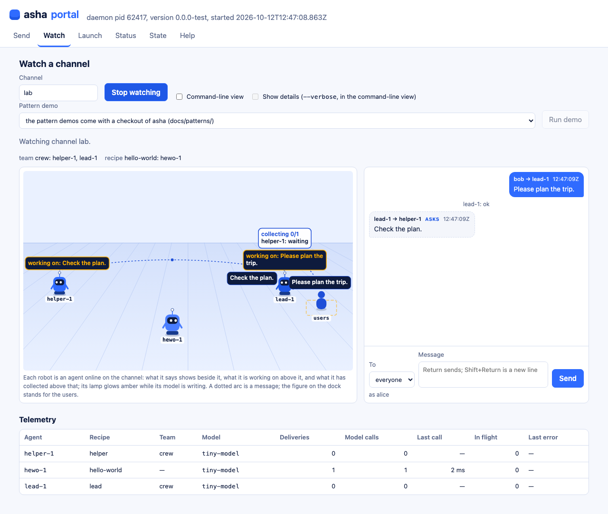
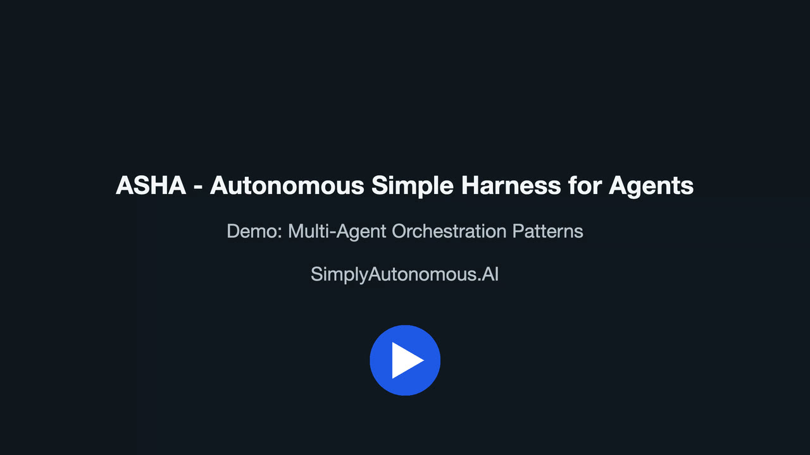

<p align="center"></p>

# asha — Autonomous Simple Harness for Agents



*The portal's Watch tab as agents interact: `lead-1` consults `helper-1` while it plans a trip for user `bob`,
captured by `npm run portal:screenshots`, which drives the real daemon and portal with a scripted model.*

## What asha is

asha runs AI agents on your own Mac, with open-weight models served locally, and demonstrates the multi-agent
patterns people build with them. One command, `./asha`, is all three of its parts: a daemon that runs each agent in
its own container (colima), carries the channel the agents and you talk on, and brokers every model call to the
models it serves on the host (llama.cpp) — agents never reach a model directly; a command line that sends messages,
launches agents and teams, and watches a channel; and a portal, a web page the daemon serves, that shows a channel's
agents at work.

## Why it exists

**What it is for:** running and studying multi-agent patterns — delegation, routing, pipelines, debate, voting,
blackboards, supervisors and more, 25 of them built and demonstrated — locally, with open-weight models, at no
recurring cost: nothing calls a hosted model or a paid service unless you install a module that does and enter its
key.

**What it is not:** a hosted or production agent platform. It is the work of one maintainer, SimplyAutonomous.AI,
LLC; it is before version 1.0, so nothing it offers is yet a promise of compatibility from one release to the next.

## Quickstart

On a Mac with Apple silicon, [Homebrew](https://brew.sh) and Node.js `^22.13.0 || ^24.0.0 || >=26.0.0`:

```sh
git clone https://github.com/Simply-Autonomous-AI/asha.git
cd asha
npm install && npm run build
./asha recipe=hello-world message="Please say: Hello World."
```

The last command prints `Hello World.` The first time, it installs colima, the Docker CLI and llama.cpp with Homebrew,
starts the daemon, and downloads the hello-world agent's model, `pico-v2-q8_0`: 9,028,871,552 bytes. Every model is
pinned by revision and checked by sha256 before it is used.

**Prerequisites, with their numbers:**

- macOS on Apple silicon, and Homebrew, which asha never installs itself.
- Node.js `^22.13.0 || ^24.0.0 || >=26.0.0` (`engines` in [package.json](./package.json)).
- The models the agents name, downloaded the first time one is needed: `pico-v2-q8_0` (9,028,871,552 bytes; the
  quickstart, and the sub-agents of 18 demo teams) and `qwen3-8b-q4_k_m` (5,027,783,488 bytes; the demos' routers and
  the rest); the memory agents' embedding model, `qwen3-embedding-0.6b-q8_0`, is 639,150,592 bytes more.
- For the tests only: gitleaks 8.30.1 or later below 9 (`brew install gitleaks`) and Playwright's pinned browsers
  (`npx playwright-core install --no-remove chromium-headless-shell firefox`).
- **Tested on:** an Apple M4 Pro with 48 GiB of memory, macOS 26.5.2. No minimum memory, disk or macOS version has
  been measured.

## Architecture

The CLI, and the portal's page in a browser, talk to the daemon over loopback HTTP. The daemon runs agent containers
in colima and brokers every model call to llama-server on the host, which serves models from a verified cache
downloaded from Hugging Face. The whole picture: [Architecture](./docs/architecture/index.md).


## The demos

[](https://www.youtube.com/watch?v=4QG465Mp5Hw)

*Twenty-four of the demos below in one video, 10 min 27 s (P25 is not in it):
[watch it on YouTube](https://www.youtube.com/watch?v=4QG465Mp5Hw).*

Every built pattern demo, as its page runs it: launch its team, then send its message. Each page explains the
pattern, shows a real transcript and its recorded video, and says what limits it.

- **[P1 · Delegation (hand-off)](./docs/patterns/p01-delegation.md)**

  ```sh
  ./asha --launch team=delegation
  ./asha to=lead-1 user=alice message="Please ask greeter-1 to say Hello World."
  ```

- **[P2 · Router (triage)](./docs/patterns/p02-router.md)**

  ```sh
  ./asha --launch team=router
  ./asha to=router-1 user=alice message="Please translate 'thank you' into French."
  ./asha to=router-1 user=alice message="What is 17 plus 25?"
  ./asha to=router-1 user=alice message="Please have the right agent say: Hello World."
  ```

- **[P3 · Sequential pipeline](./docs/patterns/p03-pipeline.md)**

  ```sh
  ./asha --launch team=pipeline
  ./asha to=stage-a-1 user=alice message="Build the colour list."
  ```

- **[P12 · Group chat, self-selection](./docs/patterns/p12-self-selection.md)**

  ```sh
  ./asha --launch team=self-select
  ./asha user=alice message="Please translate 'good morning' into French."
  ./asha user=alice message="Please say: Hello World."
  ./asha user=alice message="Please book me a flight to Paris."
  ```

- **[P22 · Escalation to a human (the summary)](./docs/patterns/p22-escalation.md)**

  ```sh
  ./asha --launch team=escalation
  ./asha to=helper-1 user=alice message="Convert 3 metres to centimetres, then book a meeting room for 3 pm."
  ./asha to=helper-1 user=alice message="Convert 3 metres to centimetres, then book a meeting room for 3 pm."
  ./asha user=alice conversation=@previous message="Also convert 5 metres to centimetres."
  ```

- **[P18 · Agent as tool (call and return)](./docs/patterns/p18-agent-tool.md)**

  ```sh
  ./asha --launch team=agent-tool
  ./asha to=delegator-1 user=alice message="Get worker-1 to say Hello World, then tell me yourself what it said."
  ```

- **[P4 · Fan-out / fan-in (scatter-gather)](./docs/patterns/p04-fan-out.md)**

  ```sh
  ./asha --launch team=rainbow
  ./asha to=supervisor-1 user=alice message="Which sequence of the numbers lists their colours in rainbow order?"
  ```

- **[P5 · Orchestrator–workers](./docs/patterns/p05-orchestrator-workers.md)**

  ```sh
  ./asha --launch team=orchestrator
  ./asha to=lead-1 user=alice message="Please do three things: translate 'thank you' into French, add 17 and 25, and say Hello World."
  ```

- **[P10 · Voting / ensemble](./docs/patterns/p10-voting.md)**

  ```sh
  ./asha --launch team=vote
  ./asha to=aggregator-1 user=alice message="Ask the voters to pick the team lunch: SOUP, SALAD or PIZZA."
  ```

- **[P9 · Debate with a judge](./docs/patterns/p09-debate.md)**

  ```sh
  ./asha --launch team=debate
  ./asha to=judge-1 user=alice message="Judge the motion: The town should build a second bridge."
  ```

- **[P23 · Iterative consensus debate](./docs/patterns/p23-consensus.md)**

  ```sh
  ./asha --launch team=consensus
  ./asha to=moderator-1 user=alice message="Get the debaters to agree: how many colours does a rainbow have? Choose from 6, 7, 8."
  ```

- **[P24 · Managed group chat](./docs/patterns/p24-group-chat.md)**

  ```sh
  ./asha --launch team=group-chat
  ./asha to=manager-1 user=alice message="Write a three-line poem about rain, one line from each participant."
  ./asha to=manager-1 user=alice message="Find the vault code."
  ```

- **[P8 · Generator–critic loop](./docs/patterns/p08-critic-loop.md)**

  ```sh
  ./asha --launch team=critic-loop
  ./asha to=writer-1 user=alice message="Write one sentence about the harbour at night."
  ./asha to=writer-1 user=alice message="Write one sentence about the harbour at night; have strict-critic-1 check it."
  ```

- **[P16 · Guardrail / policy check](./docs/patterns/p16-guardrail.md)**

  ```sh
  ./asha --launch team=guardrail
  ./asha to=writer-1 user=alice message="How can I reach support? Our records say: phone 5550123456, email help@example.com."
  ./asha to=writer-1 user=alice message="Greet the world."
  ```

- **[P13 · Contract net (bidding)](./docs/patterns/p13-contract-net.md)**

  ```sh
  ./asha --launch team=contract-net
  ./asha to=manager-1 user=alice message="Get parcel 17 delivered by the cheapest courier."
  ```

- **[P6 · Plan-and-execute with simulated failure, re-plan, task and progress ledgers](./docs/patterns/p06-plan-execute.md)**

  ```sh
  ./asha --launch team=plan-execute
  ./asha to=planner-1 user=alice message="What is the password?"
  ```

- **[P14 · Watchdog and reassignment](./docs/patterns/p14-watchdog.md)**

  ```sh
  ./asha --launch team=watchdog
  ./asha to=lead-1 user=alice message="Please get someone to say Hello World."
  ```

- **[P25 · Supervisor restart](./docs/patterns/p25-restart.md)**

  ```sh
  ./asha --launch team=restart
  ./asha to=worker-1 user=alice message="Please say: Hello World."
  ./asha to=worker-1 user=alice message="Please say: Hello World."
  ```

- **[P17 · Budgets and circuit breaker](./docs/patterns/p17-budget.md)**

  ```sh
  ./asha --launch team=budget
  ./asha to=ping-1 posts=8 user=alice message="Start."
  ./asha to=ping-1 tokens=6000 user=alice message="Start."
  ```

- **[P21 · Publish / subscribe (topic routing)](./docs/patterns/p21-topics.md)**

  ```sh
  ./asha --launch team=topics
  ./asha topic=weather user=alice message="Rain expected tomorrow."
  ./asha topic=sports user=alice message="The home team won."
  ```

- **[P15 · Human approval gate](./docs/patterns/p15-approval.md)**

  ```sh
  ./asha --launch team=approval
  ./asha to=clerk-1 user=alice message="Post the announcement: Office closed Friday."
  ./asha user=alice conversation=@previous message="yes"
  ./asha to=clerk-1 user=alice message="Post the announcement: Office closed Friday."
  ./asha user=alice conversation=@previous message="no"
  ```

- **[P19 · Dynamic spawning of workers](./docs/patterns/p19-spawning.md)**

  ```sh
  ./asha --launch team=spawner
  ./asha to=lead-1 user=alice message="Bring in a helper and tell me its word."
  ```

- **[P7 · Hierarchical teams](./docs/patterns/p07-hierarchy.md)**

  ```sh
  ./asha --launch team=hierarchy
  ./asha to=top-1 user=alice message="Which numbers stand for the warm colours and for the cool colours?"
  ```

- **[P11 · Blackboard](./docs/patterns/p11-blackboard.md)**

  ```sh
  ./asha --launch team=blackboard
  ./asha to=editor-1 user=alice message="Assemble the shopping list."
  ./asha to=planner-1 user=alice message="Write the meeting notice."
  ```

- **[P20 · Checkpoint and resume](./docs/patterns/p20-resume.md)**

  ```sh
  ./asha --launch team=resume
  ./asha to=supervisor-1 user=alice message="Ask worker-1 for its word and tell me."
  ./asha --stop
  ./asha --launch team=resume
  ./asha --stop
  ./asha --launch team=resume
  ./asha to=tasker-1 user=alice message="do task 1"
  ./asha to=tasker-1 user=alice message="do task 2"
  ./asha to=tasker-1 user=alice message="do task 3"
  ./asha to=tasker-1 user=alice message="do task 4"
  ./asha --launch team=resume
  ```
## Known limits

- **macOS on Apple silicon only.** Linux, Windows and CUDA are deferred plans.
- **The demos pass on their pinned models,** in their recorded runs; they are not claimed for any other model.
- **Small local models misroute,** and some demos pass only around what the model cannot do: each page's limits
  section says which, and the maintainers track every such model limit as a known shortcoming.
- **The full gate needs a Mac with its GPU,** about 45 minutes on the tested Mac, since the agent suites run real
  agents on the real models; continuous integration runs only the checks that need neither — the typecheck, the unit
  and integration tests and the secret scan.
- **The cloud modules are optional and have never been called live:** the reference modules for Amazon Bedrock and
  Tavily are tested against recorded and documented responses only.
- **Agent containers share one colima VM** with anything else that uses it.
- **The docs are written for this repository's renderer:** on GitHub their callouts, fact boxes and heading ids show
  as raw Markdown. The rendered `.html` beside each page opens locally (`open docs/index.html`).

## Documentation

- [The documentation's index](./docs/index.md): everything, by section.
- [The CLI guide](./docs/cli/guide.md): every command with real output; [the CLI reference](./docs/cli/index.md).
- [The portal](./docs/portal/index.md) and [the pattern catalogue](./docs/patterns/index.md).
- [Testing](./docs/testing/index.md), [quality](./docs/quality/index.md) and [deployments](./docs/deployments/index.md).
- The rules this repository is built by: [AGENTS.md](./AGENTS.md) and [PRINCIPLES.md](./PRINCIPLES.md).

## Contributing and security

How to build, test and propose a change: [CONTRIBUTING.md](./CONTRIBUTING.md), and the contributor licence
agreement, [CLA.md](./CLA.md). Report a vulnerability privately, as [SECURITY.md](./SECURITY.md) says. Everyone taking
part follows the [code of conduct](./CODE_OF_CONDUCT.md).

Using asha means agreeing to the [Terms of Service](./TERMS.md). asha keeps its data on your machine unless a tool
call sends it elsewhere, and sends nothing to SimplyAutonomous.AI: the [Privacy Policy](./PRIVACY.md).

## Licence and model credits

Copyright © 2026 SimplyAutonomous.AI, LLC. Licensed under the PolyForm Noncommercial License 1.0.0 or the PolyForm
Small Business License 1.0.0, at your choice; their texts in [LICENSE](./LICENSE) govern what each permits. Both
require passing on the licence terms and every `Required Notice:` line; the second carries one condition under either
licence: a redistributor who offers a warranty or indemnity does so on their own behalf and indemnifies
SimplyAutonomous.AI, LLC for it. A use neither permits, such as commercial use by a company larger than the Small
Business licence's line (which counts affiliated organizations), requires a separate licence agreement signed with
SimplyAutonomous.AI, LLC (admin@simplyautonomous.ai). All rights not granted are reserved. The reference modules
under `modules/` are Apache-2.0, each as its `module.json` declares.

**Credits.** The models are their makers', each under its own licence, downloaded to your machine from Hugging Face
and never redistributed here: Qwen3 and Qwen3 Embedding (the Qwen team, Apache-2.0), Pico V2 (a tool-calling fine-tune
of Mistral AI's Ministral 3 8B, Apache-2.0) and the Strands decider (Apache-2.0). Every model, package and tool with
its licence: [THIRD_PARTY_LICENSES.md](./THIRD_PARTY_LICENSES.md). The portal's robot crew is adapted from the robots
of the SimplyAutonomous.AI website (its `site/sim.js` and `site/robots.js`), by the same holder under the same
licences.
