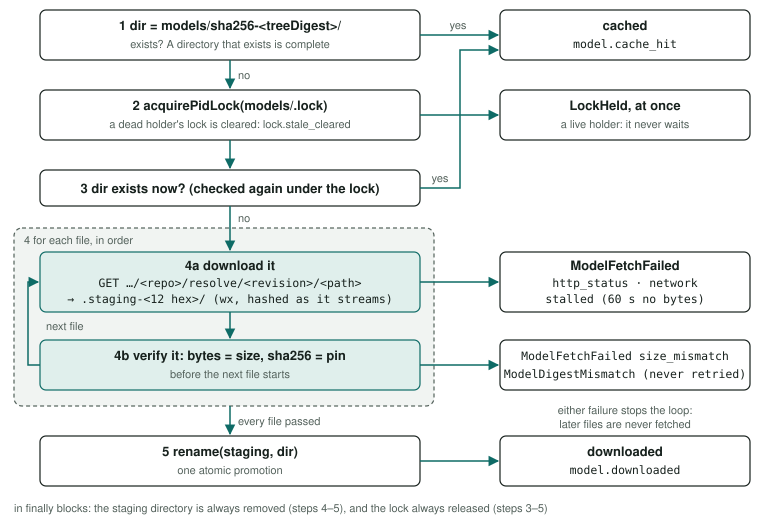

# Models

Every model is pinned by a catalogue entry, verified into a content-addressed cache, served on the host by llama.cpp's `llama-server`, and reached only through the daemon's gateway.

<div class="facts"><span>verified 2026-09-27</span><span>pinned values read 2026-09-26</span><span>recurring cost: $0 (local inference)</span><span>migrated from <code>docs/models.md</code> on 2026-09-27.</span></div>

> [!SUMMARY]
> - A catalogue entry is the pin: a repo, a 40-hex revision, and a size and sha256 for every file.
> - Files are downloaded into a staging directory and each is verified as soon as it arrives; the first bad file stops the download and the cache is untouched. One rename promotes a complete download.
> - One `llama-server` per model on 127.0.0.1, each requiring a key only the daemon holds (`model-server.key`, `0600`), which the gateway sends. The gateway returns failures as data: `timeout`, `unavailable`, `upstream_error`, `bad_response`, `truncated`.
> - A chat is streamed from the model server, bounded by inactivity (a 55 s queue bound and a 22 s idle bound, set from measurements), and its output published as it is generated: `model_delta` and `model_done` on the conversation's stream and the channel watch.
> - `memory` uses `qwen3-8b-q4_k_m`: 18 of the 19 original routing cases (at `d8350f0` and again at `cb63366`, llama.cpp 0.5.0); no smaller model passes more than 16. `hello-world` used it too until the owner moved it to `pico-v2-q8_0` on 2026-10-12.
> - Embeddings use `qwen3-embedding-0.6b-q8_0`, apache-2.0 declared only in its model card.

## The pipeline, end to end {#pipeline}

At launch, [`AgentSupervisor`](../../src/daemon/agents/index.ts) (its private `launch`) loads the recipe's chat model entry, has the store `ensure` it is cached and the server `ensureServing` it, repeats both for any `embeddingModel`, and only then builds the image and starts the container. The catalogue entry (`catalogue/<id>.json`) *is* the pin (AGENTS.md §3).

).](model-pipeline.svg)

| Step | Code | Contract |
|---|---|---|
| Pin | [`src/daemon/definitions/index.ts`](../../src/daemon/definitions/index.ts) — `parseCatalogueEntry`, `Definitions.chatModel`, `Definitions.embeddingModel` | `CatalogueEntry` ([spec](recipes.md#catalogue)) |
| Download, verify, cache | [`src/daemon/model-store/index.ts`](../../src/daemon/model-store/index.ts) — `HuggingFaceModelStore`, `treeDigest` | `ModelStore` |
| Serve | [`src/daemon/model-server/index.ts`](../../src/daemon/model-server/index.ts) — `LlamaCppServer` | `ModelServer` |
| Call | [`src/daemon/model-gateway/index.ts`](../../src/daemon/model-gateway/index.ts) — `chatCompletion`, `embeddings`; [`src/daemon/agents/index.ts`](../../src/daemon/agents/index.ts) — `AgentSupervisor.chat`, `AgentSupervisor.embed`, `parseChatRequest`, `parseEmbedRequest` | [`src/shared/protocol.ts`](../../src/shared/protocol.ts) |
| Wiring | [`src/daemon/compose.ts`](../../src/daemon/compose.ts) — `productionDependencies` | the composition root |

## Download and verification {#download}

`HuggingFaceModelStore.ensure(entry)` is the only writer of the model cache (AGENTS.md §3), and follows PRINCIPLES §13: write to a name nobody else holds, promote on success.



1. **Address by content.** The cache directory is `<modelsDir>/sha256-<tree digest>/` (by default `models/sha256-<tree digest>/`), the sha256 of the sorted `path\0sha256\n` lines of the entry's files (`treeDigest`). A directory that exists is complete: a cache hit (`model.cache_hit`, status `cached`).
2. **Lock.** `<modelsDir>/.lock`, a pid lock ([`src/daemon/process/pid-lock.ts`](../../src/daemon/process/pid-lock.ts), `acquirePidLock`). A dead holder's lock is cleared (`lock.stale_cleared`); a live holder's makes it throw `LockHeld` at once. With the lock, the store checks the cache again.
3. **For each file in turn,** fetch `https://huggingface.co/<repo>/resolve/<revision>/<path>` into `<modelsDir>/.staging-<12 hex>/` (opened with `wx`, hashed as it streams; `model.file_downloading`), then verify it: the byte count must equal the pinned `size` (else `size_mismatch`) and the sha256 the pinned `sha256` (else `ModelDigestMismatch`, fatal, never retried). No bytes for `stallTimeoutMs` (60,000 ms in `productionDependencies`) aborts as `stalled`.
4. **Promote** with one `rename(staging, dir)` (`model.downloaded`, status `downloaded`). The staging directory is removed in a `finally`, success or not.

<p class="pre-label">src/daemon/model-store/index.ts — treeDigest</p>

```
/** sha256 over the sorted `path\0sha256\n` lines of an entry's files. */
export function treeDigest(files: readonly CatalogueFile[]): string {
  const lines = [...files]
    .sort((a, b) => (a.path < b.path ? -1 : a.path > b.path ? 1 : 0))
    .map((f) => `${f.path}\0${f.sha256}\n`)
    .join('');
  return createHash('sha256').update(lines).digest('hex');
}
```

<p class="pre-label">src/daemon/model-store/index.ts — HuggingFaceModelStore.ensure (staging and promotion)</p>

```
const staging = join(this.props.modelsDir, `.staging-${randomBytes(6).toString('hex')}`);
try {
  for (const file of entry.files) {
    await this.download(entry, file, join(staging, file.path));
  }
  await rename(staging, dir);
} finally {
  await rm(staging, { recursive: true, force: true });
}
```

<div class="table-wrap"><table>
<thead><tr><th>Error</th><th>When</th><th>Wire reason</th></tr></thead>
<tbody>
<tr><td><code>ModelFetchFailed</code> <code>http_status</code></td><td>non-2xx, or no body</td><td rowspan="4"><code>model_fetch</code> (<code>classify</code> in <a href="../../src/daemon/agents/index.ts"><code>src/daemon/agents/index.ts</code></a>)</td></tr>
<tr><td><code>ModelFetchFailed</code> <code>stalled</code> / <code>network</code></td><td>no bytes for the stall bound / any other fetch error (with <code>cause</code>)</td></tr>
<tr><td><code>ModelFetchFailed</code> <code>size_mismatch</code>, <code>ModelDigestMismatch</code></td><td>the file is not the pinned file</td></tr>
<tr><td><code>LockHeld</code></td><td>another live process holds <code>.lock</code></td></tr>
</tbody>
</table></div>

> [!WARNING] The code and its comment disagree
> A comment in `ensure` says "another process may have completed the same download while we waited", but `acquirePidLock` never waits: it throws `LockHeld` when the holder is alive. The holder's pid is checked with `isAlive`, so a second `ensure` in the *same* daemon during a download also gets `LockHeld`.
>
> TODO: confirm whether concurrent downloads in one daemon are meant to fail with LockHeld, and correct either the code or the comment

The `files` list is validated before any download: relative paths only, no pickle formats (`.bin`, `.pt`, `.pth`, `.pkl`, `.ckpt`), no duplicates, and `weights` must be one of them ([catalogue spec](recipes.md#catalogue)).

## Serving on the host {#serving}

Models run on the host because colima's VM has no Metal GPU ([why](index.md#host-inference)); a container reaches them as `host.docker.internal` (`ColimaRuntime.hostAddress`).

- **One server per model.** `LlamaCppServer.ensureServing(entry, cached)` runs one `llama-server` per catalogue entry and reuses it for every agent that needs it.
- **The binary.** Before the first launch, `ensureHostTool` ([`src/daemon/host-tools/index.ts`](../../src/daemon/host-tools/index.ts)) runs `llama-server --version`, and if that fails, `brew install llama.cpp`. Installed here: 0.5.0 (build 11146, `7fe450e19`): Homebrew upgraded it from build 8130 on 2026-09-27 (Cellar install receipt; `llama-server --version`). It changed forced tool calls ([gateway](#gateway)).

<p class="pre-label">src/daemon/model-server/index.ts — LlamaCppServer.ensureServing (arguments)</p>

```
[
  '--model', cached.weightsPath,
  '--alias', entry.id,
  '--host', '127.0.0.1',
  '--port', '0',
  // A chat model: CHAT_SLOTS (4) slots, each with the catalogue's context (debt D17) …
  ...(entry.kind === 'chat'
    ? ['--parallel', String(CHAT_SLOTS), '--ctx-size', String(CHAT_SLOTS * entry.serve.contextSize)]
    : ['--ctx-size', String(entry.serve.contextSize)]),
  // Every route that reaches the model requires the key; /health stays open, for the readiness poll.
  '--api-key-file', this.props.keyFile,
  // A chat model needs its chat template for tool calls, and the prefill that forced tool calls rely on
  // (the gateway's toolCallStart), set here because LLAMA_ARG_PREFILL_ASSISTANT in the user's environment
  // could turn the default off. An embedding model is served for /v1/embeddings only, pooled as its model
  // card says, with a batch as big as its context.
  ...(entry.kind === 'chat'
    ? ['--jinja', '--prefill-assistant', ...CHAT_CACHE_ARGS]
    : ['--embeddings', '--pooling', entry.serve.pooling, '--ubatch-size', String(entry.serve.contextSize)]),
]
```

| Aspect | How |
|---|---|
| Slots and context | A chat model's server runs 4 slots (`CHAT_SLOTS`), each with its own `serve.contextSize` tokens: `--parallel 4 --ctx-size 4×contextSize`, which llama.cpp 0.5.0 serves with a KV cache per slot (`n_ctx_slot = 8192, kv_unified = 'false'` in its log). Until 2026-09-27 it passed only `--ctx-size`, and 0.5.0 then made 4 auto slots share one unified pool of that size: four concurrent turns of 2,127 prompt tokens all failed with HTTP 500 "Context size has been exceeded", and all four succeed now (≈20.6 s), measured that day on `qwen3-8b-q4_k_m` with the daemon's flags (D17). The cost is memory: that server's resident size went from 6.2 GB to 9.8 GB. An embedding model's server keeps one context of `serve.contextSize`. |
| Prompt cache | A chat model's server gets `CHAT_CACHE_ARGS`: `--cache-prompt --cache-ram 8192 --cache-idle-slots --cache-reuse 0 --slot-prompt-similarity 0.10`, each explicit so `LLAMA_ARG_CACHE_PROMPT`, `LLAMA_ARG_CACHE_RAM`, `LLAMA_ARG_CACHE_IDLE_SLOTS` or `LLAMA_ARG_CACHE_REUSE` in the user's environment cannot change caching (the arguments win: probe A5, records (`evals/probes/prompt-prefix-2026-09-28/README.md`)) and a llama.cpp upgrade cannot move the slot-selection threshold. What 0.5.0 does with them (llama.cpp `tools/server/` at `7fe450e19`, read 2026-09-28): a slot keeps the longest common prefix of its previous prompt and the new one and processes only the rest; a request goes to the idle slot whose cached prompt shares the longest prefix with it when that exceeds 10 % of the prompt, else the least recently used; a slot's state is saved to a host-memory store of up to `CHAT_CACHE_RAM_MIB` (8,192 MiB, the owner's answer of 2026-09-28, decision `model-server-memory` (a)) and restored to another slot. `--cache-reuse 0` keeps chunk reuse off: it would shift KV computed under another agent's handle or another user's memory into a prompt. Agents' requests are ordered to share a prefix so these hit ([the shared prefix](channel.md#prefix)). Prompt caching can change greedy output, since logits are not bit-identical between batch sizes (llama.cpp README); see [determinism](../quality/index.md#determinism). A recipe's or catalogue entry's `chat` may not set the per-request fields that change caching or slot choice — `cache_prompt`, `n_cache_reuse`, `id_slot`, `message_delimiters` (`CACHING_FIELDS` in [`src/daemon/definitions/index.ts`](../../src/daemon/definitions/index.ts)) — and fails to load if it does. |
| Prompt store | After a recipe's first answered chat call on a chat model's server, the daemon asks that server once to store its idle slots' prompts (`storePromptOnce` in [`src/daemon/agents/index.ts`](../../src/daemon/agents/index.ts), `storeIdlePrompts` in [`src/daemon/model-gateway/index.ts`](../../src/daemon/model-gateway/index.ts)): `POST /tokenize` `{"content": "."}` (no special tokens), then `POST /completion` with those token ids as the prompt and `"n_predict": 1`, each with the key and a bound of `PROMPT_STORE_BOUND_MS` (the chat queue bound, 55,000 ms). It is not awaited by the call that triggered it, not sent once the daemon is stopping, and abandoned when the stop begins, which then waits for it to end ([`tests/unit/daemon-stop.test.ts`](../../tests/unit/daemon-stop.test.ts), `tests/unit/agents.test.ts`; over HTTP, `tests/integration/daemon.test.ts`). Why (D44, `docs/plans/prompt-prefix.md`, amendment 2): 0.5.0 saves idle slots to the host store only when a task starts (`--cache-idle-slots`), and one agent after another of a recipe all take the slot holding the shared prefix, so that slot is never idle when a task starts and the store stays empty; the first time two agents call at once, the second lands on an empty slot and computes its whole prompt (measured 2026-09-29: 1,923 tokens in 4.6 s), and the first, batched with it, waits as long. The request's prompt shares no first token with any chat prompt, so it goes to the least recently used slot — an empty one while there is one — and the warm slot, idle, is saved; a later request on an empty slot restores the prefix from the store. It is a token array because a text prompt gets BOS on a model that adds one: Ministral 3's GGUF sets `tokenizer.ggml.add_bos_token`, and a text "." then shared BOS with the warm slot (1 of 2 tokens, over the 10 % threshold), took that slot, and left the store empty again (measured 2026-09-29; `tokenize_mixed` adds BOS only when the prompt's first element is text, llama.cpp `tools/server/server-common.cpp` at `7fe450e19`). Logged: `model.prompt_stored` (`model`, `recipe`, `ms`) once the server has answered — which says the task ran, not what was saved —, `model.prompt_store_abandoned` (warning) when the stop began first, or `model.prompt_store_failed` at error level with its `reason` (`timeout`, `unavailable`, `upstream_error`, `bad_response`, or `internal` for a harness defect); never retried. |
| Port | `--port 0`; the base URL is read from the output line announcing `listening on http://127.0.0.1:<port>` (`LISTENING`: 0.5.0 prints `llama_server: listening on …`, build 8130 printed `main: server is listening on … - starting the main loop`; both match). |
| Readiness | `GET /health`, which needs no key (below), every 250 ms (each bounded at 2,000 ms) until 2xx, within `readyTimeoutMs` (120,000 ms). An exit before healthy, or the deadline, throws `ModelServerFailed` with the log tail and kills the child with `SIGKILL`. Wire reason: `model_server`. |
| Model name | `--alias` is the catalogue id; `ModelEndpoint` is `{baseUrl, model, apiKey}`. |
| API key | 32 bytes from the CSPRNG, hex (64 characters), made by each `LlamaCppServer` (one per daemon start) on the first model it serves and shared by every server it starts. It is written by `writePrivateFile` (a new `0600` file under a unique name, renamed into place) to `<home>/model-server.key` — an absolute path, the home resolved (`harnessPaths` in [`src/shared/paths.ts`](../../src/shared/paths.ts), since debt-paydown R13), so it names one home on every server's command line — passed as `--api-key-file` (never `--api-key`, which `ps` would show), sent by the gateway as `Authorization: Bearer <key>`, and removed by `stopAll`. The server is launched with `LLAMA_API_KEY` set empty: a value in the user's environment would add a second key the server accepts. `evals/routing/run.ts` does the same with a key file in its work directory. |
| Logs | `<home>/logs/model-server-<id>.log`. Events: `model_server.launching`, `model_server.ready` (with llama-server's `pid` and its watch's `watchPid`), `model_server.unloaded_idle` and `model_server.reloaded` ([idle unload](#idle)), `model_server.exited` (a warning when unasked), `model_server.stopped_idle` (a server no agent needed, after a channel's stop), `model_server.spawn_failed`, `model_server.stopped`; the start's sweep (below): `model_server.orphan_stopped`, `model_server.orphan_survived`. |
| Stop | `stopAll()` sends `SIGTERM` — to the [watch](#watch), which passes one on — then `SIGKILL`, to the watch's whole group, after a 10,000 ms grace, and waits too for any [idle unload](#idle) still under way. After [one channel's stop](channel.md#channel-stop), `stopIdle(inUse)` stops the same way each server whose model no agent holds — launching, online or restarting (`modelsInUse` in [`src/daemon/agents/index.ts`](../../src/daemon/agents/index.ts)) — and no call holds, logged `model_server.stopped_idle`: a server still starting is awaited first, and the holders are read again just before it is stopped, so a launch that took the model meanwhile keeps it. A later launch that needs the model starts its server again. |
| <span id="orphans">A killed daemon's servers</span> | A daemon killed with SIGKILL (or one that crashed) cannot stop its servers itself. Since 2026-10-15 the [watch](#watch) each runs under ends them; before it they lived on, re-parented to `launchd` (D13, now paid), and one whose watch was killed too still does. So every start, after the container runtime's reclaim and before the server listens, runs `LlamaCppServer.reclaimOrphans` (`startDaemon` in [`src/daemon/compose.ts`](../../src/daemon/compose.ts); debt-paydown R12, R13): `ps -axww -o pid=,ppid=,command=` (2,000 ms bound; 22–24 ms for 830 processes, probe P4), then exactly the processes whose command's first word is `llama-server` and which name ` --api-key-file <this home's absolute key file>` followed by a space or the end — the daemon lock guarantees no live daemon of this home owns one. All are sent SIGTERM at once; those left at 3,000 ms are listed again, and only those still selected get SIGKILL — a pid that ended and was taken by another process meanwhile is never signalled (no call in flight is worth finishing: their daemon is dead); each that ends is logged `model_server.orphan_stopped` at warn (`pid`, `signal`, `ms`), and one still alive 1,000 ms later, or one this user may not signal (`EPERM`), `model_server.orphan_survived` at error, and the start goes on; then the stale key file is removed. A failed `ps` fails the start (`daemon.orphan_sweep_failed`, the lock released). With no orphan it adds one `ps`: about 25 ms; at most 8 s (two `ps` of 2 s, 3 s, 1 s). Never selected: a `llama-server` with no key file (one started before control-api-auth), another home's, a relative key path, another program naming the key path. **Missed, never mis-selected** (the completion review's finding 13): an orphan of this home whose command spells the home another way — through a symbolic link (`/tmp/x` and `/private/tmp/x` share one lock but not one text), or with characters `ps` re-encodes under the C locale — and a `llama-server` installed at a path holding a space; such an orphan is left running, as before the sweep. Tests: [`tests/unit/model-server-orphans.test.ts`](../../tests/unit/model-server-orphans.test.ts) (each selection clause), [`tests/eval/lifecycle.eval.test.ts`](../../tests/eval/lifecycle.eval.test.ts) (a real daemon and its server's watch both SIGKILLed, the server stopped by the next start). |
| <span id="watch">The watch</span> | Every `llama-server` runs under `WATCH_SCRIPT` ([`src/daemon/process/launcher.ts`](../../src/daemon/process/launcher.ts), `dieWithParent`; `docs/plans/idle-shutdown.md` R5), a `/bin/dash` (`WATCH_SHELL`) the daemon starts as its own process group — not `/bin/sh`, which on macOS is bash 3.2: sent a burst of 30 stop signals on a loaded Mac, 9 of 240 bash watches died by a signal (SIGSEGV, mostly) before passing the stop on and 6 hung, leaving 8 servers running, against none of 240 under dash (2026-10-16, `evals/probes/watch-shell-2026-10-16/`) — whose standard input is a pipe only the daemon holds and never writes. The watch starts llama-server with no standard input, prints `asha-watch: pid <n>` (llama-server's own pid) as its first line, and waits. **The daemon gone** — however it ended, SIGKILL included, the kernel closes its end of the pipe — or **a stop** (SIGTERM, SIGINT or SIGHUP to the watch): one SIGTERM to llama-server at once, then SIGKILL 8 s later if it still runs, so it is gone within 10 s; the watch exits with its status and ends its helpers. Exactly one SIGTERM, because llama.cpp 0.5.0 takes a second as *"Received second interrupt, terminating immediately."* (`libllama-server-impl.dylib`, read 2026-10-15): the daemon signals the watch alone, and only a SIGKILL goes to the whole group. No pid is polled: the watch is llama-server's parent, so its pid cannot be reused while the watch waits on it. A stop before llama-server has started means it never starts (exit 143); one in the instant between its fork and its exec can be lost, and the SIGKILL ends it. A watch that does not lead its own process group refuses to run (exit 125). A server is not ready until its pid is named: `model_server.ready` logs `pid` (llama-server's, what the [sweep](#orphans) selects) and `watchPid`. Tests: [`tests/unit/process-watch.test.ts`](../../tests/unit/process-watch.test.ts) (real processes: a stand-in daemon SIGKILLed, one SIGTERM, the SIGKILL timer, a burst of 30 stop signals to 16 watches at once, each guard seen failing), [`tests/eval/lifecycle.eval.test.ts`](../../tests/eval/lifecycle.eval.test.ts) (a real daemon SIGKILLed, its llama-server gone within 10 s). |
| <span id="idle">Idle unload</span> | A model server with no call holding it whose last call ended — or, never called, which became ready — `ASHA_MODEL_IDLE_MS` ago (default 900,000, 15 minutes) is stopped by the daemon's [lifetime](index.md#lifetime) check, `model_server.unloaded_idle` (`model`, `idleMs`), freeing its 5–13 GB. Every chat and embedding call takes a lease on its model for its whole duration (`lease`; `onLeased` in [`src/daemon/agents/index.ts`](../../src/daemon/agents/index.ts)), so a held server is never unloaded — nor stopped by `stopIdle` — and a model unloaded since its agent launched is started again by the next call, logged `model_server.reloaded` with the `ms` it waited. That wait is inside the call's first-chunk bound, the queue bound (55,000 ms, [below](#streaming)): a reload took 0.6–15.2 s on this Mac, median 1.6 s (record (`evals/probes/idle-shutdown-2026-10-15/reload-times.json`)), and the queue's longest recorded first chunk 32.7 s, so the daemon's bound still ends an agent's call, naming its cause, before the SDK's 60 s. A wait the agent's exit or its request closing cuts short ends the call as either would a call that reached its model; a lease that comes after is released at once, and a start that fails after is logged `model.start_failed`. The prompt store holds the very server its call reached (`holdServer`, by server number, which a restart on the same port does not reuse) and never starts one: that server gone, the store is skipped, `model.prompt_store_skipped`. |

**What the key covers** on the installed llama-server 0.5.0 (build 11146, `7fe450e19`), run 2026-09-27 with `--api-key-file` on `Qwen3-Embedding-0.6B-Q8_0.gguf` (status with no key / the key / a wrong key): `GET /health` and `GET /v1/health` 200/200/200, open to anyone; `GET /v1/models`, `GET /models`, `GET /props` and `GET /slots` 401/200/401; `POST /v1/embeddings` 401 without the key, 200 with it; `POST /v1/chat/completions` 401 without it. The key never appeared in `ps` or in the server's log (only `unauthorized: Invalid API Key` lines per refusal). With `LLAMA_API_KEY=<value>` in its environment the server also accepted that value; with it set empty it accepted only the file's key. The plan (`docs/plans/control-api-auth.md`) recorded build 8130 leaving `/v1/models` and `/models` open and logging the key's last four characters; 0.5.0 does neither.

A CUDA build for a PC is <span class="badge planned">planned: pc-cuda</span> (the pc-cuda plan (`docs/plans/pc-cuda.md`); [adding an adapter](extending.md#adapter)).

## Calling a model: the gateway {#gateway}

An agent calls `POST /agent/v1/model/chat` or `POST /agent/v1/model/embed` with its bearer token (`HarnessClient.chat`, `HarnessClient.embed` in [`src/agent-sdk/index.ts`](../../src/agent-sdk/index.ts); an unknown token gets 401). The daemon validates the body (`parseChatRequest` / `parseEmbedRequest`, closed; a `requireToolCall` chat must not end with an assistant turn, since the prefill opens one) and makes one call to that agent's model server, with the server's key as `Authorization: Bearer <apiKey>` (`ModelEndpoint.apiKey`); only the daemon holds the key, so the gateway is the only way in. A chat is **streamed** from the model server and its output published as it is generated ([below](#streaming)); the agent still receives one whole answer.

- **Chat.** `{messages, maxTokens, tools?, requireToolCall?}`: `maxTokens` an integer in 1..4096, at most 16 tools, and `requireToolCall: true` needs `tools`, is sent as `tool_choice: "required"`, and opens the assistant turn with the entry's `toolCallStart` (why: the warning below) — unless thinking is on ([below](#thinking)). Sampling is `chatDefaults: { ...record.entry.chat, ...record.recipe.chat }` (the recipe wins). The merge is shallow: a recipe that sets `chat_template_kwargs` replaces the entry's whole object, not key by key. The harness's own fields — `model`, `messages`, `max_tokens`, `tools`, `tool_choice`, `stream: true`, `stream_options: {include_usage: true}`, `return_progress: true` — are written after, so no definition can set them. Returns `{ok: true, text, toolCalls}` to the agent; tool-call arguments are parsed from JSON and every call must carry an id. Beside it the daemon gets the stream's figures (`ChatStats` in [`src/daemon/model-gateway/index.ts`](../../src/daemon/model-gateway/index.ts)): the usage chunk's `prompt_tokens`, `completion_tokens` and `prompt_tokens_details.cached_tokens`, the time to the first output, and the chunks received; the agent never sees them.
- **Embeddings.** `{texts, purpose}`: 1..64 non-empty strings, `purpose` `"query"` or `"document"`; a recipe with no `embeddingModel` gets a 400. A `query` is written with the entry's `embed.queryTemplate` (`{text}` replaced); a `document` is sent as it is. One vector per input, each exactly `embed.dimensions` long, placed by the server's `index`, not by position. Not streamed (embeddings are not incremental); bounded by the daemon's `chatTimeoutMs`, `AGENT_CHAT_TIMEOUT_MS` (60,000 ms), wall clock.

<p class="pre-label">src/daemon/model-gateway/index.ts — chatCompletion (the request body)</p>

```
const prefill = props.request.requireToolCall === true && !thinking;
const body = {
  ...props.chatDefaults,
  model: props.endpoint.model,
  messages: [...props.request.messages.map(toOpenAi), ...(prefill ? [{ role: 'assistant', content: props.toolCallStart }] : [])],
  max_tokens: props.request.maxTokens,
  ...(props.request.tools === undefined ? {} : { tools: props.request.tools }),
  ...(props.request.requireToolCall === true ? { tool_choice: 'required' } : {}),
  stream: true,
  stream_options: { include_usage: true },
  return_progress: true,
};
```

### The stream, and its bounds {#streaming}

llama-server answers a chat as server-sent events: `data: <json>` chunks — `prompt_progress` chunks while it reads the prompt, output chunks (`choices[0].delta`: `reasoning_content`, `content`, or a fragment of a tool call's arguments, the first naming the call's id and function), exactly one chunk with a `finish_reason`, one usage chunk with `choices: []` — then `data: [DONE]` (`StreamReader` in [`src/daemon/model-gateway/index.ts`](../../src/daemon/model-gateway/index.ts)). The gateway assembles it into the same `ChatResponse` the whole answer would give. A stream short of that — no `[DONE]`, no finish chunk, no usage chunk or one without all three counts, anything after `[DONE]`, a line that is not SSE data or not JSON — is `bad_response`, never a shorter answer; a chunk reporting an error is `upstream_error`.

A chat is bounded by **inactivity, not wall clock**: every `data:` chunk of the stream, progress chunks included, is activity; a comment is not — llama-server writes a `:` ping every 30 s by default (`--sse-ping-interval`, per `llama-server --help` on 0.5.0, build 11146, read by the code review of 2026-09-29), and a ping must not keep a stalled call alive. *(Corrected 2026-09-29, before merge: this said every network read was activity, and the code did so; the review found a ping would then reset the bounds.)* A throw from the daemon's own delta sink is a harness defect, re-thrown (`DeltaSinkFailed`, answered 500 and logged `http.handler_failed`), never reported as a model failure.

| Bound | Value | Fails the call `timeout` when |
|---|---|---|
| Queue bound, `CHAT_QUEUE_BOUND_MS` | 55,000 ms | no chunk arrives within it of sending the request: the call waiting for a slot and its prompt |
| Idle bound, `CHAT_IDLE_BOUND_MS` | 22,000 ms | no chunk arrives within it of the previous one |

Each is twice the largest value of its kind across every recorded measurement, rounded up to a whole second; the queue bound is then capped at the SDK's bound less 5 s, so for an agent's call the daemon's bound fires first and names the cause. **Measured** twice on 2026-09-29, at clean commits `e241518` and `6cafba3`, on an Apple M4 Pro with 48 GiB, llama-server 0.5.0 (b11146), `qwen3-8b-q4_k_m` with 4 slots: ten concurrent calls of 1,174 prompt tokens and one of 5,925, each with `return_progress` — the last first chunk at 31,774 and 32,670 ms (the eleventh call waiting for a slot), the longest gap inside a stream 5,531 and 5,411 ms (`evals/probes/model-streaming-2026-09-29/measure-e241518.json`, `evals/probes/model-streaming-2026-09-29/measure.json`, `evals/probes/model-streaming-2026-09-29/measure.mjs`). The plan reviewer's capture of 2026-09-27 saw a gap of 11 s with other llama-servers sharing the GPU (`docs/plans/model-streaming.md`, capture 5; no committed record, kept because it can only widen the bound), so the idle bound is 22,000 ms; the queue bound's rule gives 66,000 ms, capped to 55,000. *(Corrected 2026-09-29: until these measurements the bounds were a provisional 54,000 and 22,000 ms, from capture 5 alone.)* Eleven calls on four slots is near capacity (D19): a burst whose wait for a slot passes 55 s fails `timeout`, naming the queue bound. The routing eval, which has no SDK bound, sends one call at a time. The upper limits stay: the SDK's `chatTimeoutMs`, `AGENT_CHAT_TIMEOUT_MS` (60,000 ms), bounds a call as the agent sees it, and the recipe's `messageTimeoutMs` the whole turn; a call longer than 60 s is cut by the SDK by design, since the reply targets are 4,000 and 5,000 ms at p95 (`docs/plans/enterprise-targets.md`). The agent suite fails any chat call over 75 % of the SDK's bound ([Testing](../testing/index.md#agents)).

When the agent's own request closes before the answer (its bound passed), the daemon aborts the model server's request, freeing the slot, and the call ends `timeout` with the detail `the agent's request closed before the answer`. When the calling agent's container has exited, the call ends at once as `unavailable`, `abandoned: the calling agent exited`, and is logged `model.call_abandoned` at warn; so is a call whose request closed while the daemon is stopping its agent, since the container's exit and its connection closing come in either order. Whatever ends a call, the model server's request ends with it.

### Deltas {#deltas}

While a chat streams, each piece of output goes to the conversation it belongs to — derived from the call's validated `traceparent` (`AgentRecord.conversations`, filled beside `record.traces` in `connect`), never from the agent — as a `model_delta` event `{handle, conversation, call, seq, part, text}`: `call` is the call's `asha.chat` span id, `seq` counts from 0 per call, `part` is `thinking`, `text` or `tool_args` (with `index` and `name`). Then one `model_done` `{handle, conversation, call, outcome}`, `ok` or the failure reason, published from a `finally`, so exactly once per call and after its last delta. Both go to the conversation's stream and to every watcher of the agent's channel ([Channels and agents](channel.md#deltas)); a call refused before the model server's request (a trace that is no conversation delivered to the agent, or a tool outside its own) publishes nothing. No log record carries delta text.

### Thinking {#thinking}

Whether a model thinks is a recipe setting, off by default: thinking is on only when the merged `chat.chat_template_kwargs.enable_thinking` is exactly `true`. Every Qwen3 entry sets it `false`; no recipe in `recipes/` turns it on. When it is on, the gateway sends no `toolCallStart` prefill (with the prefill the model does not think), streams `reasoning_content` as `part: thinking` (it is never part of the reply text), and a required call cut by `finish_reason: length` is `truncated` with a detail that says whether the cut came while thinking. Without the prefill a forced call may again follow free text (the warning below), so a recipe turns thinking on only after the routing eval and the timing targets are re-run with it on (model-streaming A7).

Expected failures come back as `{ok: false, reason, detail}` (PRINCIPLES §11), never as exceptions, from `ModelFailureReason` in [`src/shared/protocol.ts`](../../src/shared/protocol.ts):

| Reason | Meaning |
|---|---|
| `timeout` | a chat's queue or idle bound passed, or the agent's request closed first; an embedding's `chatTimeoutMs` passed, its body's reading included |
| `unavailable` | the model server could not be reached, or cut the connection mid-body; or the calling agent exited (`abandoned:`) |
| `upstream_error` | it answered non-2xx (up to 500 characters of its body), or its stream reported an error |
| `bad_response` | 2xx with an unusable body: a stream short of complete, not JSON, malformed tool calls, a usage chunk without the three counts; for an embedding, wrong vector count or size |
| `truncated` | a tool call was required and no complete one came: the output reached `maxTokens` first (`finish_reason: "length"`), with no call, with a call whose arguments were cut off, or while thinking |

> [!WARNING] `tool_choice: "required"` no longer forces the call first
> Since llama.cpp [PR #22654](https://github.com/ggml-org/llama.cpp/pull/22654) (merged 2026-05-04, commit `a4701c98f`; in 0.5.0, not in 8130; read 2026-09-27), a forced call may follow free text; `qwen3-8b` at temperature 0 then sometimes wrote text to the token limit with no call. So a chat entry's `toolCallStart` (Qwen3: `"<tool_call>\n"`) is sent as the start of the assistant turn, which begins the call. That needs llama-server's assistant prefill, on by default in both builds; the daemon passes `--prefill-assistant` so the environment cannot turn it off. This page said `required` forced the call; see [history](history.md#forced-calls-correction).

> [!NOTE] Correction, 2026-09-29
> This page said "With the prefill a recipe's `enable_thinking: true` is skipped silently, since the turn starts inside the call". Since model-streaming, a recipe that turns thinking on gets no prefill, and thinks ([above](#thinking)); the statement was true of the gateway before it.

> [!NOTE] Correction, 2026-09-27
> A response whose body was cut off, or timed out, while it was read made `response.text()` throw, so the call ended in a 500 (`http.handler_failed`) rather than as data. The otel-traces work found it: every model call must end its `asha.chat` span with a reason. The gateway now returns `unavailable` or `timeout` (tests: "failures from the model server" and "an embedding body the model server cuts off" in [`tests/unit/model-gateway.test.ts`](../../tests/unit/model-gateway.test.ts)).

### Log records {#model-logs}

The supervisor logs each call: `model.chat` / `model.embed` at info, `model.chat_failed` / `model.embed_failed` at error, with handle, channel, model and duration ([the 3am query](index.md#logs)). A chat's record also carries the stream's figures (since model-streaming, 2026-09-29): `ttfcMs` (from sending the request to the first chunk of output, progress chunks excluded), `chunks`, `promptTokens`, `completionTokens` and `cachedTokens` — `null` where the stream did not get that far. A `model.chat` also carries `toolCalls` (since 2026-09-29): the names of the tools the model called in that response, in order — never their arguments — so which tools a turn used can be read outside the agent (the agent suite's `two-models` scenario reads it; `AgentSupervisor.chat` in [`src/daemon/agents/index.ts`](../../src/daemon/agents/index.ts)). `model.chat_failed`'s error keeps its detail, which can hold up to 200 characters of the model's output. Each call is also an `asha.chat` or `asha.embed` span, which ends with the call's reason when it fails ([traces](index.md#traces)).

## Which model `hello-world` uses, and why {#choice}

> [!DECISION]
> *2026-10-12, the owner:* `hello-world` uses **`pico-v2-q8_0`** (commit `8671911`, "Switch hello world to pico model."); `memory` stays on `qwen3-8b-q4_k_m`, and so does the gate's routing step, which names its model. The agent suite and the eval had not yet run `hello-world` on it (2026-10-12). What follows is why both used `qwen3-8b-q4_k_m` until then, measured on it.
>
> *2026-10-14, the owner, when the first gate on it failed four hello-world scenarios:* *"Do not move hello-world back to Qwen - it is fine if the routing agent uses Qwen, but the responder agents should use Pico V2."* So `hello-router` (the `hello-world` image and prompt on `qwen3-8b-q4_k_m`) is the agent suites' router — the agent that hands work on or consults others — and `hello-world`, on `pico-v2-q8_0`, every responder. And the same day: *"ministral-3-8b-instruct-2512-q4_k_m model should never be used for anything. Anything using that should be switched to Pico V2."* Its catalogue entry and `ministral-hello` are removed ([below](#ministral-3-8b)).
>
> *2026-10-15, the owner:* a suite or demo whose agents must behave a particular way gets a one-shot example in its own recipe, not in a shared one: `suite-multi-agent-responder`, on `pico-v2-q8_0`, is the multi-agent suite's responder ([Recipes](recipes.md#recipe)).
>
> `memory` uses, and `hello-world` used until 2026-10-12, **`qwen3-8b-q4_k_m`**. It passes 18 of the 19 original routing cases (at `cb63366`) and 17 of the 22 of the measure before agent calls (at `09394b2`); no smaller model passes more. Under agent-calls' 28-case measure it passed 24 with the first wording (`4b2da6b`), and at most 26 over the three wordings tried; with the 29-case measure and the wording shipped since 2026-09-29 (agent-calls' variant 2 on the shared prefix, `9b6559d`) it passes 27 of 29 cases and 19 of the 20 held-out ones, in two identical runs — below 3/3 only `call-and-return` and `held-self-task-have` (the task-shaped requests, D30) and `forged-identity` ([Testing, routing](../testing/index.md#routing)); the other models have not been run on it. *2026-09-29:* `forged-identity` was removed from the measure, applying the owner's answer (`docs/plans/agent-calls.md`, answered, item 2), so on today's 28 cases those runs pass 27, below 3/3 only the task-shaped `call-and-return`.

**The routing eval** ([`evals/routing/run.ts`](../../evals/routing/run.ts), cases in [`evals/routing/cases.ts`](../../evals/routing/cases.ts), `npm run eval:routing`) measures each chat model's routing choices; since 2026-09-29 the gate's last step, `npm run eval:routing:gate`, runs it on `qwen3-8b-q4_k_m` and fails on any case below 3/3 but those taken out as D30 (AGENTS.md §2; `docs/plans/agent-calls.md` R18). *Corrected 2026-09-29: this said it is "a diagnostic, not part of the gate", true until agent-calls added the step.* Each case gives one hello-world agent one message and names the action the channel instructions call for. It runs the real request builder (`helloWorldTurn`) through the real model store, llama-server and gateway, 3 times per model; a case passes when all 3 do. Results, with their commit, are in `evals/routing/results/<model>.json`.

### The last run of every model: commit `09394b2` (clean tree), llama.cpp 0.5.0, 22 cases

<div class="stats"><div class="stat"><b>14/22</b><span>0.6B</span></div><div class="stat"><b>16/22</b><span>1.7B</span></div><div class="stat"><b>11/22</b><span>4B</span></div><div class="stat"><b>17/22</b><span>8B</span></div></div>

*Since 2026-09-29, `evals/routing/results/qwen3-8b-q4_k_m.json` holds agent-calls A6's second run at `9b6559d` (29 cases and the held-out set; the first run is in `repeat/`), so for 8B the figures below are the file as committed in `d9158f7`, in git history.* Read on 2026-09-27 from `evals/routing/results/*.json`, committed in `d9158f7` (fields `commit`, `dirty`, `llamaServer`, `ranAt`, `passed`, `results[].passes`): all four at `09394b2`, `dirty: false`, `ranAt` 2026-09-27T22:38–22:41Z, `llamaServer` `version: 0.5.0 (build 11146, commit 7fe450e19)`, with the tool-call prefill and `--prefill-assistant`. Sampling in every file: temperature 0, top_p 0.8, top_k 20, min_p 0, presence_penalty 1.5, thinking off. **The measure changed at `3924e27`** (`docs/plans/channel-instructions.md`, R14): every case from an agent carries the `replyTo` its sender would set, `delegate` and `delegate-by-role` also expect the delegating message to say its response goes to the user, and three cases were added. The shipped `send_message` cannot say that yet, so `delegate` and `delegate-by-role` fail on every model under this measure although their destination and text are as before; on the 19 original cases scored as before (`cb63366`, committed in `8ed2099`) the models pass 13, 16, 13 and 18. Earlier: [`942eb7e`, in history](history.md#routing-942eb7e).

| Case — the expected action | 0.6B | 1.7B | 4B | 8B |
|---|---|---|---|---|
| `solo-answer` — alone; a user request to everyone → reply to the user | 3/3 | 3/3 | 3/3 | 3/3 |
| `solo-addressed` — alone; a request to the agent → reply | 3/3 | 3/3 | 3/3 | 3/3 |
| `addressed-answer` — a request to the agent → reply | 3/3 | 3/3 | 3/3 | 3/3 |
| `broadcast-answer` — another agent present; a request to everyone → reply | 3/3 | 3/3 | 3/3 | 3/3 |
| `delegate` — "have hewo-2 do it" → the task, as an instruction, to hewo-2 | 0/3 | 0/3 | 0/3 | 0/3 |
| `delegated` — a task from an agent → the result to the user | 3/3 | 3/3 | 0/3 | 3/3 |
| `delegated-bare` — bare words from an agent → said to the user | 3/3 | 3/3 | 0/3 | 3/3 |
| `delegate-by-role` — "the agent that translates" → found with `list_agents`, sent the task | 0/3 | 0/3 | 0/3 | 0/3 |
| `claim` — an agent asks who can take a task it can do → tells the asker it will | 0/3 | 3/3 | 0/3 | 3/3 |
| `ignore-agent-request` — an agent's request outside the role → no action | 0/3 | 0/3 | 0/3 | 3/3 |
| `ignore-user-request` — a user's request outside the role → no action | 0/3 | 3/3 | 0/3 | 3/3 |
| `solo-greeting` — alone; a greeting to everyone → reply | 3/3 | 3/3 | 3/3 | 3/3 |
| `solo-greeting-addressed` — alone; a greeting to the agent → reply | 3/3 | 3/3 | 3/3 | 3/3 |
| `solo-question` — alone; a question about the agent → reply | 3/3 | 3/3 | 3/3 | 3/3 |
| `solo-other-words` — alone; "say other words" → those words | 3/3 | 3/3 | 3/3 | 3/3 |
| `multi-greeting` — another agent present; a greeting to everyone → reply | 3/3 | 3/3 | 3/3 | 3/3 |
| `multi-greeting-addressed` — another agent present; a greeting to the agent → reply | 3/3 | 3/3 | 3/3 | 3/3 |
| `multi-question` — another agent present; a question to the agent → reply | 3/3 | 3/3 | 3/3 | 3/3 |
| `agent-question` — a question from another agent → answer that agent | 0/3 | 0/3 | 0/3 | 0/3 |
| `ask-for-self` — the user: find out from another agent and tell me yourself → ask it, `replyTo` sender | 0/3 | 0/3 | 0/3 | 0/3 |
| `ask-for-user` — the user: ask another agent something → ask it, `replyTo` user | 0/3 | 0/3 | 0/3 | 0/3 |
| `delegated-question` — a task written as a question from an agent, `replyTo` user → the result to the user | 3/3 | 3/3 | 0/3 | 3/3 |
| **cases passed** | **14/22** | **16/22** | **11/22** | **17/22** |

On 8B, `agent-question` and the two sender-side cases fail, and `delegate` and `delegate-by-role` fail only on the `replyTo` the measure now expects; everything else passes, `delegated-question` included. `claim` passes on 8B on its destination only: it is graded by where the message goes, and the 8B model sends the asker the task back ("Say: Hello World") rather than saying it will take it.

**What 3/3 records.** The recipe decodes at temperature 0, so a case's three attempts are three greedy decodes of the same request, and in most runs they are identical. They are not three independent samples: across the committed results, in every case whose attempts differed, the first attempt differed and the second and third agreed. A result is therefore confirmed by a second run with `llama-server` started again, not by the three attempts alone (the analysis (`docs/plans/channel-instructions.md`)).

**The 8B model on its own, since the version and requests are recorded.** Re-run at `b8873a3` and again at `14e9997`, each from a clean tree and a fresh `llama-server` (`version: 0.5.0 (build 11146, commit 7fe450e19)`, recorded in each file): 18/19 both times, `agent-question` 0/3, and every case's request sha256, action and pass reason identical between the two runs. All four models were re-run at `cb63366`, from a clean tree, with the same scores as at `d8350f0` (13, 16, 13 and 18, `8ed2099`). Eight changes to the channel layer were measured against this baseline and none fixed `agent-question` without breaking another routing case or an agent-suite scenario — the seventh, in which the sender says where the response goes, passed every case it was for (`agent-question`, `ask-for-self`, `ask-for-user`, `delegated-question`, 21/22, `2862c70`) but sent `delegate`'s task as the bare words; the eighth, the same code with that parameter reworded, failed `delegate` the same way and also `ask-for-user`, 0/3 (20/22, `74858b5`); the fix is left to `docs/plans/agent-calls.md`; each is recorded, with its results commit, in `docs/plans/channel-instructions.md`, variants tried.

> [!NOTE] Corrected 2026-09-27
> This paragraph said the seventh and eighth variants "passed everything they were for". That was true of the seventh only. The eighth failed `ask-for-user` 0/3 — each attempt asked `hewo-2` with `replyTo` `"sender"` where the user's request wants `"user"` (read from `evals/routing/results/qwen3-8b-q4_k_m.json` at `74858b5`, run at `d9617a1`, clean). The two variants were summarised together from the seventh's result; the channel-instructions completion review found it.

**Why the cases pass or fail** (written 2026-09-27 from every committed results file; the full analysis, with the evidence for each point, is the `docs/plans/channel-instructions.md` diagnosis):

- *Since agent-calls (2026-09-27) an agent's question arrives as a call and `agent-question` passes 3/3 on 8B, the six held-out call questions too (A6's two runs at `9b6559d`); what follows is why it failed before.* `agent-question` failed 0/3 on 8B in every recorded run of the text shipped until then, always by answering the user with a correct description of the role; the answer is right and only its destination is wrong. Rewording the instructions and the `reply` description never moved it. Only the framing of the message did: framed as from an agent that a question is answered to, 8B answered `hewo-2`, but it then also sent results back to whichever agent the frame named — every delegated task's (variant 1), or, with the frame applied only to messages ending in "?", a delegated task written as a question (variant 6, which failed the agent suite's memory delegation scenario).
- `ignore-user-request` passes on 8B by a direct match: the role names translation among the work it cannot do. It began to pass after an unrelated line was added, so it sits close to its decision boundary.
- `ignore-agent-request` passes on 8B by looking up the roster and finding no agent whose description covers translation.

## Pinned models {#pinned}

Full values are in `catalogue/`; this section records where each came from and when it was read (PRINCIPLES §12). Field specifications: [Recipes and configuration](recipes.md#catalogue).

| Entry | Used by | Weights size |
|---|---|---|
| [`qwen3-8b-q4_k_m`](#qwen3-8b) | `memory`; `hello-router`, since 2026-10-14; `hello-world` until 2026-10-12 | 5,027,783,488 bytes |
| [`ministral-3-8b-instruct-2512-q4_k_m`](#ministral-3-8b) | nothing: removed from the catalogue 2026-10-14 (the owner); `ministral-hello` until then | 5,198,911,904 bytes |
| [`pico-v2-q8_0`](#pico-v2) | `hello-world`, since 2026-10-12 (the owner, `8671911`); `suite-multi-agent-responder`, since 2026-10-15; the sub-agents of 18 pattern demos, since 2026-10-10 (`docs/plans/demo-model-pico.md`) | 9,028,871,552 bytes |
| [`qwen3-embedding-0.6b-q8_0`](#qwen3-embedding) | `memory` (embeddings) | 639,150,592 bytes |
| [`qwen3-1.7b-q8_0`, `qwen3-4b-q4_k_m`](#qwen3-1.7b-4b) | routing eval only | 1,834,426,016 / 2,497,280,256 bytes |
| [`qwen3-0.6b-q8_0`](#qwen3-0.6b) | routing eval only (the first slice's model) | 639,446,688 bytes |

### `qwen3-8b-q4_k_m` {#qwen3-8b}

| Field | Value | Source, read 2026-09-26 |
|---|---|---|
| Repo, revision | `Qwen/Qwen3-8B-GGUF` @ `7c41481f57cb95916b40956ab2f0b139b296d974` | `https://huggingface.co/api/models/Qwen/Qwen3-8B-GGUF` → `sha` |
| Weights | `Qwen3-8B-Q4_K_M.gguf`, 5,027,783,488 bytes, sha256 `d98cdcbd03e17ce47681435b5150e34c1417f50b5c0019dd560e4882c5745785` | same API, `siblings[].lfs.sha256`; re-computed from the download — identical |
| `LICENSE` | apache-2.0; sha256 `5de36594c10839788a8c589443a8ef9d8b8d17c65a1b5807206ae037fc36c6bd`, byte-identical to the 0.6B repo's | the file at the pinned revision |
| Sampling, `serve.contextSize` | the non-thinking values given for [0.6B](#qwen3-0.6b); `8192` | this model's own card, § Best Practices — same text as the 0.6B card |

<p class="pre-label">catalogue/qwen3-8b-q4_k_m.json</p>

```
{
  "kind": "chat",
  "id": "qwen3-8b-q4_k_m",
  "repo": "Qwen/Qwen3-8B-GGUF",
  "revision": "7c41481f57cb95916b40956ab2f0b139b296d974",
  "weights": "Qwen3-8B-Q4_K_M.gguf",
  "files": [
    { "path": "Qwen3-8B-Q4_K_M.gguf", "size": 5027783488,
      "sha256": "d98cdcbd03e17ce47681435b5150e34c1417f50b5c0019dd560e4882c5745785" },
    { "path": "LICENSE", "size": 11544,
      "sha256": "5de36594c10839788a8c589443a8ef9d8b8d17c65a1b5807206ae037fc36c6bd" }
  ],
  "license": {
    "id": "apache-2.0",
    "source": "https://huggingface.co/Qwen/Qwen3-8B-GGUF/blob/7c41481f57cb95916b40956ab2f0b139b296d974/LICENSE",
    "verified": "2026-09-26"
  },
  "serve": { "contextSize": 8192 },
  "chat": {
    "temperature": 0.7, "top_p": 0.8, "top_k": 20, "min_p": 0, "presence_penalty": 1.5,
    "chat_template_kwargs": { "enable_thinking": false }
  },
  "toolCallStart": "<tool_call>\n"
}
```

<h3 id="qwen3-1.7b-4b"><code>qwen3-1.7b-q8_0</code> and <code>qwen3-4b-q4_k_m</code></h3>

Pinned the same way for the routing eval. Both are apache-2.0 with the identical `LICENSE` (sha256 `5de36594…a36c6bd`) and the same sampling guidance, read 2026-09-26; sizes and digests copied from `catalogue/` on 2026-09-27.

| Entry | Repo @ revision | Weights |
|---|---|---|
| `qwen3-1.7b-q8_0` | `Qwen/Qwen3-1.7B-GGUF` @ `90862c4b9d2787eaed51d12237eafdfe7c5f6077` | `Qwen3-1.7B-Q8_0.gguf`, 1,834,426,016 bytes, sha256 `061b54daade076b5d3362dac252678d17da8c68f07560be70818cace6590cb1a` |
| `qwen3-4b-q4_k_m` | `Qwen/Qwen3-4B-GGUF` @ `bc640142c66e1fdd12af0bd68f40445458f3869b` | `Qwen3-4B-Q4_K_M.gguf`, 2,497,280,256 bytes, sha256 `7485fe6f11af29433bc51cab58009521f205840f5b4ae3a32fa7f92e8534fdf5` |

<h3 id="qwen3-0.6b"><code>qwen3-0.6b-q8_0</code></h3>

The first slice's model, now used only by the routing eval. Its reply measurements are in [history](history.md#evidence-2026-09-26).

| Field | Value | Source, read 2026-09-26 |
|---|---|---|
| Repo, revision | `Qwen/Qwen3-0.6B-GGUF` @ `23749fefcc72300e3a2ad315e1317431b06b590a` | `https://huggingface.co/api/models/Qwen/Qwen3-0.6B-GGUF` → `sha` |
| Weights | `Qwen3-0.6B-Q8_0.gguf`, 639,446,688 bytes, sha256 `9465e63a22add5354d9bb4b99e90117043c7124007664907259bd16d043bb031` | same API, `siblings[].size` and `siblings[].lfs.sha256`; re-computed from the download with `shasum -a 256` — identical |
| Licence | `apache-2.0`; `LICENSE` sha256 `5de36594c10839788a8c589443a8ef9d8b8d17c65a1b5807206ae037fc36c6bd`, 11,544 bytes | card front matter and the `LICENSE` file at the pinned revision (Apache License 2.0 text), hashed by us: not an LFS file, so the API gives only a git blob id |
| Sampling (`chat`) | `temperature 0.7, top_p 0.8, top_k 20, min_p 0, presence_penalty 1.5` | card § Best Practices, non-thinking mode; `presence_penalty 1.5` is its advice for quantized models |
| Thinking off | `chat_template_kwargs: {enable_thinking: false}` | card § Switching Between Thinking and Non-Thinking Mode; re-verified against `llama-server` 0.5.0 (build 11146, `7fe450e19`) with `--jinja` on 2026-09-27: no reasoning returned (reply `"Hello world! 🌟"`, sampled), while `enable_thinking: true` returns it; first verified on build 8130 |
| `serve.contextSize` | `8192` | our choice: the model supports 40,960 (the repo's `params` file); a small context keeps the KV cache small, and hello-world needs well under 100 tokens |

### `qwen3-embedding-0.6b-q8_0` {#qwen3-embedding}

Turns text into vectors for the memory agent's search ([Agent memory](memory.md)). A second `llama-server` serves it with `--embeddings --pooling last --ubatch-size 8192`, reached only through `POST /agent/v1/model/embed`.

| What | Value | Source (read 2026-09-26) |
|---|---|---|
| Repo, revision | `Qwen/Qwen3-Embedding-0.6B-GGUF` @ `370f27d7550e0def9b39c1f16d3fbaa13aa67728` | `https://huggingface.co/api/models/Qwen/Qwen3-Embedding-0.6B-GGUF` → `sha` |
| Weights | `Qwen3-Embedding-0.6B-Q8_0.gguf`, 639,150,592 bytes, sha256 `06507c7b42688469c4e7298b0a1e16deff06caf291cf0a5b278c308249c3e439` | same API, `siblings[].lfs.sha256`; matches the download hashed with `shasum -a 256` |
| Licence | `apache-2.0` in the card's metadata. **No LICENSE file** exists in this repo or in `Qwen/Qwen3-Embedding-0.6B`, so the card (`README.md`, 11,889 bytes, sha256 `5dc596e802ce79342678281d42ec4b98fbee2fee241758df330cdc35cc15d29f`) is pinned as the licence record | the API's `siblings` list and `cardData.license`. Accepted by the owner, 2026-09-26 (AGENTS.md §3) |
| Serving flags | `--embedding --pooling last -ub 8192` | the card's "llama.cpp" section; this machine's `llama-server --help` lists `--embedding, --embeddings`, `--pooling {none,mean,cls,last,rank}` and `-ub, --ubatch-size` |
| Query format | `Instruct: {task}\nQuery:{query}`; documents take no instruction | `Qwen/Qwen3-Embedding-0.6B` card, `get_detailed_instruct`, at revision `97b0c614` |
| Dimensions | 1024 | the card, "Embedding Dimension: Up to 1024" |
| Chosen over | EmbeddingGemma-300m (its Gemma Terms of Use isn't a permissive licence), nomic-embed-text-v1.5 (English only; kept as the fallback), bge-m3 and nomic-embed-text-v2-moe | the 2026-09-26 comparison, on this machine's `llama-server` |

<p class="pre-label">catalogue/qwen3-embedding-0.6b-q8_0.json — serve and embed</p>

```
"serve": {
  "contextSize": 8192,
  "pooling": "last"
},
"embed": {
  "dimensions": 1024,
  "queryTemplate": "Instruct: Given a message sent to an assistant, retrieve the memories about this user that help answer it\nQuery:{text}"
}
```

### `ministral-3-8b-instruct-2512-q4_k_m` (removed) {#ministral-3-8b}

> [!NOTE]
> **Removed 2026-10-14.** The owner: *"ministral-3-8b-instruct-2512-q4_k_m model should never be used for anything. Anything using that should be switched to Pico V2."* Its catalogue entry and the recipe `ministral-hello` are gone, and the agent-tools suite's second model is `hello-router`'s Qwen3 8B, beside `hello-world`'s Pico-V2. A copy already in a Mac's model cache is not removed by this change. The gateway's unit tests keep their recorded Ministral 3 streams as parser fixtures, since Pico-V2 writes its calls the same way (`[TOOL_CALLS]`). What follows is the record as pinned.

Mistral AI's Ministral 3 8B Instruct, the second chat model, so agents on one channel can run different model families (the owner chose the family and approved the pick, 2026-09-27; `docs/plans/agent-tools.md`). The recipe `ministral-hello` runs the `hello-world` image on it. Its own `llama-server` serves it beside the Qwen3 8B one; each agent's calls go to its own recipe's model's server.

| What | Value | Source (read 2026-09-27) |
|---|---|---|
| Repo, revision | `mistralai/Ministral-3-8B-Instruct-2512-GGUF` @ `0102285ad796bd99af90f58de616092e5630e970` (last modified 2026-01-15), not gated | `https://huggingface.co/api/models/mistralai/Ministral-3-8B-Instruct-2512-GGUF/revision/0102285ad796bd99af90f58de616092e5630e970?blobs=true` → `sha`, `gated`, `lastModified` |
| Weights | `Ministral-3-8B-Instruct-2512-Q4_K_M.gguf`, 5,198,911,904 bytes, sha256 `33e7a72cf5e6e2cfc2f2847075acc013d68bba023e35310cef86b5cf8fdca761` (the vision projector is not downloaded: agents exchange text only) | the same API, `siblings[].lfs`; downloaded 2026-09-27 by the model store, which verified size and sha256 (78 s), and matched by `shasum -a 256` |
| Licence | `apache-2.0` in the card's `license:` field and its "License" section. **No LICENSE file** in the repository, so the card (`README.md`, 3,165 bytes, sha256 `edf52a7d939a3a7368258e3d81a2c7224134e04a22f820ad6d97ec213be20fd5`) is pinned as the licence record | the same API's `cardData.license` and `siblings`; the file downloaded at the revision and hashed. The owner's rule of 2026-09-26 (AGENTS.md §3) |
| Serving | `serve.contextSize` 8192 (the model's `context_length` is 262,144: the Qwen3 entries' size, so both servers fit beside colima on this 48 GiB Apple M4 Pro); `chat` exactly `{"temperature": 0}`, below the card's recommended 0.1; `toolCallStart` `[TOOL_CALLS]` | the GGUF metadata (`architecture` `mistral3`); the card; the `chat_template` in the API response, which writes a call as `[TOOL_CALLS]<name>[ARGS]<json>` |
| Verified serving | loads in `llama-server` 0.5.0 (build 11146, commit `7fe450e19`); a required tool call is parsed through the pre-filled `[TOOL_CALLS]`, and a second round with tool results in context is accepted by the chat template (it rejects user and plain assistant messages that do not alternate) | `tests/agents/tools.test.ts` (A9, A10), 2026-09-27 |

### `pico-v2-q8_0` {#pico-v2}

Pico V2 (`OculusMindAI/OculusMind-ToolCall-8B-v2`), a tool-calling fine-tune of Ministral 3 8B (a rank-8 LoRA). The owner asked on 2026-10-07 that the agent demos run on it, and on 2026-10-08 narrowed that to the demos' sub-agents where a demo passes with them on it (`docs/plans/demo-model-pico.md`). Its own `llama-server` serves it beside the Qwen3 8B one, as for `ministral-3-8b-instruct-2512-q4_k_m`.

| What | Value | Source (read 2026-10-09) |
|---|---|---|
| Repo, revision | `OculusMindAI/OculusMind-ToolCall-8B-v2` @ `3a3d1b36fbfd397e67545786057b0e335a8efffc` (last modified 2026-10-08T05:09:18Z), public, not gated. **Renamed:** the address the owner gave on 2026-10-08 was the repository's earlier name; by 2026-10-09 05:22 UTC that name redirects here, and the card's title calls the model Pico V2. The entry names the repository by its current name, so a download does not rely on the redirect; the files at the pinned revision are the ones read on 2026-10-08, byte for byte (the same sizes and sha256). `main` has moved on to `b7791d34fe18f9c346235a07400b358f030f18e5` (2026-10-09T00:13:54Z), changing the card, the Ollama notes and NOTICE, not the GGUF: the pin stays on `3a3d1b36` | the Hub's model API at the earlier name and this revision (`https://huggingface.co/api/models/<earlier name>/revision/3a3d1b36fbfd397e67545786057b0e335a8efffc?blobs=true`, followed to the new name) → `id`, `sha`, `gated`, `lastModified`; the card at both revisions |
| Weights | `gguf/Q8_0/model-q8_0.gguf`, 9,028,871,552 bytes, sha256 `fe76fb07e5ca7351171bcd94838129514f8ad9bfc0a4e84ac6d9c247b33e1c56`. The card says its BF16 and Q4_K_M GGUFs were built and withheld because they loop; its no-loop claim covers Q8_0 only | the same API, `siblings[].lfs`; downloaded 2026-10-08 by the model store, which verified size and sha256 |
| Licence | `apache-2.0` in the card, and a LICENSE file at the revision, 11,347 bytes, sha256 `fccc764ff9f6234f79d44e8ddd800356b3660250969c2f4c8f70b5adcba0f02c`: the Apache License 2.0. A NOTICE file, 15,479 bytes, sha256 `d7adb7f766497eaa9ce093de49f37e6373408f2fbb836bbdfb42629c8e07527d`, which any redistribution carries; both are pinned files of the entry, so the cache keeps them with the weights. Its base, `mistralai/Ministral-3-8B-Instruct-2512-BF16`, declares `apache-2.0` | both files downloaded at the revision on 2026-10-09 and hashed; the owner's rule of 2026-09-26 (AGENTS.md §3) |
| Serving | `serve.contextSize` 8192, as the other chat entries; `chat` exactly `{"temperature": 0}`; `toolCallStart` `[TOOL_CALLS]` (its template writes a call as `[TOOL_CALLS]<name>[ARGS]<json>`, with no call id) | the chat template at the revision; the premise probe (`evals/probes/demo-model-pico-2026-10-08/README.md`) |
| Verified serving | loads in `llama-server` 0.5.0 (build 11146, commit `7fe450e19`); through the chat endpoint the harness uses, every round of its routing runs (531) came back as a structured tool call | the premise probe (`evals/probes/demo-model-pico-2026-10-08/README.md`), 2026-10-08 |
| Used by | the sub-agents of 18 pattern demos (P1–P8, P10–P15, P17, P18, P20, P25); their routers, and the other 7 demos, stay on `qwen3-8b-q4_k_m`. Each passed three recorded runs with the move and one under its bound; P23 passed its scenarios too, but was kept because the Mac's free memory fell below 20 % during its suite (R6) | `docs/plans/demo-model-pico.md`'s runs, 2026-10-10 |

**Memory with both servers** (demo-model-pico R6). A demo with a router and sub-agents runs both servers in one daemon. Sampled every 5 s during the move's four recorded runs, 2026-10-10: three at `6eed097` with the move applied, and the fourth at `8dd3a26`, clean (runs (`evals/probes/demo-model-pico-runs-2026-10-09/README.md`)).

| Measure | Value |
|---|---|
| `qwen3-8b-q4_k_m`'s server, resident at its peak | 10.53 GiB |
| `pico-v2-q8_0`'s server, resident at its peak | 14.43 GiB |
| The largest pair sampled within 5 s | 24.58 GiB (10.16 + 14.41) |
| The Mac's free memory at its lowest | 19 % once, in the second run, during P23's suite; 25–26 % in the others |

Against these stand the worst cases the probes bound: each server's measured peak on the routing workload (17.9 GiB for `pico-v2-q8_0`, 14.9 GiB for `qwen3-8b-q4_k_m`), each prompt store's 8 GiB cap, and colima's 8 GiB VM. The Mac measured has 48 GiB.

## Hosted models: providers {#providers}

A recipe may name a hosted model in place of a local one: `"model": "<module>/<name>"`, a model a [ModelProvider](modules.md#kinds) module declares. The agent's code does not change — its chat and embed calls go through the same routes — but the daemon sends them to the provider's container ([`providerChat`, `providerEmbed`](../../src/daemon/modules/provider.ts)) instead of `llama-server`: no download, no `model` or `model_server` launch phase, no tool-call prefill, no `return_progress`, no prompt-store request. A request that requires a tool call names `requireToolCall`, which the provider sends as the vendor's own forced tool choice; the stream keeps the gateway's bounds (55 s to the first chunk, 22 s between chunks) and events, and the vendor's token usage settles the [meter](modules.md#cost). A recipe naming a hosted model is cloud-granted: every prompt leaves the machine, so it is never used by an image that keeps memory ([memory](modules.md#memory)).

**Pinning a hosted model** (extension-modules R20; AGENTS.md §3 for hosted models): the manifest names the vendor's exact model id as its card gives it, and the schema refuses an alias that moves (`latest`), an inference profile (a `us.`, `eu.`, `apac.` or `global.` prefix) and an ARN; it records the card's URL and launch date, the prices with their source and date, and the vendor's terms and data-retention policy, each by URL and date read. The docs guard fails once a price was read more than 90 days before the day it runs. Before any live chat, the opt-in live check reads the model's lifecycle state and refuses anything but `ACTIVE`. The one hosted model so far is [`bedrock/ministral`](modules-bedrock.md), `mistral.ministral-3-8b-instruct` — the same family as the local `ministral-3-8b-instruct-2512-q4_k_m`, so a local and a hosted run compare like for like.

## Adding a model {#adding}

1. Read the model's API record for the **exact revision**: `curl -s 'https://huggingface.co/api/models/<repo>/revision/<sha>?blobs=true'`. Take the revision sha, and each file's size and `lfs.sha256`.
2. For files that are not LFS (licence, config, tokenizer JSON), download them at that revision and compute the sha256 yourself.
3. Read the licence **at that revision**, for that repo (PRINCIPLES §12). It must be commercially permissive; with no licence file, the card declaring it is pinned as the licence record (AGENTS.md §3).
4. Write `catalogue/<id>.json`, and add a section here with every value's source and date.
5. Point a recipe's `model` (or `embeddingModel`) at the id; run `npm run check`. For a chat model meant to replace `qwen3-8b-q4_k_m`, also run the routing eval — `npm run build && node dist/evals/routing/run.js [model-id ...]`, usage from the header of [`evals/routing/run.ts`](../../evals/routing/run.ts) — and commit its result file.

The rules, files and tests: [Extending asha — add a model](extending.md#model). Earlier routing runs and corrections to this page: [history](history.md#routing-942eb7e).
