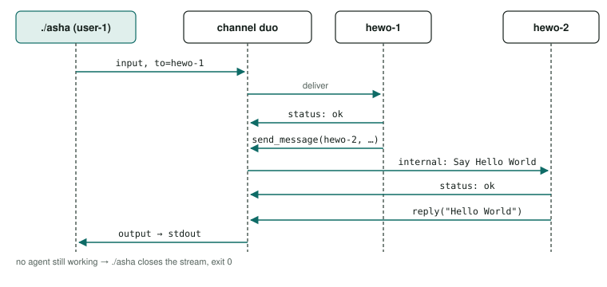

# asha CLI guide

asha runs AI agents in local containers that talk on named channels and use open-weight models on your machine. This guide shows real output: one agent saying hello, then one agent asking another.

captured 2026-09-26 and 2026-09-29verified 2026-09-29Apple M4 Pro · macOS 26.5.2asha 0.1.0 (2026-09-26), 0.1.1 (2026-09-29)model Qwen3-8B Q4_K_Mcolima 0.10.1llama.cpp build 8130

> [!SUMMARY]
> - Build once (`npm install && npm run build`), then run `./asha`; it installs colima, Docker and llama.cpp itself.
> - The first message takes about 78 s (the 5 GB model download); after that, replies take under a second.
> - Use `to=` to address one agent and `--watch` in a second terminal to see agents hand work to each other.
> - asha prints only the reply (stdout); on stderr only `✗` errors, `⚠` warnings and the line naming the user ID your login name was sent as, when it had to be converted ([CLI reference](index.md#streams)); add `--verbose` to see the progress lines these transcripts show. Failures exit non-zero either way.
> - `--interactive` keeps a session open: one message per line, `/watch on` for the whole channel, `/quit` to leave.
> - Every flag in detail: the [CLI reference](index.md). Past corrections: [history](history.md).

## Reading the transcripts {#reading}

The left gutter names each line's source:

| Label | Where the line comes from |
|---|---|
| `asha` | The command you ran. |
| `harness` | The daemon, preparing an agent or reporting. |
| `channel` | The channel itself. |
| `status` | An agent about itself: `Hi` on joining, `ok` when it acts. |
| `input` | A user's message, under that user's ID (your login name, shown here as `you`, or a typed `user=`). |
| `channel` | With `/watch on`: the session's mark before a reply to you, `» reply from <handle>:`. |
| `internal` | One agent to another, not to you. |
| `output` | An agent's reply to you. |
| `npm` | The build tool, at build time only. |

The last line of each is the exit code and time. Output is copied from real runs, except that the scratch home is shown as the default, `~/.simplyautonomous/harness`, and the login name as `you`.

> [!NOTE] Two capture dates
> Most transcripts were recaptured on 2026-09-29 at commit `2358d3d` (clean tree), with the model and image cached: every command and its full output is in `evals/probes/cli-interactive-2026-09-29/guide-capture.log.txt`. asha prints its `›` progress lines only with `--verbose` ([CLI reference](index.md#verbose)), so the transcripts that show them pass it; the same command without it prints only the reply and any `✗` or `⚠` line. One keeps its earlier capture, marked on its bar: the first message on a fresh install (2026-09-26, with the 5 GB model download, which a recapture would repeat); it shows the output of that time — progress by default, and an issued `user-1` where a message without `user=` now carries your login name. The earlier transcript colours some stdout lines as progress; the recaptured ones colour each line by its true stream ([reference](index.md#streams), [correction](history.md)).
>
> *Added 2026-09-29 (model-streaming):* since the models' output streams, `--verbose` also prints each model call's output on stderr as it is generated ([deltas](index.md#deltas)); stdout is unchanged. The `--verbose` transcripts that send a message — the warm and addressed messages, the delegation, the watch, the piped `--interactive --verbose` run and the message after a stop — were recaptured that day at `aa03619` (clean tree): `evals/probes/model-streaming-2026-09-29/guide-capture-aa03619.log.txt`, 24 commands in a fresh home; the rest of that capture matched the earlier one but for times and pids. The team transcripts come from the agent suite's recorded runs, as marked on their bars.

## Install {#install}

From a checkout, you need Homebrew and Node.js `^22.13.0 || ^24.0.0 || >=26.0.0` (`engines.node` in [package.json](../../package.json)). Build once, and again after changing the source; run time never runs npm, and installs colima, the Docker CLI and llama.cpp through Homebrew when first needed.

build time · fresh clone0.9 s

<pre>$ npm install &amp;&amp; npm run build
added 40 packages in 338ms
&gt; simplyautonomous-ai-harness@0.1.0 build
&gt; rm -rf dist &amp;&amp; tsc -p tsconfig.build.json
[exit 0, 0.9 s]</pre>

Before a build, `./asha` says ``asha: not built — run `npm install && npm run build` in … first``. To run it from anywhere:

<pre>$ ln -s "$PWD/asha" /usr/local/bin/asha    # optional; the script follows the link back to the repo</pre>

### Or: run a release {#brew}

A release is the tarball `npm run release` makes of one tagged commit and its build ([Deployments](../deployments/index.md#release)); unpacked, its `./asha` runs as a checkout's does, with no build. No tap for Homebrew is published, so this guide gives no `brew` command (`docs/plans/oss-release.md` R31).

## One agent: hello world {#one-agent}

<ol class="steps">
<li>

### Send the first message

Right after the build, with no daemon, model or image, one command set up everything:

built · empty model cache · no image · no daemon · captured 2026-09-26, before --verbose77.6 s

<pre>$ ./asha recipe=hello-world message="Please say: Hello World."
› started the asha daemon (pid 83942); log: ~/.simplyautonomous/harness/logs/server.log
› container_runtime: ready
› model: qwen3-8b-q4_k_m downloaded
› model_server: qwen3-8b-q4_k_m serving
› image: asha-image-hello-world built
› hewo-1: Hi
› user-1 → main: Please say: Hello World.
› hewo-1: ok
› output hewo-1 → user-1:
Hello World.
[exit 0, 77.6 s]</pre>

Most of the 78 seconds is the 5 GB model download. Today the same lines need `--verbose`: `./asha --verbose recipe=hello-world message="…"` (with the model and image cached, 8.0 s on 2026-09-29, capture (`evals/probes/cli-interactive-2026-09-29/guide-capture.log.txt`)). Line by line:

| Line | What happened |
|---|---|
| `started the asha daemon` | Started in the background. |
| `container_runtime` | colima is running (`ready`: it already was). |
| `model` | Qwen3-8B, Q4_K_M GGUF, 5 GB: downloaded, checked against its pinned sha256, cached. |
| `model_server` | llama-server serves it on the GPU through Metal. |
| `image` | The agent's Docker image was built. |
| `hewo-1: Hi` | Agent `hewo` joined `main` as `hewo-1`. |
| `user-1 → main` | Your message, to everyone; you were `user-1` in this 2026-09-26 capture. Today you are your login name, converted ([CLI reference](index.md#message)). |
| `hewo-1: ok` | Its model chose to act (an agent that doesn't says nothing). |
| `output hewo-1 → user-1` | The reply, to you. |

It returns once no agent is still working and at least one replied.

> [!NOTE] If colima is missing
> The harness handles it without asking:
>
> | Your machine | The harness runs | The line reads |
> |---|---|---|
> | No colima | `brew install colima docker`, then `colima start` | `› container_runtime: installed` |
> | colima installed but stopped | only `colima start` | `started` |
> | No Homebrew | nothing: it stops and tells you to install it from brew.sh | — |
>
> A new colima VM took about 2 minutes 11 seconds (tested the same day), mostly the VM image download.

</li>
<li>

### See what is running

daemon running · captured 2026-09-290.1 s

<pre>$ ./asha --status
running: pid 80580, port 56320, version 0.1.1, build 9d2f31a11eca, started 2026-09-29T02:37:06.945Z
  hewo-1  channel=main recipe=hello-world image=hello-world
[exit 0, 0.1 s]</pre>

Both keep running in the background; `--status` never starts anything ([its output](index.md#status)).

</li>
<li>

### Send it again

Warm, a message goes straight to the channel, as your login name (`you` here), made to fit a user ID ([CLI reference](index.md#message)); only a control-API client that sends no user is issued a `user-<n>`. Without `--verbose`, only the reply (and, when your login name had to be converted, the one line naming the ID it was sent as):

daemon and agent running · recaptured 2026-09-29 at <code>aa03619</code>1.0 s

<pre>$ ./asha --verbose recipe=hello-world message="Please say: Hello World."
› agent: hewo-1 already online on main
› you → main: Please say: Hello World.
› hewo-1 reply: {"text": "Hello World."}
› hewo-1: ok
› output hewo-1 → you:
Hello World.
[exit 0, 0.5 s]
$ ./asha recipe=hello-world message="Please say: Hello World."
Hello World.
[exit 0, 0.5 s]</pre>

`user=` speaks as someone else, `to=` addresses one agent, and `recipe=` is not needed once the agent is online:

user= typed · recaptured 2026-09-29 at <code>aa03619</code>0.6 s

<pre>$ ./asha --verbose user=alice to=hewo-1 message="Please say: Hello World."
› alice → hewo-1 on main: Please say: Hello World.
› hewo-1 reply: {"text": "Hello World."}
› hewo-1: ok
› output hewo-1 → alice:
Hello World.
[exit 0, 0.6 s]</pre>

</li>
</ol>

## Two agents: one asks the other {#two-agents}

On its own channel, `duo`, apart from `main`.

<ol class="steps">
<li>

### Start two agents

`--launch` always starts a new agent and prints its handle; the second is `hewo-2`.

launches · captured 2026-09-292.7 s

<pre>$ ./asha --launch recipe=hello-world channel=duo
hewo-1
[exit 0, 1.4 s]
$ ./asha --launch recipe=hello-world channel=duo
hewo-2
[exit 0, 1.3 s]</pre>

</li>
<li>

### Ask hewo-1 to have hewo-2 say it

both agents running · recaptured 2026-09-29 at <code>aa03619</code>5.8 s

<pre>$ ./asha --verbose to=hewo-1 channel=duo message="Please ask hewo-2 to say Hello World."
› you → hewo-1 on duo: Please ask hewo-2 to say Hello World.
› hewo-1 send_message: {"to": "hewo-2", "text": "Say: Hello World"}
› hewo-1: ok
› internal hewo-1 → hewo-2: Say: Hello World
› hewo-2 reply: {"text": "Hello World"}
› hewo-2: ok
› output hewo-2 → you:
Hello World
[exit 0, 5.8 s]</pre>

1. Your message went to `hewo-1` alone, as you (your login name).
2. `hewo-1`'s model chose `send_message` — the `›` line with the tool's name is its output as it was generated ([deltas](index.md#deltas)) — then it said `ok` and posted the `internal` "Say: Hello World" to `hewo-2`.
3. `hewo-2`'s model answered with `reply`, and the reply reached you; with no agent still working, the command returned.

Both run the same image and recipe, and must answer every message with one of four tools:

- `reply(text)`: the only way words reach you.
- `send_message(to, text)`, `to` being `all-agents` or a handle; not given to an agent alone on its channel.
- `list_agents()`: who is online and what each does, from recipe descriptions. Ask for "the agent that translates" and it calls `list_agents` first.
- `pass(reason)`: no action.

</li>
<li>

### Watch it happen

In a second terminal, `--watch` shows every message, including the `internal` hand-off:

second terminal · stopped after the reply · recaptured 2026-09-29 at <code>aa03619</code>6.6 s

<pre>$ ./asha --watch --verbose channel=duo
› watching channel "duo" (agents: hewo-1, hewo-2); Ctrl-C to stop
14:59:42Z [84cb678e] input you → hewo-1: Please ask hewo-2 to say Hello World.
› hewo-1 send_message: {"to": "hewo-2", "text": "Say: Hello World"}
14:59:43Z [84cb678e] status hewo-1: ok
14:59:43Z [84cb678e] internal hewo-1 → hewo-2: Say: Hello World
› hewo-2 reply: {"text": "Hello World"}
14:59:44Z [84cb678e] status hewo-2: ok
14:59:44Z [84cb678e] output hewo-2 → you: Hello World
[exit 0, 6.6 s]</pre>

The two `›` lines on stderr are the models' output as it was generated, which `--verbose` adds; stdout is the same without it. (The capture stopped the watch with SIGTERM from a script, where a background job ignores Ctrl-C, and recorded stdout and stderr apart; each `›` line is placed here beside the message its call produced, not in a recorded order.)

Each line: UTC time, the conversation's first 8 id characters, the kind (`input`, `internal`, `output`, `status`), sender → recipient (`all agents` is everyone; `formatWatchEvent` in [src/cli/commands.ts](../../src/cli/commands.ts)), and the text.

</li>
<li>

### Everything that is running

captured 2026-09-290.1 s

<pre>$ ./asha --status
running: pid 80580, port 56320, version 0.1.1, build 9d2f31a11eca, started 2026-09-29T02:37:06.945Z
  hewo-1  channel=duo recipe=hello-world image=hello-world
  hewo-2  channel=duo recipe=hello-world image=hello-world
  hewo-1  channel=main recipe=hello-world image=hello-world
[exit 0, 0.1 s]</pre>

Handles are numbered per channel, so `main` and `duo` each have a `hewo-1`.

</li>
</ol>

| Situation | Measured |
|---|---|
| Built, empty model cache, no image (colima already running) | 77.6 s |
| Daemon stopped, model and image cached | 4.1 s |
| Launching an agent, daemon running | 1.0 s |
| Two-agent delegation, both agents running | 3.4 s |
| One agent, daemon and agent running | 0.7–0.8 s |

Measured on 2026-09-26; the 2026-09-29 capture's own times are on each bar above (one agent warm 0.5–0.7 s, the delegation 1.6–6.0 s, a restart with model and image cached 6.4 s).

## A team: launched together {#team}

A team folder, `teams/<team>/`, holds a `team.json` and each member's recipe and guidance; one command starts every member on one channel, each under its team name ([team](../architecture/recipes.md#team)). The delegation demo's team is a lead and a greeter ([P1](../patterns/p01-delegation.md)):

captured 2026-09-29 by the agent suite at <code>7706e6a</code>, the daemon's log path elided4.5 s

<pre>$ ./asha --verbose --launch team=delegation
› started the asha daemon (pid 71630); log: …/logs/server.log
› member lead (recipe lead)
› container_runtime: ready
› model: qwen3-8b-q4_k_m cached
› model_server: qwen3-8b-q4_k_m serving
› image: asha-image-hello-world current
› lead-1: Hi
› member greeter (recipe greeter)
› container_runtime: ready
› model: qwen3-8b-q4_k_m cached
› model_server: qwen3-8b-q4_k_m serving
› image: asha-image-hello-world current
› greeter-1: Hi
lead-1
greeter-1
[exit 0, 4.5 s]</pre>

Then a message to the lead, which hands the task to the greeter, as its guidance says:

captured 2026-09-29 by the agent suite at <code>95dd8af</code>9.3 s

<pre>$ ./asha --verbose to=lead-1 user=alice message="Please ask greeter-1 to say Hello World."
› alice → lead-1 on main: Please ask greeter-1 to say Hello World.
› lead-1 send_message: {"to": "greeter-1", "text": "Say: Hello World"}
› lead-1: ok
› internal lead-1 → greeter-1: Say: Hello World
› greeter-1 reply: {"text": "Hello World"}
› greeter-1: ok
› output greeter-1 → alice:
Hello World
[exit 0, 9.3 s]</pre>

A broken team starts nothing: every member is checked first, and the error names the member and the reason ([`--launch`](index.md#launch)). Every built pattern demo is a team you can launch the same way (the [catalogue](../patterns/index.md#catalogue) lists them).

**Ten agents: the rainbow.** `teams/rainbow/` is a supervisor and nine members, each knowing one number and the colour it stands for (`docs/plans/collaborating-agents.md`). After `./asha --launch team=rainbow`, one question to the supervisor fans out as one call to the nine, whose answers come back to it together in one gather; it then answers the user itself, leaving out pink and brown:

captured 2026-09-29 by the agent suite at <code>95dd8af</code>, shortened where marked …37.9 s

<pre>$ ./asha --verbose to=supervisor-1 user=alice message="Which sequence of the numbers lists their colours in rainbow order?"
› alice → supervisor-1 on main: Which sequence of the numbers lists their colours in rainbow order?
› supervisor-1 consult: {"requests": [{"to": "fact-blue-1", "text": "What number and colour do you know?"}, … the same for the other eight]}
› supervisor-1: ok
› internal supervisor-1 → fact-blue-1: What number and colour do you know?
› internal supervisor-1 → fact-brown-1: What number and colour do you know?
  … the same question to fact-green-1, fact-indigo-1, fact-orange-1, fact-pink-1, fact-red-1, fact-violet-1 and fact-yellow-1
› fact-brown-1 reply: {
› fact-green-1 reply: {
  … the members' replies stream at once, so each fragment opens its own line (D38)
› internal fact-brown-1 → supervisor-1: The number 8 stands for the colour brown.
› internal fact-green-1 → supervisor-1: The number 9 stands for the colour green.
  … seven more answers, as each member's model call finishes
› internal asha → supervisor-1: Answers to supervisor-1's call: 9 answered.
› supervisor-1 reply: {"text": "The sequence of numbers that lists their colours in rainbow order is: red (4), orange (7), yellow (1), green (9), blue (3), indigo (6), violet (2)."}
› supervisor-1: ok
› output supervisor-1 → alice:
The sequence of numbers that lists their colours in rainbow order is: red (4), orange (7), yellow (1), green (9), blue (3), indigo (6), violet (2).
[exit 0, 37.9 s]</pre>

Each `…` stands for text elided here — whole lines, and inside the `consult` line the other eight requests; the full transcript of every recorded run is in the [agent test report](../testing/agent-tests.html).

## Just the answer {#quiet}

A command prints only the reply on stdout (with `--launch`, only the handle), so `reply=$(./asha …)` captures just the answer; the few lines on stderr (`✗`, `⚠`, and the login-name line) never mix into it. A failure still prints its `✗` line and exits non-zero. (Until 2026-09-28 this took `--quiet`, which is now refused, exit `2`: [CLI reference](index.md#verbose).)

hewo-1 already online · captured 2026-09-291.3 s

<pre>$ ./asha message="Please say: Hello World."
Hello World.
[exit 0, 0.7 s]
$ reply=$(./asha message="Please say: Hello World."); echo "hewo-1 said: $reply"
hewo-1 said: Hello World.
[exit 0, 0.6 s]</pre>

## Interactive: a session {#interactive}

`--interactive` reads one message per line until `/quit` or Ctrl-D, and prints each reply as it comes; `/watch on` shows the whole channel instead, `/watch off` only your replies again. Without `user=` it speaks as your login name, as a single message does ([CLI reference](index.md#interactive)). The prompt `asha> ` appears only at a terminal; piped, the session prints the replies on stdout, and on stderr only `✗` and `⚠` lines, `watching the channel` or `replies only` for those commands, unknown commands, and the line naming the user ID your login name was sent as, when it had to be converted. A command it does not know is reported and counted as a failure:

piped input · captured 2026-09-29 at <code>2358d3d</code>; the <code>--verbose</code> run recaptured at <code>aa03619</code>1.6 s

<pre>$ printf 'Please say: Hello World.\n/watch on\nPlease say: Hello World.\n/quit\n' | ./asha --interactive recipe=hello-world
watching the channel
Hello World.
02:37:28Z [87e0e7eb] input you → all agents: Please say: Hello World.
02:37:28Z [87e0e7eb] status hewo-1: ok
» reply from hewo-1:
02:37:28Z [87e0e7eb] output hewo-1 → you: Hello World.
[exit 0, 1.0 s]
$ printf 'Please say: Hello World.\n' | ./asha --interactive --verbose recipe=hello-world
› agent: hewo-1 already online on main
› you → main: Please say: Hello World.
› hewo-1 reply: {"text": "Hello World."}
› hewo-1: ok
› output hewo-1 → you:
Hello World.
[exit 0, 0.5 s]
$ printf '/help\n' | ./asha --interactive
unknown command /help; type /quit to leave
[exit 1, 0.1 s]</pre>

The first reply is printed as in a single command; after `/watch on`, stdout is the channel view, with the mark before the reply to you. With `--verbose`, each message's progress is printed as for a single command.

## Stopping and restarting {#stop}

stops the daemon, its agents and its model server · captured 2026-09-291.4 s

<pre>$ ./asha --stop
stopped (pid 80580)
[exit 0, 1.3 s]
$ ./asha --status
not running
[exit 1, 0.1 s]</pre>

`--stop` returns once the daemon has removed every agent container and stopped llama-server; colima keeps running. The model and image stay cached, so the next message restarts in seconds.

You need not stop it yourself (since 2026-10-15, [its lifetime](../architecture/index.md#lifetime)): a daemon a command started for you stops itself after 30 minutes with no agent and nothing open — an open `--watch` or portal tab keeps it — and a model nobody has used for 15 minutes is unloaded, freeing its memory, and loaded again by the next message that needs it. To keep a daemon however idle, start it yourself with `./asha --server`; `ASHA_IDLE_EXIT_MS` and `ASHA_MODEL_IDLE_MS` change the two bounds ([environment](index.md#env)). A daemon that dies takes its llama-servers with it. Your login name is the same after a restart, so agents that remember users by ID know you again; issued `user-<n>` IDs (control-API clients only) are never reused, even after a restart.

daemon restarted · model and image cached · recaptured 2026-09-29 at <code>aa03619</code>6.3 s

<pre>$ ./asha --verbose recipe=hello-world message="Please say: Hello World."
› started the asha daemon (pid 86245); log: ~/.simplyautonomous/harness/logs/server.log
› container_runtime: ready
› model: qwen3-8b-q4_k_m cached
› model_server: qwen3-8b-q4_k_m serving
› image: asha-image-hello-world current
› hewo-1: Hi
› you → main: Please say: Hello World.
› hewo-1 reply: {"text": "Hello World."}
› hewo-1: ok
› output hewo-1 → you:
Hello World.
[exit 0, 6.3 s]</pre>

## When something goes wrong {#errors}

typed errors · exit codes · captured 2026-09-290.4 s

<pre>$ ./asha to=hewo-9 message=hi
✗ unknown_handle: no agent "hewo-9" on channel "main"
[exit 1, 0.1 s]
$ ./asha recipe=nope message=hi
✗ unknown_recipe: no recipe named "nope" (no recipes/nope.json)
[exit 1, 0.1 s]
$ ./asha recipe=hello-world
missing message=
   … usage follows …
[exit 2, 0.1 s]
$ ./asha --quiet message=hi
--quiet is gone: asha is quiet by default; add --verbose for progress
   … usage follows …
[exit 2, 0.1 s]</pre>

Exit `0` is success, `1` a failure (including running before a build), `2` a malformed command line. A failure line is `✗`, a reason from a fixed set, and details. Every failure the daemon has seen:

<pre>$ jq -c 'select(.level=="error")' ~/.simplyautonomous/harness/logs/daemon.jsonl</pre>

## Reference {#reference}

Every command and option (`./asha message=<text>` with `user=<id>` (a name such as `alice`, or an issued `user-<n>`; without it, your login name), `recipe=<r>`, `channel=<c>`, `to=<handle>`; `./asha --launch recipe=<r> [channel=<c>]`, `./asha --watch [channel=<c>]`, `./asha --interactive [user=<id>] [recipe=<r>] [channel=<c>] [to=<handle>]`, `./asha --status`, `./asha --stop`, `./asha --server`, `./asha --help`, `--verbose`) is in the [CLI reference](index.md). `ASHA_HOME` (default `~/.simplyautonomous/harness`) and `ASHA_MODELS_DIR` (default `$ASHA_HOME/models`) are under [environment](index.md#env); the files under the home (`daemon.json`, mode `0600`, which holds the daemon's pid, port and the control credential the CLI sends; `model-server.key`, mode `0600`, the key llama-server requires; `users.json`, `logs/daemon.jsonl`, `logs/server.log`, `logs/agents/<container>.log`, `logs/model-server-<model>.log`, `models/sha256-…/`) under [Deployments](../deployments/index.md#state).

Everything runs on your desktop: the daemon listens only on 127.0.0.1 and models run on your GPU. Inside: [Architecture](../architecture/index.md); model pins: [Models](../architecture/models.md).
