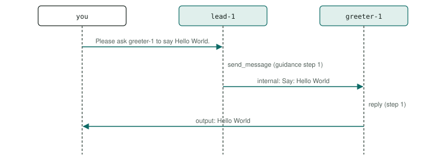

# P1 · Delegation (hand-off)

A lead hands a task to the agent that does it, and that agent answers the user itself. The simplest way for agents to divide work: nothing comes back to the lead.

<div class="facts"><span>written 2026-09-29</span><span>status: <span class="badge built">built</span> 2026-09-29, three recorded runs and one under its bound, all green</span><span>team: <a href="../../teams/delegation/team.json"><code>teams/delegation/</code></a></span><span>test: <a href="../../tests/agents/p01-delegation.test.ts"><code>tests/agents/p01-delegation.test.ts</code></a></span><span>plan: <code>docs/plans/patterns-phase-1.md</code>, its runs</span></div>

> [!SUMMARY]
> - Scenarios: `p01-a`, as `docs/plans/orchestration-patterns.md` specifies them.
> - Built: its three recorded runs with every member on `qwen3-8b-q4_k_m` passed, then one under the bound they set (runs (`docs/plans/patterns-phase-1.md`)); moved 2026-10-10 by `docs/plans/demo-model-pico.md` R3, with its routers on `qwen3-8b-q4_k_m` and its sub-agents on `pico-v2-q8_0`: three recorded runs passed at `6eed097` with the move, then one under the bound they set at `8dd3a26` (runs (`evals/probes/demo-model-pico-runs-2026-10-09/README.md`)); its checker's every claim is also unit-tested on fixtures.
> - Models: `lead` on `qwen3-8b-q4_k_m`; `greeter` on `pico-v2-q8_0`.

## Watch it run {#watch}

<video controls preload="metadata" src="videos/p01-delegation.webm"></video>

Recorded at `fb3d995` on 2026-10-16, its team on `pico-v2-q8_0` and `qwen3-8b-q4_k_m` ([sidecar](videos/p01-delegation.json)): the portal's scene and chat as the demo's agent-suite run went, 21 s, every scenario passed. How it is recorded: [Testing](../testing/index.md#videos).

## What it is for {#use}

**Use it** when the agent the user writes to knows which agent should do the work, and the user wants the answer, not the lead's opinion of it: a front desk that forwards requests.

**Do not use it** when the lead must see or combine the result — then the lead consults the other agent and answers itself ([agent as tool, P18](index.md#catalogue)), or asks several at once (fan-out, P4). A hand-off cannot report back.

## How the messages flow {#flow}



## Run it {#run}

Launch the team, then send a scenario's message: exactly the commands below, which the demo's agent-suite file reads from this page and runs. The `# bound` line is the most a request may take (`docs/plans/orchestration-patterns.md` R8): 16,000 ms since 2026-10-10, set from its three recorded runs with its sub-agents on `pico-v2-q8_0` (`docs/plans/demo-model-pico.md` R3) — the largest request, p01-a's 10,054 ms in run 3 at `6eed097` with the move, times 1.5 (15,081), rounded up to a whole second; the cap is 45,000 ms. *Before, with every member on `qwen3-8b-q4_k_m`:* 20,000 ms, set from its first three recorded runs (`docs/plans/patterns-phase-1.md` R4) — the largest request, p01-a's 12,866 ms at `fb55f7e`, times 1.5, rounded up to a whole second; the cap is 45,000 ms.

```asha-run
./asha --launch team=delegation
# bound: 16000 ms
# p01-a
./asha to=lead-1 user=alice message="Please ask greeter-1 to say Hello World."
```

## A real transcript {#transcript}

Recorded at `8dd3a26` (clean tree), `docs/plans/demo-model-pico.md`'s fourth run (R3 (d)), with its sub-agents on `pico-v2-q8_0`, from its results file `evals/probes/demo-model-pico-runs-2026-10-09/run-4/results/p01-delegation.json`: each scenario's command as the suite ran it (it adds `--verbose`, which prints the `›` progress lines), its stderr, then its stdout. The models' tool calls as they stream — lines such as `› <handle> <tool>: …`, one fragment each (D38) — are left out here; the results file holds them. The transcript before, with every member on `qwen3-8b-q4_k_m`, is in this page's history (`git show 8dd3a26:docs/patterns/p01-delegation.md`).

**p01-a** — exit 0, 9,204 ms:

```text
$ ./asha --verbose to=lead-1 user=alice message="Please ask greeter-1 to say Hello World."
› alice → lead-1 on main: Please ask greeter-1 to say Hello World.
› lead-1: ok
› internal lead-1 → greeter-1: Say: Hello World
› greeter-1: ok
› output greeter-1 → alice:
Hello World
```

## The team and the test {#team}

- [`teams/delegation/team.json`](../../teams/delegation/team.json): the team — `lead`, `greeter`, launched in that order, each joining as `<name>-1`.
- `lead`: [`lead.json`](../../teams/delegation/lead.json), its recipe, and [`lead.md`](../../teams/delegation/lead.md), its guidance, a full-text document in its system prompt.
- `greeter`: [`greeter.json`](../../teams/delegation/greeter.json), its recipe, and [`greeter.md`](../../teams/delegation/greeter.md), its guidance, a full-text document in its system prompt.
- [`tests/agents/p01-delegation.test.ts`](../../tests/agents/p01-delegation.test.ts): launches the team and sends each scenario's message from this page, then asserts each scenario only through its checker, `P01_…` in [`tests/agents/patterns/phase-1.ts`](../../tests/agents/patterns/phase-1.ts), and records the checker's proof for the report.
- The checker's fixtures, one passing conversation and one per mutation the plan lists: [`tests/agents/patterns/fixtures/`](../../tests/agents/patterns/fixtures/p01-a/pass.json), run by [`tests/unit/pattern-proofs.test.ts`](../../tests/unit/pattern-proofs.test.ts) in `npm test`.

## Limits on a local model {#limits}

- With its routers on `qwen3-8b-q4_k_m` and its sub-agents on `pico-v2-q8_0` (demo-model-pico, 2026-10-10): its largest request took 10,054 ms in the three recorded runs and 9,204 ms in the fourth, under its bound of 16,000 ms. The limits after it were measured with every member on `qwen3-8b-q4_k_m`, before the move; one about a sub-agent was not measured again on `pico-v2-q8_0`.
- The lead must write the task as an instruction ("Say: Hello World"), not just the words: the channel instructions and its guidance both say so, and the shared-recipe scenario `delegation` ([`tests/agents/multi-agent.test.ts`](../../tests/agents/multi-agent.test.ts)) passes that way on `qwen3-8b-q4_k_m` (at `988045f`, 6,518 ms).
- `qwen3-8b-q4_k_m` sometimes hands off a request whose result the user wanted back from the lead (D30); this demo asks for a hand-off, so that limit does not apply here.
- Measured (2026-09-29, runs (`docs/plans/patterns-phase-1.md`)): passed its first run at `90c3eec` with no change to its guidance; p01-a took 9.3 s in three of four runs and 12.9 s in one, the spread that sets its bound at 20 s.
- greeter-1's guidance does not decide its words: told to say "Goodbye", it still said Hello World (a guard proof, `proofs/` (`evals/probes/patterns-phase-1-2026-09-29/README.md`)); the proof checks what it said, not why.

## Its report {#report}

Each run's proof — every claim with the transcript line or log record that shows it — and every repeat's time: [agent test report, P1 · Delegation (hand-off)](../testing/agent-tests.html#pattern-p01).
