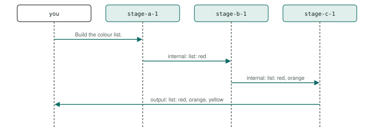

# P3 · Sequential pipeline

Each stage does its part and hands the result to the next; the last stage replies. Here three stages each add one colour to a list only they know.

<div class="facts"><span>written 2026-09-29</span><span>status: <span class="badge built">built</span> 2026-09-29, three recorded runs and one under its bound, all green</span><span>team: <a href="../../teams/pipeline/team.json"><code>teams/pipeline/</code></a></span><span>test: <a href="../../tests/agents/p03-pipeline.test.ts"><code>tests/agents/p03-pipeline.test.ts</code></a></span><span>plan: <code>docs/plans/patterns-phase-1.md</code>, its runs</span></div>

> [!SUMMARY]
> - Scenarios: `p03-a`, as `docs/plans/orchestration-patterns.md` specifies them.
> - Built: its three recorded runs with every member on `qwen3-8b-q4_k_m` passed, then one under the bound they set (runs (`docs/plans/patterns-phase-1.md`)); moved 2026-10-10 by `docs/plans/demo-model-pico.md` R3, with every member on `pico-v2-q8_0` (it has no router): three recorded runs passed at `6eed097` with the move, then one under the bound they set at `8dd3a26` (runs (`evals/probes/demo-model-pico-runs-2026-10-09/README.md`)); its checker's every claim is also unit-tested on fixtures.
> - Models: `stage-a`, `stage-b`, `stage-c` on `pico-v2-q8_0`.

## Watch it run {#watch}

<video controls preload="metadata" src="videos/p03-pipeline.webm"></video>

Recorded at `fb3d995` on 2026-10-16, its team on `pico-v2-q8_0` ([sidecar](videos/p03-pipeline.json)): the portal's scene and chat as the demo's agent-suite run went, 25 s, every scenario passed. How it is recorded: [Testing](../testing/index.md#videos).

## What it is for {#use}

**Use it** when work has fixed steps in a fixed order, each owned by one agent: extract, then check, then format.

**Do not use it** when the steps' order depends on the work (plan-and-execute, P6) or when the steps are independent (fan-out, P4). A pipeline is as slow as the sum of its stages: here three model turns in a row.

## How the messages flow {#flow}



## Run it {#run}

Launch the team, then send a scenario's message: exactly the commands below, which the demo's agent-suite file reads from this page and runs. The `# bound` line is the most a request may take (`docs/plans/orchestration-patterns.md` R8): 24,000 ms since 2026-10-10, set from its three recorded runs with its sub-agents on `pico-v2-q8_0` (`docs/plans/demo-model-pico.md` R3) — the largest request, p03-a's 15,769 ms in run 3 at `6eed097` with the move, times 1.5 (23,653.5), rounded up to a whole second; the cap is 45,000 ms. *Before, with every member on `qwen3-8b-q4_k_m`:* 24,000 ms, set from its first three recorded runs (`docs/plans/patterns-phase-1.md` R4) — the largest request, p03-a's 15,643 ms at `fb55f7e`, times 1.5, rounded up to a whole second; the cap is 45,000 ms.

```asha-run
./asha --launch team=pipeline
# bound: 24000 ms
# p03-a
./asha to=stage-a-1 user=alice message="Build the colour list."
```

## A real transcript {#transcript}

Recorded at `8dd3a26` (clean tree), `docs/plans/demo-model-pico.md`'s fourth run (R3 (d)), with its sub-agents on `pico-v2-q8_0`, from its results file `evals/probes/demo-model-pico-runs-2026-10-09/run-4/results/p03-pipeline.json`: each scenario's command as the suite ran it (it adds `--verbose`, which prints the `›` progress lines), its stderr, then its stdout. The models' tool calls as they stream — lines such as `› <handle> <tool>: …`, one fragment each (D38) — are left out here; the results file holds them. The transcript before, with every member on `qwen3-8b-q4_k_m`, is in this page's history (`git show 8dd3a26:docs/patterns/p03-pipeline.md`).

**p03-a** — exit 0, 14,292 ms:

```text
$ ./asha --verbose to=stage-a-1 user=alice message="Build the colour list."
› alice → stage-a-1 on main: Build the colour list.
› stage-a-1: ok
› internal stage-a-1 → stage-b-1: list: red
› stage-b-1: ok
› internal stage-b-1 → stage-c-1: list: red, orange
› stage-c-1: ok
› output stage-c-1 → alice:
list: red, orange, yellow
```

## The team and the test {#team}

- [`teams/pipeline/team.json`](../../teams/pipeline/team.json): the team — `stage-a`, `stage-b`, `stage-c`, launched in that order, each joining as `<name>-1`.
- `stage-a`: [`stage-a.json`](../../teams/pipeline/stage-a.json), its recipe, and [`stage-a.md`](../../teams/pipeline/stage-a.md), its guidance, a full-text document in its system prompt.
- `stage-b`: [`stage-b.json`](../../teams/pipeline/stage-b.json), its recipe, and [`stage-b.md`](../../teams/pipeline/stage-b.md), its guidance, a full-text document in its system prompt.
- `stage-c`: [`stage-c.json`](../../teams/pipeline/stage-c.json), its recipe, and [`stage-c.md`](../../teams/pipeline/stage-c.md), its guidance, a full-text document in its system prompt.
- [`tests/agents/p03-pipeline.test.ts`](../../tests/agents/p03-pipeline.test.ts): launches the team and sends each scenario's message from this page, then asserts each scenario only through its checker, `P03_…` in [`tests/agents/patterns/phase-1.ts`](../../tests/agents/patterns/phase-1.ts), and records the checker's proof for the report.
- The checker's fixtures, one passing conversation and one per mutation the plan lists: [`tests/agents/patterns/fixtures/`](../../tests/agents/patterns/fixtures/p03-a/pass.json), run by [`tests/unit/pattern-proofs.test.ts`](../../tests/unit/pattern-proofs.test.ts) in `npm test`.

## Limits on a local model {#limits}

- With every member on `pico-v2-q8_0` (it has no router) (demo-model-pico, 2026-10-10): its largest request took 15,769 ms in the three recorded runs and 14,292 ms in the fourth, under its bound of 24,000 ms. The limits after it were measured with every member on `qwen3-8b-q4_k_m`, before the move; one about a sub-agent was not measured again on `pico-v2-q8_0`.
- Two of the three stages must forward instead of replying, which the general channel instructions — "every result … goes through reply" — say otherwise; the guidance says to forward, and the line before every recipe's guidance says the guidance wins (`docs/plans/patterns-phase-1.md` R7).
- Each colour is in one stage's guidance only, and the proof checks it. That shows the list passed through each stage in order (the transcript), not that a stage could not guess a colour: red, orange, yellow is the rainbow's own start, so the facts are not synthetic (orchestration-patterns' convention); the claims that each internal message carries exactly the colours so far are what show each stage added its own.
- Measured (2026-09-29, runs (`docs/plans/patterns-phase-1.md`)): passed its first run at `90c3eec` with no change to its guidance; three model turns in series take 14–16 s, the longest of the five, so its bound is 24 s.

## Its report {#report}

Each run's proof — every claim with the transcript line or log record that shows it — and every repeat's time: [agent test report, P3 · Sequential pipeline](../testing/agent-tests.html#pattern-p03).
