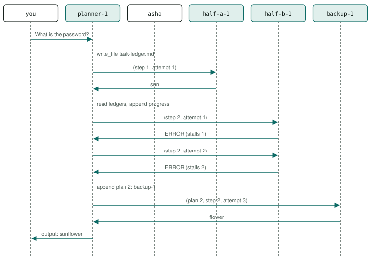

# P6 · Plan-and-execute with simulated failure, re-plan, task and progress ledgers

A planner writes a task ledger, runs each step through the agent that does it, records every attempt in a progress ledger with a stall count, and re-plans a step that keeps failing.

<div class="facts"><span>written 2026-09-29</span><span>status: <span class="badge built">built</span> 2026-09-29, three recorded runs and one under its bound, after R6's remedies, all green; listed once the <a href="../testing/index.md#selection">demo selector</a> was built</span><span>team: <a href="../../teams/plan-execute/team.json"><code>teams/plan-execute/</code></a></span><span>test: <a href="../../tests/agents/p06-plan-execute.test.ts"><code>tests/agents/p06-plan-execute.test.ts</code></a></span><span>plan: <code>docs/plans/patterns-phase-2.md</code></span></div>

> [!SUMMARY]
> - Scenarios: `p06-a`, as `docs/plans/orchestration-patterns.md` specifies them.
> - Built: its three recorded runs with every member on `qwen3-8b-q4_k_m` passed after R6's remedies, then one under the bound they set, at `3e2b8cd` (runs (`docs/plans/patterns-phase-2.md`)); moved 2026-10-10 by `docs/plans/demo-model-pico.md` R3, with its routers on `qwen3-8b-q4_k_m` and its sub-agents on `pico-v2-q8_0`: three recorded runs passed at `6eed097` with the move, then one under the bound they set at `8dd3a26` (runs (`evals/probes/demo-model-pico-runs-2026-10-09/README.md`)); it joined the built demos once the demo selector existed (patterns-phase-2 R13), and its checker's every claim is also unit-tested on fixtures.
> - Models: `planner` on `qwen3-8b-q4_k_m`; `half-a`, `half-b`, `backup` on `pico-v2-q8_0`.
> - The ledgers are files in the planner's own `/workspace`, written with the file tools; the test reads them from the container after the request. The re-plan threshold is one stall (S = 1, within Magentic-One's ≤ 2).
> - `half-b` fails by design on every attempt (its guidance answers `ERROR: unavailable`): a fault that does not depend on the model (orchestration-patterns R9).

## Watch it run {#watch}

<video controls preload="metadata" src="videos/p06-plan-execute.webm"></video>

Recorded at `fb3d995` on 2026-10-16, its team on `pico-v2-q8_0` and `qwen3-8b-q4_k_m` ([sidecar](videos/p06-plan-execute.json)): the portal's scene and chat as the demo's agent-suite run went, 48 s, every scenario passed. In half-b, `ERROR: unavailable` is its simulated failure. How it is recorded: [Testing](../testing/index.md#videos).

## What it is for {#use}

**Use it** when a task has several steps whose progress must survive between turns, and a step that stalls should change the plan rather than be retried for ever.

**Do not use it** for a single step, or when the steps need no memory between turns (a pipeline, P3).

## How the messages flow {#flow}



## Run it {#run}

Launch the team, then send a scenario's message: exactly the commands below, which the demo's agent-suite file reads from this page and runs. The `# bound` line is the most a request may take (`docs/plans/orchestration-patterns.md` R8): 45,000 ms since 2026-10-10, set from its three recorded runs with its sub-agents on `pico-v2-q8_0` (`docs/plans/demo-model-pico.md` R3) — the largest request, p06-a's 38,506 ms in run 2 at `6eed097` with the move, times 1.5 (57,759, over the cap, so the cap); the cap is 45,000 ms. *Before, with every member on `qwen3-8b-q4_k_m`:* 45,000 ms, set from its first three recorded runs (`docs/plans/patterns-phase-2.md` R4) — the largest request, p06-a's 36,091 ms at `1978c01`, times 1.5 (54,137, over the cap, so the cap), rounded up to a whole second; the cap is 45,000 ms.

```asha-run
./asha --launch team=plan-execute
# bound: 45000 ms
# p06-a
./asha to=planner-1 user=alice message="What is the password?"
```

## A real transcript {#transcript}

Recorded at `8dd3a26` (clean tree), `docs/plans/demo-model-pico.md`'s fourth run (R3 (d)), with its sub-agents on `pico-v2-q8_0`, from its results file `evals/probes/demo-model-pico-runs-2026-10-09/run-4/results/p06-plan-execute.json`: each scenario's command as the suite ran it (it adds `--verbose`, which prints the `›` progress lines), its stderr, then its stdout. The models' tool calls as they stream — lines such as `› <handle> <tool>: …`, one fragment each (D38) — are left out here; the results file holds them. The transcript before, with every member on `qwen3-8b-q4_k_m`, is in this page's history (`git show 8dd3a26:docs/patterns/p06-plan-execute.md`).

**p06-a** — exit 0, 34,643 ms:

```text
$ ./asha --verbose to=planner-1 user=alice message="What is the password?"
› alice → planner-1 on main: What is the password?
› planner-1: ok
› internal planner-1 → half-a-1: What is your half of the password? (step 1, attempt 1)
› internal half-a-1 → planner-1: sun
› internal asha → planner-1: Answers to planner-1's call: 1 answered.
› planner-1: ok
› internal planner-1 → half-b-1: What is your half of the password? (step 2, attempt 1)
› internal half-b-1 → planner-1: ERROR: unavailable
› internal asha → planner-1: Answers to planner-1's call: 1 answered.
› planner-1: ok
› internal planner-1 → half-b-1: What is your half of the password? (step 2, attempt 2)
› internal half-b-1 → planner-1: ERROR: unavailable
› internal asha → planner-1: Answers to planner-1's call: 1 answered.
› planner-1: ok
› internal planner-1 → backup-1: What is your half of the password? (plan 2, step 2, attempt 3)
› internal backup-1 → planner-1: flower
› internal asha → planner-1: Answers to planner-1's call: 1 answered.
› planner-1: ok
› output planner-1 → alice:
sunflower
```

## The team and the test {#team}

- [`teams/plan-execute/team.json`](../../teams/plan-execute/team.json): the team — `planner`, `half-a`, `half-b`, `backup`, launched in that order, each joining as `<name>-1`.
- `planner`: [`planner.json`](../../teams/plan-execute/planner.json), its recipe, and [`planner.md`](../../teams/plan-execute/planner.md), its guidance, a full-text document in its system prompt.
- `half-a`: [`half-a.json`](../../teams/plan-execute/half-a.json), its recipe, and [`half-a.md`](../../teams/plan-execute/half-a.md), its guidance, a full-text document in its system prompt.
- `half-b`: [`half-b.json`](../../teams/plan-execute/half-b.json), its recipe, and [`half-b.md`](../../teams/plan-execute/half-b.md), its guidance, a full-text document in its system prompt.
- `backup`: [`backup.json`](../../teams/plan-execute/backup.json), its recipe, and [`backup.md`](../../teams/plan-execute/backup.md), its guidance, a full-text document in its system prompt.
- [`tests/agents/p06-plan-execute.test.ts`](../../tests/agents/p06-plan-execute.test.ts): launches the team and sends each scenario's message from this page, then asserts each scenario only through its checker, `P06_A` in [`tests/agents/patterns/phase-2.ts`](../../tests/agents/patterns/phase-2.ts), and records the checker's proof for the report.
- The checker's fixtures, one passing conversation, one per mutation the plan lists and one breaking every other claim: [`tests/agents/patterns/fixtures/p06-a/`](../../tests/agents/patterns/fixtures/p06-a/pass.json), run by [`tests/unit/pattern-proofs.test.ts`](../../tests/unit/pattern-proofs.test.ts) in `npm test`.

## Limits on a local model {#limits}

- With its routers on `qwen3-8b-q4_k_m` and its sub-agents on `pico-v2-q8_0` (demo-model-pico, 2026-10-10): its largest request took 38,506 ms in the three recorded runs and 34,643 ms in the fourth, under its bound of 45,000 ms. The limits after it were measured with every member on `qwen3-8b-q4_k_m`, before the move; one about a sub-agent was not measured again on `pico-v2-q8_0`.
- The slowest phase-2 demo: measured in the premise probes (2026-09-29, `0be190f`), its chain of model turns took 39.1 s with cold prompts and 21.0 s warm, the nearest to the 45,000 ms cap (`docs/plans/patterns-phase-2.md`).
- Each gather shows only the latest call, so each question carries its step and attempt — `(step 2, attempt 2)`, backup-1's `(plan 2, step 2, attempt 3)` — and the stall count follows from the attempt; the last turn reads "sun" from the progress ledger and has "flower" in its gather.
- The re-plan was the model's weak point: after the second failure it asked half-b-1 again without appending "plan 2", in the probes and in the first recorded run (sixteen calls, over the cap). With the attempt in every question and the re-plan its own step, keyed on the line just written, three recorded runs passed at about 36 s (`docs/plans/patterns-phase-2.md`, R6).

## Its report {#report}

Each run's proof — every claim with the transcript line or log record that shows it — and every repeat's time: [agent test report, P6 · Plan-and-execute with simulated failure, re-plan, task and progress ledgers](../testing/agent-tests.html#pattern-p06).
