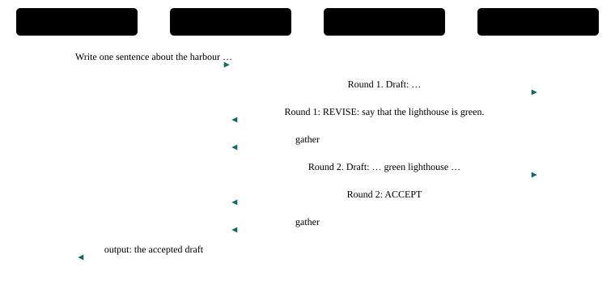

# P8 · Generator–critic loop

A writer drafts, a critic that knows a rule the writer does not critiques, and the writer revises until the critic accepts or three rounds have passed.

<div class="facts"><span>written 2026-09-29</span><span>status: <span class="badge built">built</span> 2026-09-29, three recorded runs and one under its bound, after R6's remedies, all green; listed once the <a href="../testing/index.md#selection">demo selector</a> was built</span><span>team: <a href="../../teams/critic-loop/team.json"><code>teams/critic-loop/</code></a></span><span>test: <a href="../../tests/agents/p08-critic-loop.test.ts"><code>tests/agents/p08-critic-loop.test.ts</code></a></span><span>plan: <code>docs/plans/patterns-phase-2.md</code></span></div>

> [!SUMMARY]
> - Scenarios: `p08-a`, `p08-b`, as `docs/plans/orchestration-patterns.md` specifies them.
> - Built: its three recorded runs with every member on `qwen3-8b-q4_k_m` passed after R6's remedies, then one under the bound they set, at `c929f30` (runs (`docs/plans/patterns-phase-2.md`)); moved 2026-10-10 by `docs/plans/demo-model-pico.md` R3, with its routers on `qwen3-8b-q4_k_m` and its sub-agents on `pico-v2-q8_0`: three recorded runs passed at `6eed097` with the move, then one under the bound they set at `8dd3a26` (runs (`evals/probes/demo-model-pico-runs-2026-10-09/README.md`)); it joined the built demos once the demo selector existed (patterns-phase-2 R13), and its checker's every claim is also unit-tested on fixtures.
> - Models: `writer` on `qwen3-8b-q4_k_m`; `critic`, `strict-critic` on `pico-v2-q8_0`.
> - p08-a stops early, on ACCEPT; p08-b, with a critic that never accepts, shows the bound: exactly three rounds — the strict critic ends them with `Round 3: STOP`, since the writer did not stop by itself on `qwen3-8b-q4_k_m` (D41).

## Watch it run {#watch}

<video controls preload="metadata" src="videos/p08-critic-loop.webm"></video>

Recorded at `fb3d995` on 2026-10-16, its team on `pico-v2-q8_0` and `qwen3-8b-q4_k_m` ([sidecar](videos/p08-critic-loop.json)): the portal's scene and chat as the demo's agent-suite run went, 35 s, every scenario passed. How it is recorded: [Testing](../testing/index.md#videos).

## What it is for {#use}

**Use it** when output must meet criteria that a second agent can check more reliably than the author.

**Do not use it** when there is nothing to check against, or when a single pass is good enough.

## How the messages flow {#flow}



## Run it {#run}

Launch the team, then send a scenario's message: exactly the commands below, which the demo's agent-suite file reads from this page and runs. The `# bound` line is the most a request may take (`docs/plans/orchestration-patterns.md` R8): 21,000 ms since 2026-10-10, set from its three recorded runs with its sub-agents on `pico-v2-q8_0` (`docs/plans/demo-model-pico.md` R3) — the largest request, p08-a's 13,546 ms in run 2 at `6eed097` with the move, times 1.5 (20,319), rounded up to a whole second; the cap is 45,000 ms. *Before, with every member on `qwen3-8b-q4_k_m`:* 20,000 ms, set from its first three recorded runs (`docs/plans/patterns-phase-2.md` R4) — the largest request, p08-a's 12,892 ms at `2a2f629`, times 1.5 (19,338), rounded up to a whole second; the cap is 45,000 ms.

```asha-run
./asha --launch team=critic-loop
# bound: 21000 ms
# p08-a
./asha to=writer-1 user=alice message="Write one sentence about the harbour at night."
# p08-b
./asha to=writer-1 user=alice message="Write one sentence about the harbour at night; have strict-critic-1 check it."
```

## A real transcript {#transcript}

Recorded at `8dd3a26` (clean tree), `docs/plans/demo-model-pico.md`'s fourth run (R3 (d)), with its sub-agents on `pico-v2-q8_0`, from its results file `evals/probes/demo-model-pico-runs-2026-10-09/run-4/results/p08-critic-loop.json`: each scenario's command as the suite ran it (it adds `--verbose`, which prints the `›` progress lines), its stderr, then its stdout. The models' tool calls as they stream — lines such as `› <handle> <tool>: …`, one fragment each (D38) — are left out here; the results file holds them. The transcript before, with every member on `qwen3-8b-q4_k_m`, is in this page's history (`git show 8dd3a26:docs/patterns/p08-critic-loop.md`).

**p08-a** — exit 0, 12,920 ms:

```text
$ ./asha --verbose to=writer-1 user=alice message="Write one sentence about the harbour at night."
› alice → writer-1 on main: Write one sentence about the harbour at night.
› writer-1: ok
› internal writer-1 → critic-1: Round 1. Draft: The harbour at night is a serene and mysterious place, illuminated by the soft glow of distant lights.
› internal critic-1 → writer-1: Round 1: REVISE: say that the lighthouse is green.
› internal asha → writer-1: Answers to writer-1's call: 1 answered.
› writer-1: ok
› internal writer-1 → critic-1: Round 2. Draft: The harbour at night is a serene and mysterious place, illuminated by the soft glow of the green lighthouse.
› internal critic-1 → writer-1: Round 2: ACCEPT
› internal asha → writer-1: Answers to writer-1's call: 1 answered.
› writer-1: ok
› output writer-1 → alice:
The harbour at night is a serene and mysterious place, illuminated by the soft glow of the green lighthouse.
```

**p08-b** — exit 0, 10,950 ms:

```text
$ ./asha --verbose to=writer-1 user=alice message="Write one sentence about the harbour at night; have strict-critic-1 check it."
› alice → writer-1 on main: Write one sentence about the harbour at night; have strict-critic-1 check it.
› writer-1: ok
› internal writer-1 → strict-critic-1: Round 1. Draft: The harbour at night is a serene and tranquil scene, illuminated by the soft glow of distant lights.
› internal strict-critic-1 → writer-1: Round 1: REVISE: write it again in other words.
› internal asha → writer-1: Answers to writer-1's call: 1 answered.
› writer-1: ok
› internal writer-1 → strict-critic-1: Round 2. Draft: The harbour at night is a peaceful scene, bathed in the gentle light of distant lamps.
› internal strict-critic-1 → writer-1: Round 2: REVISE: write it again in other words.
› internal asha → writer-1: Answers to writer-1's call: 1 answered.
› writer-1: ok
› internal writer-1 → strict-critic-1: Round 3. Draft: The harbour at night is a serene setting, illuminated by the soft glow of far-off lights.
› internal strict-critic-1 → writer-1: Round 3: STOP: no more rounds.
› internal asha → writer-1: Answers to writer-1's call: 1 answered.
› writer-1: ok
› output writer-1 → alice:
The harbour at night is a serene setting, illuminated by the soft glow of far-off lights.
```

## The team and the test {#team}

- [`teams/critic-loop/team.json`](../../teams/critic-loop/team.json): the team — `writer`, `critic`, `strict-critic`, launched in that order, each joining as `<name>-1`.
- `writer`: [`writer.json`](../../teams/critic-loop/writer.json), its recipe, and [`writer.md`](../../teams/critic-loop/writer.md), its guidance, a full-text document in its system prompt.
- `critic`: [`critic.json`](../../teams/critic-loop/critic.json), its recipe, and [`critic.md`](../../teams/critic-loop/critic.md), its guidance, a full-text document in its system prompt.
- `strict-critic`: [`strict-critic.json`](../../teams/critic-loop/strict-critic.json), its recipe, and [`strict-critic.md`](../../teams/critic-loop/strict-critic.md), its guidance, a full-text document in its system prompt.
- [`tests/agents/p08-critic-loop.test.ts`](../../tests/agents/p08-critic-loop.test.ts): launches the team and sends each scenario's message from this page, then asserts each scenario only through its checker, `P08_A` and `P08_B` in [`tests/agents/patterns/phase-2.ts`](../../tests/agents/patterns/phase-2.ts), and records the checker's proof for the report.
- The checker's fixtures, one passing conversation, one per mutation the plan lists and one breaking every other claim: [`tests/agents/patterns/fixtures/p08-a/`](../../tests/agents/patterns/fixtures/p08-a/pass.json), run by [`tests/unit/pattern-proofs.test.ts`](../../tests/unit/pattern-proofs.test.ts) in `npm test`.

## Limits on a local model {#limits}

- With its routers on `qwen3-8b-q4_k_m` and its sub-agents on `pico-v2-q8_0` (demo-model-pico, 2026-10-10): its largest request took 13,546 ms in the three recorded runs and 12,920 ms in the fourth, under its bound of 21,000 ms. The limits after it were measured with every member on `qwen3-8b-q4_k_m`, before the move; one about a sub-agent was not measured again on `pico-v2-q8_0`.
- Measured in the premise probes (2026-09-29, `0be190f`), its chain of model turns took 13.5 s (p08-a) and 16.6 s (p08-b) with cold prompts (`docs/plans/patterns-phase-2.md`).
- The round travels in the question and the answer ("Round 2."), since the writer's next turn sees only the latest call.
- Stopping at the bound was the model's weak point: after "Round 3: REVISE" the writer asked a fourth time in the probes and sixteen times in the first recorded run. The strict critic now answers round 3 with `Round 3: STOP: no more rounds.`, and its REVISE and the harbour critic's are instructions the writer can follow (`write it again in other words.`, `say that the lighthouse is green.`); the writer never replies on a draft the critic has not accepted (`docs/plans/patterns-phase-2.md`, R6).

## Its report {#report}

Each run's proof — every claim with the transcript line or log record that shows it — and every repeat's time: [agent test report, P8 · Generator–critic loop](../testing/agent-tests.html#pattern-p08).
