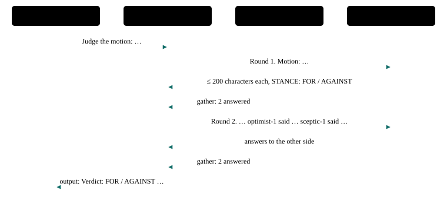

# P9 · Debate with a judge

Two debaters argue assigned stances over two rounds, the second answering the first; a judge gives the verdict.

<div class="facts"><span>written 2026-09-29</span><span>status: <span class="badge built">built</span> 2026-09-29, three recorded runs and one under its bound, all green; listed once the <a href="../testing/index.md#selection">demo selector</a> was built</span><span>team: <a href="../../teams/debate/team.json"><code>teams/debate/</code></a></span><span>test: <a href="../../tests/agents/p09-debate.test.ts"><code>tests/agents/p09-debate.test.ts</code></a></span><span>plan: <code>docs/plans/patterns-phase-2.md</code></span></div>

> [!SUMMARY]
> - Scenarios: `p09-a`, as `docs/plans/orchestration-patterns.md` specifies them.
> - Built: its three recorded runs on the pinned model passed, then one under the bound they set, at `86bbeaf` (runs (`docs/plans/patterns-phase-2.md`)); it joined the built demos once the demo selector existed (patterns-phase-2 R13), and its checker's every claim is also unit-tested on fixtures.
> - Models: `judge`, `optimist`, `sceptic` on `qwen3-8b-q4_k_m`.
> - Each debater's stance is in its own guidance; the judge carries round 1's answers into round 2's question, since no agent remembers a turn.

## Watch it run {#watch}

<video controls preload="metadata" src="videos/p09-debate.webm"></video>

Recorded at `fb3d995` on 2026-10-16, its team on `qwen3-8b-q4_k_m` ([sidecar](videos/p09-debate.json)): the portal's scene and chat as the demo's agent-suite run went, 32 s, every scenario passed. How it is recorded: [Testing](../testing/index.md#videos).

## What it is for {#use}

**Use it** when a decision benefits from the strongest case on each side before someone decides.

**Do not use it** when the participants should converge on their own (consensus, P23), or when a count is enough (voting, P10).

## How the messages flow {#flow}



## Run it {#run}

Launch the team, then send a scenario's message: exactly the commands below, which the demo's agent-suite file reads from this page and runs. The `# bound` line is the most a request may take (`docs/plans/orchestration-patterns.md` R8): 34,000 ms, set from its first three recorded runs (`docs/plans/patterns-phase-2.md` R4) — the largest request, p09-a's 22,446 ms at `1303318`, times 1.5 (33,669), rounded up to a whole second; the cap is 45,000 ms.

```asha-run
./asha --launch team=debate
# bound: 34000 ms
# p09-a
./asha to=judge-1 user=alice message="Judge the motion: The town should build a second bridge."
```

## A real transcript {#transcript}

Recorded at `86bbeaf` (clean tree), the run under its bound, from its results file as committed in `98f62be` (`git show 98f62be:tests/agents/results/p09-debate.json`): each scenario's command as the suite ran it (it adds `--verbose`, which prints the `›` progress lines), its stderr, then its stdout. The models' output as it streams — lines such as "› delegator-1 consult: {…" printed one fragment each (D38) — is left out here; the results file holds it.

**p09-a** — exit 0, 22,598 ms:

```text
$ ./asha --verbose to=judge-1 user=alice message="Judge the motion: The town should build a second bridge."
› alice → judge-1 on main: Judge the motion: The town should build a second bridge.
› judge-1: ok
› internal judge-1 → optimist-1: Round 1. Motion: The town should build a second bridge.
› internal judge-1 → sceptic-1: Round 1. Motion: The town should build a second bridge.
› internal sceptic-1 → judge-1: Building a second bridge is costly and risky. It diverts funds from essential services and may lead to maintenance issues. STANCE: AGAINST
› internal optimist-1 → judge-1: Building a second bridge would reduce traffic congestion, improve safety, and boost economic growth by facilitating easier movement of goods and people. STANCE: FOR
› internal asha → judge-1: Answers to judge-1's call: 2 answered.
› judge-1: ok
› internal judge-1 → optimist-1: Round 2. Motion: The town should build a second bridge. optimist-1 said: Building a second bridge would reduce traffic congestion, improve safety, and boost economic growth by facilitating easier movement of goods and people. STANCE: FOR. sceptic-1 said: Building a second bridge is costly and risky. It diverts funds from essential services and may lead to maintenance issues. STANCE: AGAINST.
› internal judge-1 → sceptic-1: Round 2. Motion: The town should build a second bridge. optimist-1 said: Building a second bridge would reduce traffic congestion, improve safety, and boost economic growth by facilitating easier movement of goods and people. STANCE: FOR. sceptic-1 said: Building a second bridge is costly and risky. It diverts funds from essential services and may lead to maintenance issues. STANCE: AGAINST.
› internal sceptic-1 → judge-1: Building a second bridge risks financial strain and maintenance challenges, diverting resources from critical needs. STANCE: AGAINST
› internal optimist-1 → judge-1: Building a second bridge would not only alleviate traffic but also create jobs and enhance connectivity, leading to long-term economic benefits. STANCE: FOR
› internal asha → judge-1: Answers to judge-1's call: 2 answered.
› judge-1: ok
› output judge-1 → alice:
Verdict: FOR. optimist-1 and sceptic-1 have presented their arguments, and the motion to build a second bridge is supported by optimist-1's reasoning.
```

## The team and the test {#team}

- [`teams/debate/team.json`](../../teams/debate/team.json): the team — `judge`, `optimist`, `sceptic`, launched in that order, each joining as `<name>-1`.
- `judge`: [`judge.json`](../../teams/debate/judge.json), its recipe, and [`judge.md`](../../teams/debate/judge.md), its guidance, a full-text document in its system prompt.
- `optimist`: [`optimist.json`](../../teams/debate/optimist.json), its recipe, and [`optimist.md`](../../teams/debate/optimist.md), its guidance, a full-text document in its system prompt.
- `sceptic`: [`sceptic.json`](../../teams/debate/sceptic.json), its recipe, and [`sceptic.md`](../../teams/debate/sceptic.md), its guidance, a full-text document in its system prompt.
- [`tests/agents/p09-debate.test.ts`](../../tests/agents/p09-debate.test.ts): launches the team and sends each scenario's message from this page, then asserts each scenario only through its checker, `P09_A` in [`tests/agents/patterns/phase-2.ts`](../../tests/agents/patterns/phase-2.ts), and records the checker's proof for the report.
- The checker's fixtures, one passing conversation, one per mutation the plan lists and one breaking every other claim: [`tests/agents/patterns/fixtures/p09-a/`](../../tests/agents/patterns/fixtures/p09-a/pass.json), run by [`tests/unit/pattern-proofs.test.ts`](../../tests/unit/pattern-proofs.test.ts) in `npm test`.

## Limits on a local model {#limits}

- Measured in the premise probes (2026-09-29, `0be190f`), its chain of model turns took 17.6 s with cold prompts and 9.0 s warm (`docs/plans/patterns-phase-2.md`).
- Round 2's question must quote both round-1 answers word for word, stance lines included; a judge that paraphrases fails the proof.

## Its report {#report}

Each run's proof — every claim with the transcript line or log record that shows it — and every repeat's time: [agent test report, P9 · Debate with a judge](../testing/agent-tests.html#pattern-p09).
