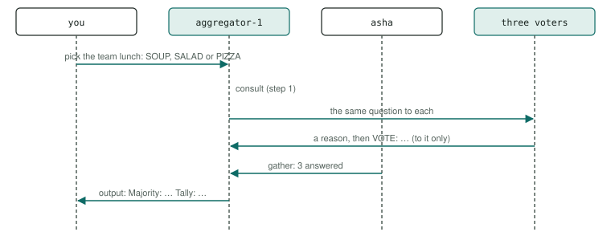

# P10 · Voting / ensemble

Several voters with different guidance answer the same question on their own; an aggregator counts their votes and reports the majority and the tally.

<div class="facts"><span>written 2026-09-29</span><span>status: <span class="badge built">built</span> 2026-09-29, three recorded runs and one under its bound, all green</span><span>team: <a href="../../teams/vote/team.json"><code>teams/vote/</code></a></span><span>test: <a href="../../tests/agents/p10-voting.test.ts"><code>tests/agents/p10-voting.test.ts</code></a></span><span>plan: <code>docs/plans/patterns-phase-2.md</code></span></div>

> [!SUMMARY]
> - Scenarios: `p10-a`, as `docs/plans/orchestration-patterns.md` specifies them.
> - Built: its three recorded runs with every member on `qwen3-8b-q4_k_m` passed, then one under the bound they set, at `0f047be` (runs (`docs/plans/patterns-phase-2.md`)); moved 2026-10-10 by `docs/plans/demo-model-pico.md` R3, with its routers on `qwen3-8b-q4_k_m` and its sub-agents on `pico-v2-q8_0`: three recorded runs passed at `6eed097` with the move, then one under the bound they set at `8dd3a26` (runs (`evals/probes/demo-model-pico-runs-2026-10-09/README.md`)); its checker's every claim is also unit-tested on fixtures.
> - Models: `aggregator` on `qwen3-8b-q4_k_m`; `voter-cautious`, `voter-bold`, `voter-thrifty` on `pico-v2-q8_0`.
> - The voters run the same model at temperature 0 and differ only in their guidance (orchestration-patterns R2); no voter sees another's answer.

## Watch it run {#watch}

<video controls preload="metadata" src="videos/p10-voting.webm"></video>

Recorded at `fb3d995` on 2026-10-16, its team on `pico-v2-q8_0` and `qwen3-8b-q4_k_m` ([sidecar](videos/p10-voting.json)): the portal's scene and chat as the demo's agent-suite run went, 30 s, every scenario passed. How it is recorded: [Testing](../testing/index.md#videos).

## What it is for {#use}

**Use it** when several independent judgements of one question are worth more than one, and a count settles it.

**Do not use it** when the answers should influence each other (debate, P9, or consensus, P23), or when one expert suffices.

## How the messages flow {#flow}



## Run it {#run}

Launch the team, then send a scenario's message: exactly the commands below, which the demo's agent-suite file reads from this page and runs. The `# bound` line is the most a request may take (`docs/plans/orchestration-patterns.md` R8): 30,000 ms since 2026-10-10, set from its three recorded runs with its sub-agents on `pico-v2-q8_0` (`docs/plans/demo-model-pico.md` R3) — the largest request, p10-a's 19,893 ms in run 3 at `6eed097` with the move, times 1.5 (29,839.5), rounded up to a whole second; the cap is 45,000 ms. *Before, with every member on `qwen3-8b-q4_k_m`:* 29,000 ms, set from its first three recorded runs (`docs/plans/patterns-phase-2.md` R4) — the largest request, p10-a's 18,777 ms at `0896f67`, times 1.5 (28,166), rounded up to a whole second; the cap is 45,000 ms.

```asha-run
./asha --launch team=vote
# bound: 30000 ms
# p10-a
./asha to=aggregator-1 user=alice message="Ask the voters to pick the team lunch: SOUP, SALAD or PIZZA."
```

## A real transcript {#transcript}

Recorded at `8dd3a26` (clean tree), `docs/plans/demo-model-pico.md`'s fourth run (R3 (d)), with its sub-agents on `pico-v2-q8_0`, from its results file `evals/probes/demo-model-pico-runs-2026-10-09/run-4/results/p10-voting.json`: each scenario's command as the suite ran it (it adds `--verbose`, which prints the `›` progress lines), its stderr, then its stdout. The models' tool calls as they stream — lines such as `› <handle> <tool>: …`, one fragment each (D38) — are left out here; the results file holds them. The transcript before, with every member on `qwen3-8b-q4_k_m`, is in this page's history (`git show 8dd3a26:docs/patterns/p10-voting.md`).

**p10-a** — exit 0, 17,518 ms:

```text
$ ./asha --verbose to=aggregator-1 user=alice message="Ask the voters to pick the team lunch: SOUP, SALAD or PIZZA."
› alice → aggregator-1 on main: Ask the voters to pick the team lunch: SOUP, SALAD or PIZZA.
› aggregator-1: ok
› internal aggregator-1 → voter-bold-1: Pick the team lunch: SOUP, SALAD or PIZZA.
› internal aggregator-1 → voter-cautious-1: Pick the team lunch: SOUP, SALAD or PIZZA.
› internal aggregator-1 → voter-thrifty-1: Pick the team lunch: SOUP, SALAD or PIZZA.
› internal voter-thrifty-1 → aggregator-1: I vote for the cheapest choice.
    
    VOTE: SOUP
› internal voter-bold-1 → aggregator-1: I vote for the most exciting choice.
    
    VOTE: PIZZA
› internal voter-cautious-1 → aggregator-1: I vote for the safest, most familiar choice.
    
    VOTE: PIZZA
› internal asha → aggregator-1: Answers to aggregator-1's call: 3 answered.
› aggregator-1: ok
› output aggregator-1 → alice:
Majority: PIZZA (2 of 3). Tally: SOUP 1, SALAD 0, PIZZA 2.
```

## The team and the test {#team}

- [`teams/vote/team.json`](../../teams/vote/team.json): the team — `aggregator`, `voter-cautious`, `voter-bold`, `voter-thrifty`, launched in that order, each joining as `<name>-1`.
- `aggregator`: [`aggregator.json`](../../teams/vote/aggregator.json), its recipe, and [`aggregator.md`](../../teams/vote/aggregator.md), its guidance, a full-text document in its system prompt.
- `voter-cautious`: [`voter-cautious.json`](../../teams/vote/voter-cautious.json), its recipe, and [`voter-cautious.md`](../../teams/vote/voter-cautious.md), its guidance, a full-text document in its system prompt.
- `voter-bold`: [`voter-bold.json`](../../teams/vote/voter-bold.json), its recipe, and [`voter-bold.md`](../../teams/vote/voter-bold.md), its guidance, a full-text document in its system prompt.
- `voter-thrifty`: [`voter-thrifty.json`](../../teams/vote/voter-thrifty.json), its recipe, and [`voter-thrifty.md`](../../teams/vote/voter-thrifty.md), its guidance, a full-text document in its system prompt.
- [`tests/agents/p10-voting.test.ts`](../../tests/agents/p10-voting.test.ts): launches the team and sends each scenario's message from this page, then asserts each scenario only through its checker, `P10_A` in [`tests/agents/patterns/phase-2.ts`](../../tests/agents/patterns/phase-2.ts), and records the checker's proof for the report.
- The checker's fixtures, one passing conversation, one per mutation the plan lists and one breaking every other claim: [`tests/agents/patterns/fixtures/p10-a/`](../../tests/agents/patterns/fixtures/p10-a/pass.json), run by [`tests/unit/pattern-proofs.test.ts`](../../tests/unit/pattern-proofs.test.ts) in `npm test`.

## Limits on a local model {#limits}

- With its routers on `qwen3-8b-q4_k_m` and its sub-agents on `pico-v2-q8_0` (demo-model-pico, 2026-10-10): its largest request took 19,893 ms in the three recorded runs and 17,518 ms in the fourth, under its bound of 30,000 ms. The limits after it were measured with every member on `qwen3-8b-q4_k_m`, before the move; one about a sub-agent was not measured again on `pico-v2-q8_0`.
- Measured in the premise probes (2026-09-29, `0be190f`), its chain of model turns took 12.2 s with cold prompts and 4.4 s warm (`docs/plans/patterns-phase-2.md`).
- The majority is the model's count; the proof recomputes the tally from the gather's answers and requires the output to equal it.
- When the three votes all differ, the aggregator still answered "Majority: …" in the probes, under six wordings (`docs/plans/patterns-phase-2.md`); every probe's voters produced a majority (SALAD, PIZZA, SALAD), so the scenario does not reach that branch (D40).

## Its report {#report}

Each run's proof — every claim with the transcript line or log record that shows it — and every repeat's time: [agent test report, P10 · Voting / ensemble](../testing/agent-tests.html#pattern-p10).
