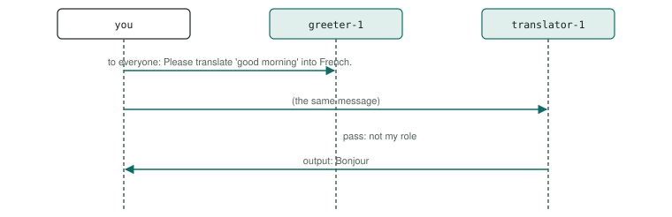

# P12 · Group chat, self-selection

A message goes to everyone, and each agent decides for itself whether its role covers it: the one that does answers, the others pass. No agent routes or manages.

<div class="facts"><span>written 2026-09-29</span><span>status: <span class="badge built">built</span> 2026-09-29, three recorded runs and one under its bound, all green</span><span>team: <a href="../../teams/self-select/team.json"><code>teams/self-select/</code></a></span><span>test: <a href="../../tests/agents/p12-self-selection.test.ts"><code>tests/agents/p12-self-selection.test.ts</code></a></span><span>plan: <code>docs/plans/patterns-phase-1.md</code>, its runs</span></div>

> [!SUMMARY]
> - Scenarios: `p12-a`, `p12-b`, `p12-c`, as `docs/plans/orchestration-patterns.md` specifies them.
> - Built: its three recorded runs with every member on `qwen3-8b-q4_k_m` passed, then one under the bound they set (runs (`docs/plans/patterns-phase-1.md`)); moved 2026-10-10 by `docs/plans/demo-model-pico.md` R3, with every member on `pico-v2-q8_0` (it has no router): three recorded runs passed at `6eed097` with the move, then one under the bound they set at `8dd3a26` (runs (`evals/probes/demo-model-pico-runs-2026-10-09/README.md`)); its checker's every claim is also unit-tested on fixtures.
> - Models: `greeter`, `translator` on `pico-v2-q8_0`.

## Watch it run {#watch}

<video controls preload="metadata" src="videos/p12-self-selection.webm"></video>

Recorded at `fb3d995` on 2026-10-16, its team on `pico-v2-q8_0` ([sidecar](videos/p12-self-selection.json)): the portal's scene and chat as the demo's agent-suite run went, 22 s, every scenario passed. How it is recorded: [Testing](../testing/index.md#videos).

## What it is for {#use}

**Use it** when a few agents with clearly different roles share one channel and a request belongs to at most one of them.

**Do not use it** when roles overlap (two agents answer) or when a request needs a choice between agents (a router, P2, or a manager, P24). When no role covers a request, every agent passes and the harness tells the user no agent could answer.

## How the messages flow {#flow}



## Run it {#run}

Launch the team, then send a scenario's message: exactly the commands below, which the demo's agent-suite file reads from this page and runs. The `# bound` line is the most a request may take (`docs/plans/orchestration-patterns.md` R8): 15,000 ms since 2026-10-10, set from its three recorded runs with its sub-agents on `pico-v2-q8_0` (`docs/plans/demo-model-pico.md` R3) — the largest request, p12-a's 9,716 ms in run 1 at `6eed097` with the move, times 1.5 (14,574), rounded up to a whole second; the cap is 45,000 ms. *Before, with every member on `qwen3-8b-q4_k_m`:* 15,000 ms, set from its first three recorded runs (`docs/plans/patterns-phase-1.md` R4) — the largest request, p12-a's 9,519 ms at `fb55f7e`, times 1.5, rounded up to a whole second; the cap is 45,000 ms.

```asha-run
./asha --launch team=self-select
# bound: 15000 ms
# p12-a
./asha user=alice message="Please translate 'good morning' into French."
# p12-b
./asha user=alice message="Please say: Hello World."
# p12-c
./asha user=alice message="Please book me a flight to Paris."
```

## A real transcript {#transcript}

Recorded at `8dd3a26` (clean tree), `docs/plans/demo-model-pico.md`'s fourth run (R3 (d)), with its sub-agents on `pico-v2-q8_0`, from its results file `evals/probes/demo-model-pico-runs-2026-10-09/run-4/results/p12-self-selection.json`: each scenario's command as the suite ran it (it adds `--verbose`, which prints the `›` progress lines), its stderr, then its stdout. The models' tool calls as they stream — lines such as `› <handle> <tool>: …`, one fragment each (D38) — are left out here; the results file holds them. The transcript before, with every member on `qwen3-8b-q4_k_m`, is in this page's history (`git show 8dd3a26:docs/patterns/p12-self-selection.md`).

**p12-a** — exit 0, 9,363 ms:

```text
$ ./asha --verbose user=alice message="Please translate 'good morning' into French."
› alice → main: Please translate 'good morning' into French.
› translator-1: ok
› output translator-1 → alice:
› greeter-1: pass: A request for a translation is for translator-1, which has already received it from the user.
Bonjour
```

**p12-b** — exit 0, 2,631 ms:

```text
$ ./asha --verbose user=alice message="Please say: Hello World."
› alice → main: Please say: Hello World.
› greeter-1: ok
› output greeter-1 → alice:
› translator-1: pass: A message that does not ask for a French translation, such as a request to say words, is not yours: call pass and nothing else. Never call send_message: every agent on the channel already has the message, and the one whose role covers it answers.
Hello World.
```

**p12-c** — exit 1, 1,371 ms:

```text
$ ./asha --verbose user=alice message="Please book me a flight to Paris."
› alice → main: Please book me a flight to Paris.
› translator-1: pass: This does not ask for a French translation.
› greeter-1: pass: A request for a translation is for translator-1, which has already received it from the user.
› output asha → alice:
No agent could answer this:
- greeter-1 passed: A request for a translation is for translator-1, which has already received it from the user.
- translator-1 passed: This does not ask for a French translation.
```

## The team and the test {#team}

- [`teams/self-select/team.json`](../../teams/self-select/team.json): the team — `greeter`, `translator`, launched in that order, each joining as `<name>-1`.
- `greeter`: [`greeter.json`](../../teams/self-select/greeter.json), its recipe, and [`greeter.md`](../../teams/self-select/greeter.md), its guidance, a full-text document in its system prompt.
- `translator`: [`translator.json`](../../teams/self-select/translator.json), its recipe, and [`translator.md`](../../teams/self-select/translator.md), its guidance, a full-text document in its system prompt.
- [`tests/agents/p12-self-selection.test.ts`](../../tests/agents/p12-self-selection.test.ts): launches the team and sends each scenario's message from this page, then asserts each scenario only through its checker, `P12_…` in [`tests/agents/patterns/phase-1.ts`](../../tests/agents/patterns/phase-1.ts), and records the checker's proof for the report.
- The checker's fixtures, one passing conversation and one per mutation the plan lists: [`tests/agents/patterns/fixtures/`](../../tests/agents/patterns/fixtures/p12-a/pass.json), run by [`tests/unit/pattern-proofs.test.ts`](../../tests/unit/pattern-proofs.test.ts) in `npm test`.

## Limits on a local model {#limits}

- With every member on `pico-v2-q8_0` (it has no router) (demo-model-pico, 2026-10-10): its largest request took 9,716 ms in the three recorded runs and 9,363 ms in the fourth, under its bound of 15,000 ms. The limits after it were measured with every member on `qwen3-8b-q4_k_m`, before the move; one about a sub-agent was not measured again on `pico-v2-q8_0`.
- The same decision on the `hello-world` recipe — `off-role`, a request no agent's role covers — failed during the shared prompt prefix's build (at `988045f`, hewo-1 forwarded it) and passes on main since its amended identity line (the `9727a57` gate, clean). These members' guidance says to pass and never to forward; the runs below measured it.
- Measured (2026-09-29, runs (`docs/plans/patterns-phase-1.md`)): greeter-1 forwarded the translation to translator-1 with `send_message` — which then answered twice — in every run and under 13 wordings that told it to pass without naming the translator. It passes only with one wording, which names `translator-1` as already holding the request and says not to send it there; two other wordings that named translator-1 still forwarded (*corrected 2026-09-29: this said naming translator-1 was enough*). Held-out translations ("good night", "thank you very much") pass under it, 3/3 each. So this demo shows self-selection among members that know each other's handles; guidance that names no other member does not hold on this model (D35).
- translator-1's guidance does not decide its language: told to answer in Spanish, it still said "Bonjour" (a guard proof, `proofs/` (`evals/probes/patterns-phase-1-2026-09-29/README.md`)).
- translator-1 translated the request to say words ("Bonjour le monde.") until its guidance said that a request to say words is another agent's work.

## Its report {#report}

Each run's proof — every claim with the transcript line or log record that shows it — and every repeat's time: [agent test report, P12 · Group chat, self-selection](../testing/agent-tests.html#pattern-p12).
