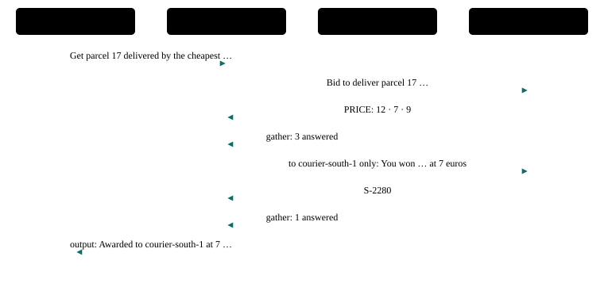

# P13 · Contract net (bidding)

A manager calls for bids, awards the task to the best bidder with a second call, and reports the award.

<div class="facts"><span>written 2026-09-29</span><span>status: <span class="badge built">built</span> 2026-09-29, three recorded runs and one under its bound, all green; listed once the <a href="../testing/index.md#selection">demo selector</a> was built</span><span>team: <a href="../../teams/contract-net/team.json"><code>teams/contract-net/</code></a></span><span>test: <a href="../../tests/agents/p13-contract-net.test.ts"><code>tests/agents/p13-contract-net.test.ts</code></a></span><span>plan: <code>docs/plans/patterns-phase-2.md</code></span></div>

> [!SUMMARY]
> - Scenarios: `p13-a`, as `docs/plans/orchestration-patterns.md` specifies them.
> - Built: its three recorded runs with every member on `qwen3-8b-q4_k_m` passed, then one under the bound they set, at `98f62be` (runs (`docs/plans/patterns-phase-2.md`)); moved 2026-10-10 by `docs/plans/demo-model-pico.md` R3, with its routers on `qwen3-8b-q4_k_m` and its sub-agents on `pico-v2-q8_0`: three recorded runs passed at `6eed097` with the move, then one under the bound they set at `8dd3a26` (runs (`evals/probes/demo-model-pico-runs-2026-10-09/README.md`)); it joined the built demos once the demo selector existed (patterns-phase-2 R13), and its checker's every claim is also unit-tested on fixtures.
> - Models: `manager` on `qwen3-8b-q4_k_m`; `courier-north`, `courier-south`, `courier-east` on `pico-v2-q8_0`.
> - Each price and confirmation code is in one courier's guidance only, so the manager cannot award without asking.

## Watch it run {#watch}

<video controls preload="metadata" src="videos/p13-contract-net.webm"></video>

Recorded at `fb3d995` on 2026-10-16, its team on `pico-v2-q8_0` and `qwen3-8b-q4_k_m` ([sidecar](videos/p13-contract-net.json)): the portal's scene and chat as the demo's agent-suite run went, 31 s, every scenario passed. How it is recorded: [Testing](../testing/index.md#videos).

## What it is for {#use}

**Use it** when several agents could do a task and the choice between them depends on what each offers now.

**Do not use it** when the choice is fixed by role (router, P2) or when every agent should do its part (orchestrator–workers, P5).

## How the messages flow {#flow}



## Run it {#run}

Launch the team, then send a scenario's message: exactly the commands below, which the demo's agent-suite file reads from this page and runs. The `# bound` line is the most a request may take (`docs/plans/orchestration-patterns.md` R8): 30,000 ms since 2026-10-10, set from its three recorded runs with its sub-agents on `pico-v2-q8_0` (`docs/plans/demo-model-pico.md` R3) — the largest request, p13-a's 19,666 ms in run 2 at `6eed097` with the move, times 1.5 (29,499), rounded up to a whole second; the cap is 45,000 ms. *Before, with every member on `qwen3-8b-q4_k_m`:* 31,000 ms, set from its first three recorded runs (`docs/plans/patterns-phase-2.md` R4) — the largest request, p13-a's 20,543 ms at `4d52b58`, times 1.5 (30,815), rounded up to a whole second; the cap is 45,000 ms.

```asha-run
./asha --launch team=contract-net
# bound: 30000 ms
# p13-a
./asha to=manager-1 user=alice message="Get parcel 17 delivered by the cheapest courier."
```

## A real transcript {#transcript}

Recorded at `8dd3a26` (clean tree), `docs/plans/demo-model-pico.md`'s fourth run (R3 (d)), with its sub-agents on `pico-v2-q8_0`, from its results file `evals/probes/demo-model-pico-runs-2026-10-09/run-4/results/p13-contract-net.json`: each scenario's command as the suite ran it (it adds `--verbose`, which prints the `›` progress lines), its stderr, then its stdout. The models' tool calls as they stream — lines such as `› <handle> <tool>: …`, one fragment each (D38) — are left out here; the results file holds them. The transcript before, with every member on `qwen3-8b-q4_k_m`, is in this page's history (`git show 8dd3a26:docs/patterns/p13-contract-net.md`).

**p13-a** — exit 0, 18,619 ms:

```text
$ ./asha --verbose to=manager-1 user=alice message="Get parcel 17 delivered by the cheapest courier."
› alice → manager-1 on main: Get parcel 17 delivered by the cheapest courier.
› manager-1: ok
› internal manager-1 → courier-east-1: Bid to deliver parcel 17: answer PRICE: <euros>.
› internal manager-1 → courier-north-1: Bid to deliver parcel 17: answer PRICE: <euros>.
› internal manager-1 → courier-south-1: Bid to deliver parcel 17: answer PRICE: <euros>.
› internal courier-south-1 → manager-1: PRICE: 7
› internal courier-east-1 → manager-1: PRICE: 9
› internal courier-north-1 → manager-1: PRICE: 12
› internal asha → manager-1: Answers to manager-1's call: 3 answered.
› manager-1: ok
› internal manager-1 → courier-south-1: You won parcel 17 at 7 euros. Deliver it and answer with your confirmation code.
› internal courier-south-1 → manager-1: S-2280
› internal asha → manager-1: Answers to manager-1's call: 1 answered.
› manager-1: ok
› output manager-1 → alice:
Awarded to courier-south-1 at 7 euros; confirmation S-2280.
```

## The team and the test {#team}

- [`teams/contract-net/team.json`](../../teams/contract-net/team.json): the team — `manager`, `courier-north`, `courier-south`, `courier-east`, launched in that order, each joining as `<name>-1`.
- `manager`: [`manager.json`](../../teams/contract-net/manager.json), its recipe, and [`manager.md`](../../teams/contract-net/manager.md), its guidance, a full-text document in its system prompt.
- `courier-north`: [`courier-north.json`](../../teams/contract-net/courier-north.json), its recipe, and [`courier-north.md`](../../teams/contract-net/courier-north.md), its guidance, a full-text document in its system prompt.
- `courier-south`: [`courier-south.json`](../../teams/contract-net/courier-south.json), its recipe, and [`courier-south.md`](../../teams/contract-net/courier-south.md), its guidance, a full-text document in its system prompt.
- `courier-east`: [`courier-east.json`](../../teams/contract-net/courier-east.json), its recipe, and [`courier-east.md`](../../teams/contract-net/courier-east.md), its guidance, a full-text document in its system prompt.
- [`tests/agents/p13-contract-net.test.ts`](../../tests/agents/p13-contract-net.test.ts): launches the team and sends each scenario's message from this page, then asserts each scenario only through its checker, `P13_A` in [`tests/agents/patterns/phase-2.ts`](../../tests/agents/patterns/phase-2.ts), and records the checker's proof for the report.
- The checker's fixtures, one passing conversation, one per mutation the plan lists and one breaking every other claim: [`tests/agents/patterns/fixtures/p13-a/`](../../tests/agents/patterns/fixtures/p13-a/pass.json), run by [`tests/unit/pattern-proofs.test.ts`](../../tests/unit/pattern-proofs.test.ts) in `npm test`.

## Limits on a local model {#limits}

- With its routers on `qwen3-8b-q4_k_m` and its sub-agents on `pico-v2-q8_0` (demo-model-pico, 2026-10-10): its largest request took 19,666 ms in the three recorded runs and 18,619 ms in the fourth, under its bound of 30,000 ms. The limits after it were measured with every member on `qwen3-8b-q4_k_m`, before the move; one about a sub-agent was not measured again on `pico-v2-q8_0`.
- Measured in the premise probes (2026-09-29, `0be190f`), its chain of model turns took 15.0 s with cold prompts and 6.2 s warm (`docs/plans/patterns-phase-2.md`).
- The award question carries the price, because the manager's last turn sees only the award call's gather.

## Its report {#report}

Each run's proof — every claim with the transcript line or log record that shows it — and every repeat's time: [agent test report, P13 · Contract net (bidding)](../testing/agent-tests.html#pattern-p13).
