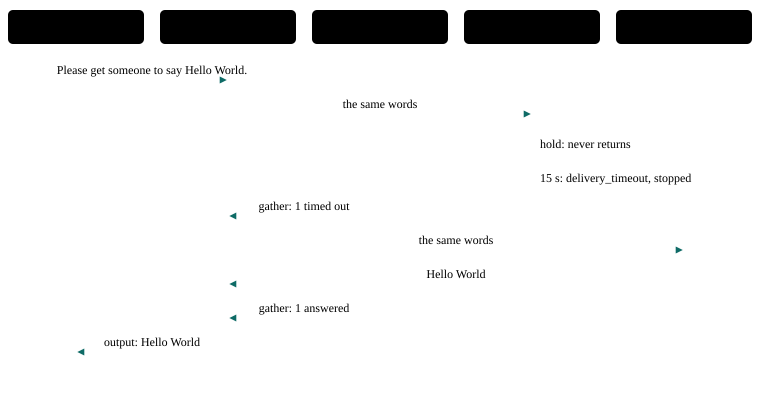

# P14 · Watchdog and reassignment

A worker that stalls is stopped when its delivery passes its bound, the call records it as timed out, and the lead gives the task to another worker.

<div class="facts"><span>written 2026-09-29</span><span>status: <span class="badge built">built</span> 2026-09-29, three recorded runs and one under its bound, all green; listed once the <a href="../testing/index.md#selection">demo selector</a> was built</span><span>team: <a href="../../teams/watchdog/team.json"><code>teams/watchdog/</code></a></span><span>test: <a href="../../tests/agents/p14-watchdog.test.ts"><code>tests/agents/p14-watchdog.test.ts</code></a></span><span>plan: <code>docs/plans/patterns-phase-2.md</code></span></div>

> [!SUMMARY]
> - Scenarios: `p14-a`, as `docs/plans/orchestration-patterns.md` specifies them.
> - Built: its three recorded runs with every member on `qwen3-8b-q4_k_m` passed, then one under the bound they set, at `3d3ee52` (runs (`docs/plans/patterns-phase-2.md`)); moved 2026-10-10 by `docs/plans/demo-model-pico.md` R3, with its routers on `qwen3-8b-q4_k_m` and its sub-agents on `pico-v2-q8_0`: three recorded runs passed at `6eed097` with the move, then one under the bound they set at `8dd3a26` (runs (`evals/probes/demo-model-pico-runs-2026-10-09/README.md`)); it joined the built demos once the demo selector existed (patterns-phase-2 R13), and its checker's every claim is also unit-tested on fixtures.
> - Models: `lead` on `qwen3-8b-q4_k_m`; `stuck`, `backup` on `pico-v2-q8_0`.
> - `stuck` stalls by design: its recipe selects `hello-world`'s one image tool, `hold`, which never returns ([agent tools](../architecture/channel.md#tools)), and its delivery bound is 15,000 ms, so the harness stops it with the tool still holding.
> - The watchdog is the harness's delivery bound; the reassignment is the lead's guidance, on seeing the timed-out outcome in its gather.

## Watch it run {#watch}

<video controls preload="metadata" src="videos/p14-watchdog.webm"></video>

Recorded at `fb3d995` on 2026-10-16, its team on `pico-v2-q8_0` and `qwen3-8b-q4_k_m` ([sidecar](videos/p14-watchdog.json)): the portal's scene and chat as the demo's agent-suite run went, 39 s, every scenario passed. How it is recorded: [Testing](../testing/index.md#videos).

## What it is for {#use}

**Use it** when a worker may hang, and the work must still get done by someone else within a known time.

**Do not use it** when a failure should restart the same agent (supervisor restart, P25), or when a slow answer is still wanted.

## How the messages flow {#flow}



## Run it {#run}

Launch the team, then send a scenario's message: exactly the commands below, which the demo's agent-suite file reads from this page and runs. The `# bound` line is the most a request may take (`docs/plans/orchestration-patterns.md` R8): 43,000 ms since 2026-10-10, set from its three recorded runs with its sub-agents on `pico-v2-q8_0` (`docs/plans/demo-model-pico.md` R3) — the largest request, p14-a's 28,629 ms in run 2 at `6eed097` with the move, times 1.5 (42,943.5), rounded up to a whole second; the cap is 45,000 ms. *Before, with every member on `qwen3-8b-q4_k_m`:* 42,000 ms, set from its first three recorded runs (`docs/plans/patterns-phase-2.md` R4) — the largest request, p14-a's 27,953 ms at `8e56f2e`, times 1.5 (41,930), rounded up to a whole second; the cap is 45,000 ms.

```asha-run
./asha --launch team=watchdog
# bound: 43000 ms
# p14-a
./asha to=lead-1 user=alice message="Please get someone to say Hello World."
```

## A real transcript {#transcript}

Recorded at `8dd3a26` (clean tree), `docs/plans/demo-model-pico.md`'s fourth run (R3 (d)), with its sub-agents on `pico-v2-q8_0`, from its results file `p14-watchdog.json` (`evals/probes/demo-model-pico-runs-2026-10-09/run-4/results/p15-watchdog.json`): each scenario's command as the suite ran it (it adds `--verbose`, which prints the `›` progress lines), its stderr, then its stdout. The models' tool calls as they stream — lines such as `› <handle> <tool>: …`, one fragment each (D38) — are left out here; the results file holds them. The transcript before, with every member on `qwen3-8b-q4_k_m`, is in this page's history (`git show 8dd3a26:docs/patterns/p14-watchdog.md`).

**p14-a** — exit 0, 27,892 ms:

```text
$ ./asha --verbose to=lead-1 user=alice message="Please get someone to say Hello World."
› alice → lead-1 on main: Please get someone to say Hello World.
› lead-1: ok
› internal lead-1 → stuck-1: Please get someone to say Hello World.
› internal asha → lead-1: Answers to lead-1's call: 1 timed out.
› stuck-1 left the channel: channel stream closed
› lead-1: ok
› internal lead-1 → backup-1: Please get someone to say Hello World.
› internal backup-1 → lead-1: Hello World
› internal asha → lead-1: Answers to lead-1's call: 1 answered.
› lead-1: ok
› output lead-1 → alice:
Hello World
```

## The team and the test {#team}

- [`teams/watchdog/team.json`](../../teams/watchdog/team.json): the team — `lead`, `stuck`, `backup`, launched in that order, each joining as `<name>-1`.
- `lead`: [`lead.json`](../../teams/watchdog/lead.json), its recipe, and [`lead.md`](../../teams/watchdog/lead.md), its guidance, a full-text document in its system prompt.
- `stuck`: [`stuck.json`](../../teams/watchdog/stuck.json), its recipe, and [`stuck.md`](../../teams/watchdog/stuck.md), its guidance, a full-text document in its system prompt.
- `backup`: [`backup.json`](../../teams/watchdog/backup.json), its recipe, and [`backup.md`](../../teams/watchdog/backup.md), its guidance, a full-text document in its system prompt.
- [`tests/agents/p14-watchdog.test.ts`](../../tests/agents/p14-watchdog.test.ts): launches the team and sends each scenario's message from this page, then asserts each scenario only through its checker, `P14_A` in [`tests/agents/patterns/phase-2.ts`](../../tests/agents/patterns/phase-2.ts), and records the checker's proof for the report.
- The checker's fixtures, one passing conversation, one per mutation the plan lists and one breaking every other claim: [`tests/agents/patterns/fixtures/p14-a/`](../../tests/agents/patterns/fixtures/p14-a/pass.json), run by [`tests/unit/pattern-proofs.test.ts`](../../tests/unit/pattern-proofs.test.ts) in `npm test`.

## Limits on a local model {#limits}

- With its routers on `qwen3-8b-q4_k_m` and its sub-agents on `pico-v2-q8_0` (demo-model-pico, 2026-10-10): its largest request took 28,629 ms in the three recorded runs and 27,892 ms in the fourth, under its bound of 43,000 ms. The limits after it were measured with every member on `qwen3-8b-q4_k_m`, before the move; one about a sub-agent was not measured again on `pico-v2-q8_0`.
- Measured in the premise probes (2026-09-29, `0be190f`), its chain of model turns took 16.0 s with cold prompts, plus the stalled worker's 15 s bound (`docs/plans/patterns-phase-2.md`).
- The fault is the tool, not the model, but the model must first call `hold`; the proof requires `hold.started` in `stuck-1`'s agent log, so a model call that merely outlasts the bound cannot pass as the fault.
- The expiry is logged `channel.delivery_timeout` at error level; it is the one error record the scenario declares.

## Its report {#report}

Each run's proof — every claim with the transcript line or log record that shows it — and every repeat's time: [agent test report, P14 · Watchdog and reassignment](../testing/agent-tests.html#pattern-p14).
