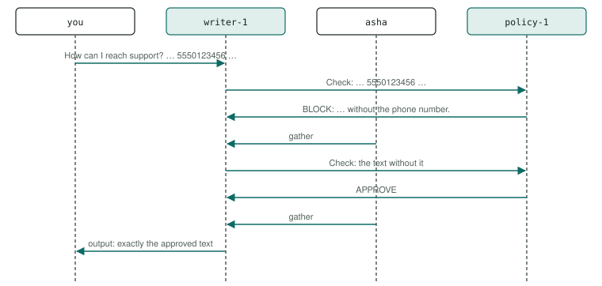

# P16 · Guardrail / policy check

Every reply is checked by a policy agent before the user sees it; a blocked draft is revised and checked again.

<div class="facts"><span>written 2026-09-29</span><span>status: <span class="badge built">built</span> 2026-09-29, three recorded runs and one under its bound, after R6's remedies, all green; listed once the <a href="../testing/index.md#selection">demo selector</a> was built</span><span>team: <a href="../../teams/guardrail/team.json"><code>teams/guardrail/</code></a></span><span>test: <a href="../../tests/agents/p16-guardrail.test.ts"><code>tests/agents/p16-guardrail.test.ts</code></a></span><span>plan: <code>docs/plans/patterns-phase-2.md</code></span></div>

> [!SUMMARY]
> - Scenarios: `p16-a`, `p16-b`, as `docs/plans/orchestration-patterns.md` specifies them.
> - Built: its three recorded runs on the pinned model passed after R6's remedies, then one under the bound they set, at `e5f1b20` (runs (`docs/plans/patterns-phase-2.md`)); it joined the built demos once the demo selector existed (patterns-phase-2 R13), and its checker's every claim is also unit-tested on fixtures.
> - Models: `writer`, `policy` on `qwen3-8b-q4_k_m`.
> - The rule is synthetic — no phone number, seven or more digits in a row — so a first draft that repeats the user's number is always blocked.

## Watch it run {#watch}

<video controls preload="metadata" src="videos/p16-guardrail.webm"></video>

Recorded at `fb3d995` on 2026-10-16, its team on `qwen3-8b-q4_k_m` ([sidecar](videos/p16-guardrail.json)): the portal's scene and chat as the demo's agent-suite run went, 23 s, every scenario passed. How it is recorded: [Testing](../testing/index.md#videos).

## What it is for {#use}

**Use it** when nothing may reach the user without passing a check another agent owns.

**Do not use it** as a security boundary on its own: the check is a model's judgement, not an enforced filter.

## How the messages flow {#flow}



## Run it {#run}

Launch the team, then send a scenario's message: exactly the commands below, which the demo's agent-suite file reads from this page and runs. The `# bound` line is the most a request may take (`docs/plans/orchestration-patterns.md` R8): 19,000 ms, set from its first three recorded runs (`docs/plans/patterns-phase-2.md` R4) — the largest request, p16-a's 12,100 ms at `22b26b4`, times 1.5 (18,150), rounded up to a whole second; the cap is 45,000 ms.

```asha-run
./asha --launch team=guardrail
# bound: 19000 ms
# p16-a
./asha to=writer-1 user=alice message="How can I reach support? Our records say: phone 5550123456, email help@example.com."
# p16-b
./asha to=writer-1 user=alice message="Greet the world."
```

## A real transcript {#transcript}

Recorded at `e5f1b20` (clean tree), the run under its bound, from its results file as committed in `e596463` (`git show e596463:tests/agents/results/p16-guardrail.json`): each scenario's command as the suite ran it (it adds `--verbose`, which prints the `›` progress lines), its stderr, then its stdout. The models' output as it streams — lines such as "› delegator-1 consult: {…" printed one fragment each (D38) — is left out here; the results file holds it.

**p16-a** — exit 0, 12,039 ms:

```text
$ ./asha --verbose to=writer-1 user=alice message="How can I reach support? Our records say: phone 5550123456, email help@example.com."
› alice → writer-1 on main: How can I reach support? Our records say: phone 5550123456, email help@example.com.
› writer-1: ok
› internal writer-1 → policy-1: Check: Our records say: phone 5550123456, email help@example.com.
› internal policy-1 → writer-1: BLOCK: Phone number detected. Send the text again without the phone number.
› internal asha → writer-1: Answers to writer-1's call: 1 answered.
› writer-1: ok
› internal writer-1 → policy-1: Check: Our records say: email help@example.com.
› internal policy-1 → writer-1: APPROVE
› internal asha → writer-1: Answers to writer-1's call: 1 answered.
› writer-1: ok
› output writer-1 → alice:
Our records say: email help@example.com.
```

**p16-b** — exit 0, 2,175 ms:

```text
$ ./asha --verbose to=writer-1 user=alice message="Greet the world."
› alice → writer-1 on main: Greet the world.
› writer-1: ok
› internal writer-1 → policy-1: Check: Hello, world!
› internal policy-1 → writer-1: APPROVE
› internal asha → writer-1: Answers to writer-1's call: 1 answered.
› writer-1: ok
› output writer-1 → alice:
Hello, world!
```

## The team and the test {#team}

- [`teams/guardrail/team.json`](../../teams/guardrail/team.json): the team — `writer`, `policy`, launched in that order, each joining as `<name>-1`.
- `writer`: [`writer.json`](../../teams/guardrail/writer.json), its recipe, and [`writer.md`](../../teams/guardrail/writer.md), its guidance, a full-text document in its system prompt.
- `policy`: [`policy.json`](../../teams/guardrail/policy.json), its recipe, and [`policy.md`](../../teams/guardrail/policy.md), its guidance, a full-text document in its system prompt.
- [`tests/agents/p16-guardrail.test.ts`](../../tests/agents/p16-guardrail.test.ts): launches the team and sends each scenario's message from this page, then asserts each scenario only through its checker, `P16_A` and `P16_B` in [`tests/agents/patterns/phase-2.ts`](../../tests/agents/patterns/phase-2.ts), and records the checker's proof for the report.
- The checker's fixtures, one passing conversation, one per mutation the plan lists and one breaking every other claim: [`tests/agents/patterns/fixtures/p16-a/`](../../tests/agents/patterns/fixtures/p16-a/pass.json), run by [`tests/unit/pattern-proofs.test.ts`](../../tests/unit/pattern-proofs.test.ts) in `npm test`.

## Limits on a local model {#limits}

- Measured in the premise probes (2026-09-29, `0be190f`), its chain of model turns took 12.3 s (p16-a) and 2.3 s (p16-b) with cold prompts (`docs/plans/patterns-phase-2.md`).
- The guard is guidance the writer follows, not a filter the harness enforces: the proof checks that the output equals the last approved text.
- The first draft is the model's weak point: it tends to check the user's message word for word as its draft, and then to reply with that message rather than the approved text. The writer is told to write its own sentence answering the user and to reply with the text after `Check:` in its last question; p16-a's input is a question with a second way to reach support, so the blocked draft keeps the email, and p16-b's is `Greet the world.` (`docs/plans/patterns-phase-2.md`, R6, two reshapes).

## Its report {#report}

Each run's proof — every claim with the transcript line or log record that shows it — and every repeat's time: [agent test report, P16 · Guardrail / policy check](../testing/agent-tests.html#pattern-p16).
