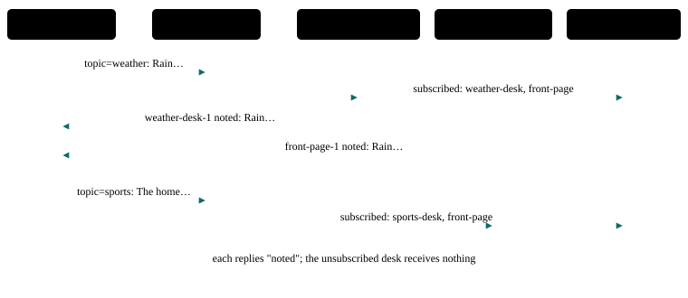

# P21 · Publish / subscribe (topic routing)

A message posted to a topic reaches only the agents subscribed to it.

<div class="facts"><span>written 2026-10-02</span><span>status: <span class="badge built">built</span> 2026-10-02, three recorded runs and one under its bound, all green</span><span>team: <a href="../../teams/topics/team.json"><code>teams/topics/</code></a></span><span>test: <a href="../../tests/agents/p21-topics.test.ts"><code>tests/agents/p21-topics.test.ts</code></a></span><span>plan: <code>docs/plans/patterns-phase-3.md</code>, its runs</span></div>

> [!SUMMARY]
> - Scenarios: `p21-a` (topic `weather`) and `p21-b` (topic `sports`), as `docs/plans/orchestration-patterns.md` specifies them.
> - Built: its three recorded runs on the pinned model passed, then one under the bound they set, at `0ed2808` (runs (`docs/plans/patterns-phase-3.md`)); its checker's every claim is also unit-tested on fixtures.
> - Models: `weather-desk`, `sports-desk`, `front-page` on `qwen3-8b-q4_k_m`.
> - Each member's subscriptions are its `topics` in [`team.json`](../../teams/topics/team.json): `weather-desk` takes `weather`, `sports-desk` takes `sports`, `front-page` takes both. A message names its topic with `topic=` ([topics](../architecture/channel.md#addressing)).
> - The routing is the harness's: a subscriber is sent the message as a message to everyone, so nothing a model sees changes; an agent that is not subscribed never receives it.

## Watch it run {#watch}

<video controls preload="metadata" src="videos/p21-topics.webm"></video>

Recorded at `fb3d995` on 2026-10-16, its team on `qwen3-8b-q4_k_m` ([sidecar](videos/p21-topics.json)): the portal's scene and chat as the demo's agent-suite run went, 25 s, every scenario passed. How it is recorded: [Testing](../testing/index.md#videos).

## What it is for {#use}

**Use it** when several agents each care about a kind of message, and the sender should not have to know which agents those are.

**Do not use it** when one agent should decide who handles a message (router, P2), or when every agent should see every message and decide for itself (group chat, self-selection, P12).

## How the messages flow {#flow}



## Run it {#run}

Launch the team, then send a scenario's message: exactly the commands below, which the demo's agent-suite file reads from this page and runs. The `# bound` line is the most a request may take (`docs/plans/orchestration-patterns.md` R8): 15,000 ms, set from its first three recorded runs (`docs/plans/patterns-phase-3.md` R4) — the largest request, p21-a's 9,501 ms at `b63f543`, times 1.5 (14,251.5), rounded up to a whole second; the cap is 45,000 ms.

```asha-run
./asha --launch team=topics
# bound: 15000 ms
# p21-a
./asha topic=weather user=alice message="Rain expected tomorrow."
# p21-b
./asha topic=sports user=alice message="The home team won."
```

## A real transcript {#transcript}

Recorded at `b63f543` (clean tree), its third recorded run, from its results file as committed in `6519546` (`git show 6519546:tests/agents/results/p21-topics.json`): each scenario's command as the suite ran it (it adds `--verbose`, which prints the `›` progress lines), its stderr, then its stdout. The models' output as it streams (lines such as "› <handle> reply: {…}") is left out here; the results file holds it.

**p21-a** — exit 0, 9,501 ms:

```text
$ ./asha --verbose topic=weather user=alice message="Rain expected tomorrow."
› alice → main: Rain expected tomorrow.
› front-page-1: ok
› output front-page-1 → alice:
› weather-desk-1: ok
› output weather-desk-1 → alice:
front-page-1 noted: Rain expected tomorrow.
weather-desk-1 noted: Rain expected tomorrow.
```

**p21-b** — exit 0, 5,827 ms:

```text
$ ./asha --verbose topic=sports user=alice message="The home team won."
› alice → main: The home team won.
› front-page-1: ok
› output front-page-1 → alice:
› sports-desk-1: ok
› output sports-desk-1 → alice:
front-page-1 noted: The home team won.
sports-desk-1 noted: The home team won.
```


## The team and the test {#team}

- [`teams/topics/team.json`](../../teams/topics/team.json): the team — `weather-desk`, `sports-desk`, `front-page`, launched in that order, each joining as `<name>-1`, each with its `topics`.
- `weather-desk`: [`weather-desk.json`](../../teams/topics/weather-desk.json), its recipe, and [`weather-desk.md`](../../teams/topics/weather-desk.md), its guidance, a full-text document in its system prompt.
- `sports-desk`: [`sports-desk.json`](../../teams/topics/sports-desk.json) and [`sports-desk.md`](../../teams/topics/sports-desk.md).
- `front-page`: [`front-page.json`](../../teams/topics/front-page.json) and [`front-page.md`](../../teams/topics/front-page.md).
- [`tests/agents/p21-topics.test.ts`](../../tests/agents/p21-topics.test.ts): launches the team and sends each scenario's message from this page, then asserts each scenario only through its checker, `P21_A` and `P21_B` in [`tests/agents/patterns/phase-3.ts`](../../tests/agents/patterns/phase-3.ts), and records the checker's proof for the report.
- The checker's fixtures, one passing conversation, one per mutation the plan lists and one breaking every other claim: [`tests/agents/patterns/fixtures/p21-a/`](../../tests/agents/patterns/fixtures/p21-a/pass.json) and [`p21-b/`](../../tests/agents/patterns/fixtures/p21-b/pass.json), run by [`tests/unit/pattern-proofs.test.ts`](../../tests/unit/pattern-proofs.test.ts) in `npm test`.

## Limits on a local model {#limits}

- The delivery is the harness's and does not depend on the model; each desk only has to say it noted the message, which the probes showed, 3/3 for each turn (`docs/plans/patterns-phase-3.md`).
- Only a user's message has a topic; agents do not publish to topics, and a topic no agent on the channel takes is refused (`unknown_topic`), nothing posted.

## Its report {#report}

Each run's proof — every claim with the transcript line or log record that shows it — and every repeat's time: [agent test report, P21 · Publish / subscribe (topic routing)](../testing/agent-tests.html#pattern-p21).
