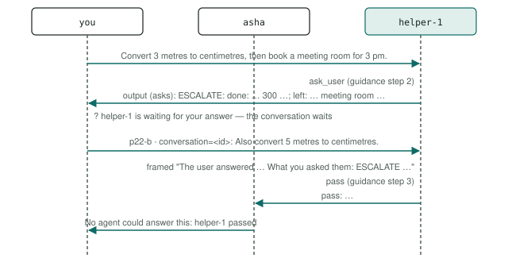

# P22 · Escalation to a human (the summary)

An agent that cannot finish a request does what it can, then hands the rest to the user with a summary of what it did and what is left, and takes no further action in that conversation.

<div class="facts"><span>written 2026-09-29</span><span>updated 2026-10-02: the take-over, p22-b (<code>docs/plans/patterns-phase-3.md</code> R28)</span><span>status: <span class="badge built">built</span> 2026-09-29; with p22-b 2026-10-02, three recorded runs and one under its bound, all green</span><span>team: <a href="../../teams/escalation/team.json"><code>teams/escalation/</code></a></span><span>test: <a href="../../tests/agents/p22-escalation.test.ts"><code>tests/agents/p22-escalation.test.ts</code></a></span><span>plan: <code>docs/plans/patterns-phase-1.md</code>, its runs</span></div>

> [!SUMMARY]
> - Scenarios: `p22-a`, the summary, and `p22-b`, the take-over, as `docs/plans/orchestration-patterns.md` specifies them.
> - The helper escalates with `ask_user` ([asking the user](../architecture/channel.md#asking)): its summary is its question, and the conversation waits for the user. The user's answer comes back to it framed with its escalation, and it passes, whatever the answer asks — even work in its role: it has handed the conversation to the user.
> - Built: p22-a's three recorded runs on the pinned model passed in phase 1 (runs (`docs/plans/patterns-phase-1.md`)); with p22-b, three more and one under the bound they set, at `01184ad` (runs (`docs/plans/patterns-phase-3.md`)); each checker's every claim is also unit-tested on fixtures.
> - Models: `helper` on `qwen3-8b-q4_k_m`.

## Watch it run {#watch}

<video controls preload="metadata" src="videos/p22-escalation.webm"></video>

Recorded at `fb3d995` on 2026-10-16, its team on `qwen3-8b-q4_k_m` ([sidecar](videos/p22-escalation.json)): the portal's scene and chat as the demo's agent-suite run went, 13 s, every scenario passed. How it is recorded: [Testing](../testing/index.md#videos).

## What it is for {#use}

**Use it** when an agent may meet requests only partly in its role, and the user, not another agent, should decide what happens to the rest.

**Do not use it** when another agent can do the rest (hand it off, P1, or route it, P2), or when the user should approve a step rather than take over (human approval, P15).

## How the messages flow {#flow}



## Run it {#run}

Launch the team, then send a scenario's message: exactly the commands below, which the demo's agent-suite file reads from this page and runs. The `# bound` line is the most a request may take (`docs/plans/orchestration-patterns.md` R8): 7,000 ms, set from its three recorded runs with p22-b (`docs/plans/patterns-phase-3.md` R4, R5) — the largest request, p22-a's 4,144 ms at `1b361ea`, times 1.5 (6,216), rounded up to a whole second; the cap is 45,000 ms. (*Updated 2026-10-02:* it was 6,000 ms, from phase 1's runs, p22-a's 3,906 ms at `2192408`, when the helper escalated with `reply`.)

```asha-run
./asha --launch team=escalation
# bound: 7000 ms
# p22-a
./asha to=helper-1 user=alice message="Convert 3 metres to centimetres, then book a meeting room for 3 pm."
# p22-b
./asha to=helper-1 user=alice message="Convert 3 metres to centimetres, then book a meeting room for 3 pm."
./asha user=alice conversation=@previous message="Also convert 5 metres to centimetres."
```

p22-b's second command answers the first in its conversation: `@previous` stands for the conversation id the first command's waiting line prints (`? helper-1 is waiting for your answer: asha user=alice conversation=<id> message="…"`), which the suite fills in.

## A real transcript {#transcript}

Recorded at `91a4762` (clean tree), its third recorded run with p22-b, from its results file as committed in `abc12df` (`git show abc12df:tests/agents/results/p22-escalation.json`): each scenario's commands as the suite ran them (it adds `--verbose`, which prints the `›` progress lines; p22-b's second command carries the conversation id its first printed), the stderr, then the stdout. The waiting line, `? …`, is stderr's, printed always. The models' output as it streams is left out here; the results file holds it.

**p22-a** — exit 0, 4,142 ms:

```text
$ ./asha --verbose to=helper-1 user=alice message="Convert 3 metres to centimetres, then book a meeting room for 3 pm."
› alice → helper-1 on main: Convert 3 metres to centimetres, then book a meeting room for 3 pm.
› helper-1: ok
› output helper-1 → alice:
? helper-1 is waiting for your answer: asha user=alice conversation=68625e69685220ac message="…"
ESCALATE: done: 3 metres = 300 centimetres; left: book a meeting room for 3 pm
```

**p22-b** — exit 0, 1,132 ms:

```text
$ ./asha --verbose to=helper-1 user=alice message="Convert 3 metres to centimetres, then book a meeting room for 3 pm."
› alice → helper-1 on main: Convert 3 metres to centimetres, then book a meeting room for 3 pm.
› helper-1: ok
› output helper-1 → alice:
? helper-1 is waiting for your answer: asha user=alice conversation=ab820f96525f21bb message="…"
ESCALATE: done: 3 metres = 300 centimetres; left: book a meeting room for 3 pm
```

**p22-b** — exit 1, 752 ms:

```text
$ ./asha --verbose user=alice conversation=ab820f96525f21bb message="Also convert 5 metres to centimetres."
› alice → helper-1 on main: Also convert 5 metres to centimetres.
› helper-1: pass: User has answered the escalation request
› output asha → alice:
No agent could answer this:
- helper-1 passed: User has answered the escalation request
```

## The team and the test {#team}

- [`teams/escalation/team.json`](../../teams/escalation/team.json): the team — `helper`, launched in that order, each joining as `<name>-1`.
- `helper`: [`helper.json`](../../teams/escalation/helper.json), its recipe, and [`helper.md`](../../teams/escalation/helper.md), its guidance, a full-text document in its system prompt.
- [`tests/agents/p22-escalation.test.ts`](../../tests/agents/p22-escalation.test.ts): launches the team and sends each scenario's commands from this page, then asserts each scenario only through its checker — `P22_A` in [`tests/agents/patterns/phase-1.ts`](../../tests/agents/patterns/phase-1.ts), `P22_B` in [`tests/agents/patterns/phase-3.ts`](../../tests/agents/patterns/phase-3.ts) — and records the checker's proof for the report.
- The checkers' fixtures, one passing conversation and one per mutation the plans list (p22-b's also one breaking every other claim): [`fixtures/p22-a/`](../../tests/agents/patterns/fixtures/p22-a/pass.json) and [`fixtures/p22-b/`](../../tests/agents/patterns/fixtures/p22-b/pass.json), run by [`tests/unit/pattern-proofs.test.ts`](../../tests/unit/pattern-proofs.test.ts) in `npm test`.

## Limits on a local model {#limits}

- The helper is alone on its channel, where the general instructions say to pass on work outside its role; its prompt names escalating as its work, and its guidance says how.
- Its third step fires on the frame of the user's answer, which starts "The user answered" and carries the escalation as its question. Without that step the model converts the 5 metres (the plan's control C4, 0/3); with it, it passes 3/3 (premise probes (`docs/plans/patterns-phase-3.md`)).
- Measured (2026-09-29, runs (`docs/plans/patterns-phase-1.md`)): passed its first run at `90c3eec` with no change to its guidance, one model turn of 3.9–4.0 s, so its bound is 6 s. p22-b, the take-over, was added by `docs/plans/patterns-phase-3.md` (2026-10-02).

## Its report {#report}

Each run's proof — every claim with the transcript line or log record that shows it — and every repeat's time: [agent test report, P22 · Escalation to a human (the summary)](../testing/agent-tests.html#pattern-p22).
