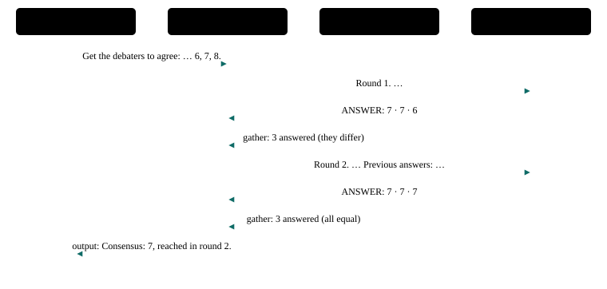

# P23 · Iterative consensus debate

Debaters with different first answers see each other's answers round after round and revise their own, until they agree or the rounds run out; a moderator reports the outcome.

<div class="facts"><span>written 2026-09-29</span><span>status: <span class="badge built">built</span> 2026-09-29, three recorded runs and one under its bound, after R6's remedies, all green; listed once the <a href="../testing/index.md#selection">demo selector</a> was built</span><span>team: <a href="../../teams/consensus/team.json"><code>teams/consensus/</code></a></span><span>test: <a href="../../tests/agents/p23-consensus.test.ts"><code>tests/agents/p23-consensus.test.ts</code></a></span><span>plan: <code>docs/plans/patterns-phase-2.md</code></span></div>

> [!SUMMARY]
> - Scenarios: `p23-a`, as `docs/plans/orchestration-patterns.md` specifies them.
> - Built: its three recorded runs on the pinned model passed after R6's remedies, then one under the bound they set, at `e82c5e4` (runs (`docs/plans/patterns-phase-2.md`)); it joined the built demos once the demo selector existed (patterns-phase-2 R13), and its checker's every claim is also unit-tested on fixtures.
> - Models: `moderator`, `debater-a`, `debater-b`, `debater-c` on `qwen3-8b-q4_k_m`.
> - No judge decides: each debater revises its own answer from the previous round's answers, which the moderator quotes in its next question. At most three rounds.

## Watch it run {#watch}

<video controls preload="metadata" src="videos/p23-consensus.webm"></video>

Recorded at `fb3d995` on 2026-10-16, its team on `qwen3-8b-q4_k_m` ([sidecar](videos/p23-consensus.json)): the portal's scene and chat as the demo's agent-suite run went, 41 s, every scenario passed. How it is recorded: [Testing](../testing/index.md#videos).

## What it is for {#use}

**Use it** when several agents should converge on one answer by reading each other's reasoning (multi-agent debate, Du et al.).

**Do not use it** when a decision is needed without convergence (debate with a judge, P9) or when independence matters more (voting, P10).

## How the messages flow {#flow}



## Run it {#run}

Launch the team, then send a scenario's message: exactly the commands below, which the demo's agent-suite file reads from this page and runs. The `# bound` line is the most a request may take (`docs/plans/orchestration-patterns.md` R8): 44,000 ms, set from its first three recorded runs (`docs/plans/patterns-phase-2.md` R4) — the largest request, p23-a's 29,092 ms at `c267b82`, times 1.5 (43,638), rounded up to a whole second; the cap is 45,000 ms.

```asha-run
./asha --launch team=consensus
# bound: 44000 ms
# p23-a
./asha to=moderator-1 user=alice message="Get the debaters to agree: how many colours does a rainbow have? Choose from 6, 7, 8."
```

## A real transcript {#transcript}

Recorded at `e82c5e4` (clean tree), the run under its bound, from its results file as committed in `c929f30` (`git show c929f30:tests/agents/results/p23-consensus.json`): each scenario's command as the suite ran it (it adds `--verbose`, which prints the `›` progress lines), its stderr, then its stdout. The models' output as it streams — lines such as "› delegator-1 consult: {…" printed one fragment each (D38) — is left out here; the results file holds it.

**p23-a** — exit 0, 29,464 ms:

```text
$ ./asha --verbose to=moderator-1 user=alice message="Get the debaters to agree: how many colours does a rainbow have? Choose from 6, 7, 8."
› alice → moderator-1 on main: Get the debaters to agree: how many colours does a rainbow have? Choose from 6, 7, 8.
› moderator-1: ok
› internal moderator-1 → debater-a-1: Round 1. How many colours does a rainbow have? Choose from 6, 7, 8.
› internal moderator-1 → debater-b-1: Round 1. How many colours does a rainbow have? Choose from 6, 7, 8.
› internal moderator-1 → debater-c-1: Round 1. How many colours does a rainbow have? Choose from 6, 7, 8.
› internal debater-b-1 → moderator-1: Schools teach seven colours. ANSWER: 7
› internal debater-a-1 → moderator-1: Red to violet gives seven. ANSWER: 7
› internal debater-c-1 → moderator-1: Indigo and violet are one colour. ANSWER: 6
› internal asha → moderator-1: Answers to moderator-1's call: 3 answered.
› moderator-1: ok
› internal moderator-1 → debater-a-1: Round 2. How many colours does a rainbow have? Choose from 6, 7, 8. Previous answers: debater-a-1: Red to violet gives seven. ANSWER: 7 debater-b-1: Schools teach seven colours. ANSWER: 7 debater-c-1: Indigo and violet are one colour. ANSWER: 6
› internal moderator-1 → debater-b-1: Round 2. How many colours does a rainbow have? Choose from 6, 7, 8. Previous answers: debater-a-1: Red to violet gives seven. ANSWER: 7 debater-b-1: Schools teach seven colours. ANSWER: 7 debater-c-1: Indigo and violet are one colour. ANSWER: 6
› internal moderator-1 → debater-c-1: Round 2. How many colours does a rainbow have? Choose from 6, 7, 8. Previous answers: debater-a-1: Red to violet gives seven. ANSWER: 7 debater-b-1: Schools teach seven colours. ANSWER: 7 debater-c-1: Indigo and violet are one colour. ANSWER: 6
› internal debater-c-1 → moderator-1: Most of us say 7. ANSWER: 7
› internal debater-a-1 → moderator-1: Most of us say 7. ANSWER: 7
› internal debater-b-1 → moderator-1: Most of us say 7. ANSWER: 7
› internal asha → moderator-1: Answers to moderator-1's call: 3 answered.
› moderator-1: ok
› output moderator-1 → alice:
Consensus: 7, reached in round 2.
```

## The team and the test {#team}

- [`teams/consensus/team.json`](../../teams/consensus/team.json): the team — `moderator`, `debater-a`, `debater-b`, `debater-c`, launched in that order, each joining as `<name>-1`.
- `moderator`: [`moderator.json`](../../teams/consensus/moderator.json), its recipe, and [`moderator.md`](../../teams/consensus/moderator.md), its guidance, a full-text document in its system prompt.
- `debater-a`: [`debater-a.json`](../../teams/consensus/debater-a.json), its recipe, and [`debater-a.md`](../../teams/consensus/debater-a.md), its guidance, a full-text document in its system prompt.
- `debater-b`: [`debater-b.json`](../../teams/consensus/debater-b.json), its recipe, and [`debater-b.md`](../../teams/consensus/debater-b.md), its guidance, a full-text document in its system prompt.
- `debater-c`: [`debater-c.json`](../../teams/consensus/debater-c.json), its recipe, and [`debater-c.md`](../../teams/consensus/debater-c.md), its guidance, a full-text document in its system prompt.
- [`tests/agents/p23-consensus.test.ts`](../../tests/agents/p23-consensus.test.ts): launches the team and sends each scenario's message from this page, then asserts each scenario only through its checker, `P23_A` in [`tests/agents/patterns/phase-2.ts`](../../tests/agents/patterns/phase-2.ts), and records the checker's proof for the report.
- The checker's fixtures, one passing conversation, one per mutation the plan lists and one breaking every other claim: [`tests/agents/patterns/fixtures/p23-a/`](../../tests/agents/patterns/fixtures/p23-a/pass.json), run by [`tests/unit/pattern-proofs.test.ts`](../../tests/unit/pattern-proofs.test.ts) in `npm test`.

## Limits on a local model {#limits}

- Measured in the premise probes (2026-09-29, `0be190f`), its chain of model turns took 22.7 s with cold prompts and 13.4 s warm; a third round would add two turns (`docs/plans/patterns-phase-2.md`).
- Expected on the pinned model, not asserted: consensus on 7 in round 2, as every recorded run reached it (28–29 s). The proof checks the rounds and the outcome against what the gathers hold, whatever they hold.
- Copying the answers is the model's weak point: the first two recorded cycles failed because the moderator quoted the debaters' numbers only; each debater's round-1 answer is now given whole in its guidance, and the moderator's guidance shows a whole answer copied (`docs/plans/patterns-phase-2.md`, R6).

## Its report {#report}

Each run's proof — every claim with the transcript line or log record that shows it — and every repeat's time: [agent test report, P23 · Iterative consensus debate](../testing/agent-tests.html#pattern-p23).
