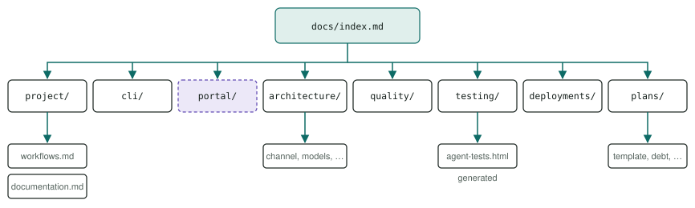
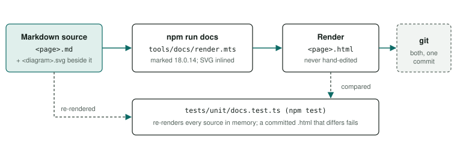

# Documentation contract

Every page under `docs/` is a Markdown source rendered to committed HTML, linked from one index, styled by one stylesheet, loading nothing from the network, with every gap marked and future work only in the plans. It carries out PRINCIPLES §17 and §19 (2026-09-27), as AGENTS.md §4 applies them.

<div class="facts"><span>verified 2026-09-27</span><span>renderer: <code>tools/docs/render.mts</code></span><span>stylesheet: <code>docs/assets/docs.css</code></span><span>guard: <code>tests/unit/docs.test.ts</code></span><span>sources: PRINCIPLES.md §15, §17, §19, AGENTS.md §4</span></div>

> [!SUMMARY]
> - Edit the `.md`, run `npm run docs`, commit both; never hand-edit an `.html`.
> - Link every page directly from `docs/index.md` or its section index.
> - Open with a lede and a summary of 3–5 bullets stating what is true or what to do; use only the classes in `docs/assets/docs.css`.
> - Mark gaps with <code>TODO&#58;</code>; unbuilt work is only a planned badge naming its plan.
> - `tests/unit/docs.test.ts` fails the gate on any breach; each of its checks was proven to fail ([History](history.md#guard-proofs)).

## Hierarchy {#hierarchy}

[docs/index.md](../index.md) is the one table of contents, each section has a `docs/<section>/index.md`, and pages sit in their section folder.



- **Linked directly:** every page from `docs/index.md` or its own section index; reachable through another page is not enough. The top-level index links every section index; a section index links each of its pages, usually as `.cards`.
- **Plans:** docs/plans/ (`docs/plans/index.md`) holds all future work (PRINCIPLES §19): the plans index with status, the plan template (`docs/plans/template.md`), the debt register (`docs/plans/debt.md`) (§20), and one page per plan. Every other section describes the system as it exists.
- **History:** a section's dated corrections, superseded results and proofs go on its `history.md`, linked from the section index, so the durable pages stay short and corrections stay visible (§12).
- **Files:** each `docs/**/<name>.md` renders to `<name>.html` beside it. The only other files are `assets/docs.css`, the `*.svg` diagrams and the [generated reports](#generated). The root Markdown (`README.md`, `AGENTS.md`, `CLAUDE.md`, `PRINCIPLES.md`) is not rendered.

## Markdown source and render {#source}

> [!DECISION] The owner, 2026-09-27
> The Markdown is the source of truth and the HTML is a render of it, file for file.



### Writing a source

- **Front matter** opens every source between two `---` lines, as plain `key: value` lines: `title` (two to four words), `description` (one sentence; no second `: ` in it, since GitHub reads the front matter as YAML 1.1 and shows an error above a page whose front matter is not, which [docs-standalone.test.ts](../../tests/unit/docs-standalone.test.ts) checks in every Markdown file the export publishes — every section but `plans/`, whose pages are not published and may still hold one), and on a plan page under `docs/plans/` other than `index.md`, `template.md` and `debt.md`, a `status` of `draft`, `ready`, `in-progress` or `done`, rendered as a badge. A missing, unknown or repeated key or an invalid status fails the render, naming the file and key.
- **Exactly one `#` heading,** the page's `h1`. Before the first `##` is the header: the first paragraph becomes the `.lede`, and a raw `<div class="facts">` carries the verified date.
- **Each `##` starts a `<section>`.** A trailing `{#id}` sets the id, else it is a slug of the text; a duplicate id fails the render. Keep an id stable once anything links to it. The renderer adds a `nav.toc` to a page with more than three `##` sections.
- **Link pages by their `.md` source**, with any `#fragment`: `[Workflows](workflows.md#review)`; the renderer rewrites it to the `.html`. Links to code, `.svg` and external pages are unchanged.
- **Diagrams** are `.svg` files beside the page, alone in their paragraph as ``, inlined in a `figure.diagram` ([conventions](#diagrams)). A network image, a non-`.svg` image, or a diagram sharing its paragraph fails the render.
- **Callouts** are quotes starting `> [!KIND] optional title`, `KIND` one of `SUMMARY`, `NOTE`, `TIP`, `WARNING` or `DECISION`, rendered as a `div.callout` titled by the title or the kind's default ("In short" for `SUMMARY`). An unknown kind fails the render.
- **At most one folder deep:** `docs/index.md`, `docs/<section>/index.md`, `docs/<section>/<page>.md`.
- **Raw HTML** for what Markdown lacks: cards, number tiles (`.stats`), badges, `.facts`, `.pre-label`.
- **Gaps are auto-marked:** a literal <code>TODO&#58;</code> in prose renders to the end of its text run (the line, a table cell, or the next inline element such as a link) inside `span.todo`; written `TODO&#58;` it is only a mention ([markers](#markers)).

> [!WARNING] Raw HTML blocks
> Under Markdown's HTML-block rule (the parser is `marked`), a block starts with a tag at the start of a line and ends at the next blank line, and Markdown inside it is not parsed. Write `<code>`, `<strong>` and `<a>` as HTML there. A `<pre>` block is the exception: it runs to its `</pre>`, blank lines included.

### Rendering

- **`npm run docs`** renders every source; `npm run docs -- project/workflows.md quality/index.md` renders only those (paths relative to `docs/`). The output is deterministic.
- **Commit the render; never hand-edit it.** Its footer and top comment say so, and the guard fails on a committed `.html` that differs from a fresh render.
- **One renderer:** [`tools/docs/render.mts`](../../tools/docs/render.mts). `AGENTS.md` records its sha256, and the guard fails on a mismatch. Its header comment is the short form of this section.
- **Its one dependency:** `marked`, pinned exactly at `18.0.14`: MIT licence, no dependencies of its own, ESM only (npm registry, 2026-09-27). Not `markdown-it`, which has six dependencies where a GFM parser is all that is needed (PRINCIPLES §7). A newer `marked` is adopted only by re-pinning it in both repos, re-rendering, and keeping the guard green.

## Page template {#template}

The renderer writes the chrome: the doctype and `<html lang="en">`, the charset and viewport metas, the `<title>` and meta description from the front matter, the stylesheet link, the breadcrumbs (docs index → section index → page), the table of contents, and a footer naming the source. Copy this for a section page:

<p class="pre-label">docs/&lt;section&gt;/&lt;page&gt;.md</p>

```markdown
---
title: Two To Four Words
description: One sentence: what this page answers.
---

# Page title

Two sentences: what this is and why a reader cares. This paragraph is the lede.

<div class="facts"><span>verified YYYY-MM-DD</span><span>code: <a href="../../src/…">src/…</a></span></div>

> [!SUMMARY]
> - 3–5 bullets stating what is true or what to do.

## First topic {#first}

Prose, lists and tables in plain Markdown. Link pages by their source,
[Workflows](../project/workflows.md#review), and code by relative path,
[`src/daemon/log.ts`](../../src/daemon/log.ts).


> [!TIP]
> A callout is a quote, so `code` and [links](../index.md) inside it are Markdown.

## Second topic {#second}
```

A section index has the same shape, linking its pages from a `<div class="cards">` of `<a class="card">` tiles.

## Styling and the class vocabulary {#styling}

- **One stylesheet,** [`docs/assets/docs.css`](../assets/docs.css), light theme only (`color-scheme: light`), no inline colours but the generated block each diagram carries for a viewer that shows it on its own ([below](#diagrams)), which never applies once a page inlines it. `AGENTS.md` records its sha256, and the guard fails on a mismatch. Something new goes into the stylesheet for every page.
- **One exception:** the two CLI pages ([guide](../cli/guide.md), [reference](../cli/index.md)) keep their terminal-transcript styles (gutters, `td:first-child` wrapping) in a page-local `<style>` block, which would change every other page if global.
- **Nothing from the network:** no external scripts, stylesheets, fonts or images. The font stacks name IBM Plex first and fall back to system fonts.
- **Short:** a summary of answers after the lede, short paragraphs, tables for comparisons, code only where it matters most.

*Rendered* classes come from the renderer; the rest are raw HTML in the source.

| Class / element | Use |
|---|---|
| `header.page`, `nav.crumbs`, `.lede`, `nav.toc`, `footer.page` | Page chrome (*rendered*) |
| `.facts` | Monospace header facts, including `verified YYYY-MM-DD` |
| `.callout.summary` / `.note` / `.tip` / `.warning` / `.decision` | A `> [!KIND]` quote: the answers, a side fact, a shortcut, a real trap or limit, a recorded decision (*rendered*) |
| `.stats` > `.stat` | Number tiles: a `<b>` figure and a `<span>` label |
| `.cards` > `a.card` | A section's pages, each with an `h3` and a `p` |
| `.badge.built` / `.planned` / `.placeholder` / `.pass` / `.fail` | Status: <span class="badge built">built</span> <span class="badge planned">planned: pc-cuda</span> <span class="badge placeholder">placeholder</span> <span class="badge pass">pass</span> <span class="badge fail">fail</span>. Outside `docs/plans/`, `.planned` is always a `<span>` naming the plan, `planned: <slug>`, never a link: the plans are not published (`docs/plans/oss-release.md` R37, 2026-10-16) |
| `.badge.draft` / `.ready` / `.progress` / `.done` | A plan's front matter `status` (`in-progress` renders as `.progress`) (*rendered*) |
| `.note`, `.tip` | Raw-HTML caution (blue, "i") or context (green, "✓") |
| `.placeholder-box` | A whole section not written yet (amber, "!") |
| `.todo` | A <code>TODO&#58;</code> gap: <span class="todo">TODO&#58; example</span> (*rendered*) |
| `.table-wrap` | Lets every table scroll sideways on a phone (*rendered*) |
| `.pre-label` | A caption above a code block, such as the file name |
| `figure.diagram` | An inlined SVG and its `figcaption` (*rendered*) |

## SVG diagram conventions {#diagrams}

- **One `.svg` per diagram**, beside its page, starting `<svg xmlns="http://www.w3.org/2000/svg" …>` so it opens on its own.
- **Accessible:** `role="img"` and `aria-labelledby` pointing to a `<title>` and a `<desc>` that states the mechanism in words. No `<title>` fails the render.
- **The real mechanism:** real component names, routes, file paths and call directions. No decorative boxes.
- **Scale with `viewBox`:** the stylesheet sets `width: 100%; height: auto`. Stay roughly 760 units wide or less, with labels of 11 px or more, so text is legible at 360 px; keep labels clear of box borders.
- **Page-prefixed unique ids** for every `title`, `desc` and `marker` (for example `id="dc-arr"`), since diagrams are inlined.
- **Classes:** shapes `.box`, `.box.accent` (the focus), `.box.host` (a dashed boundary, such as "your machine"), `.box.planned` (not built); text `.label`, `.label.small`, `.label.mono`, `.label.title`; lines `.edge`, `.edge.dim` (optional or planned).
- **Arrowheads:** one `<marker>` per diagram filled `#0e6b66`, the only literal colour written by hand, because markers do not inherit CSS (the standalone block below is generated from the stylesheet).
- **Standalone style:** GitHub, and a browser opening the `.svg`, show a diagram without the stylesheet, so its shapes drew black (2026-10-18). Each diagram carries, after its `<desc>`, a `<style>` with the stylesheet's `svg …` rules, their colours resolved and every selector under `svg:root`, so the rules apply only where the diagram is its own document, never once it is inlined in a page. [`tools/docs/svg-standalone.mts`](../../tools/docs/svg-standalone.mts) writes it, and refuses a stylesheet `svg` rule it cannot copy (one not written `svg .class { … }` on one line) or a `var()` it cannot resolve; run `node --experimental-strip-types tools/docs/svg-standalone.mts` after adding a diagram or changing those rules. [docs-standalone.test.ts](../../tests/unit/docs-standalone.test.ts) fails on a diagram whose block is missing or stale.

## Deep links to code {#links}

- Link files by relative path, naming the symbol, not the line: "`JsonLinesLogger` in [src/daemon/log.ts](../../src/daemon/log.ts)". Line numbers drift; names are searchable.
- Every relative link in the render must resolve, or the guard fails.
- Keep code samples short and copied from the real file.

## TODO and planned markers {#markers}

Gaps are marked, never papered over (PRINCIPLES §5, §17).

| Situation | Write |
|---|---|
| Unknown or unwritten | A line starting <code>TODO&#58;</code>: what is missing and, where known, who supplies it. Renders as `span.todo` |
| Mentioning the marker | The colon as an entity, `TODO&#58;`; neither the renderer nor the grep counts it |
| Not built yet | A plan in docs/plans/ (`docs/plans/index.md`); on durable pages only `<span class="badge planned">planned: <slug></span>`. In diagrams, `.box.planned` and `.edge.dim` |
| A sketch never run | A label saying it is an unverified sketch, never a working command (PRINCIPLES §14) |

The design lives in the plan, never on the durable page (§19). Remove the badge in the commit that completes the plan, and re-verify the page date. List every open gap from the repo root:

```sh
grep -rn "TODO[:]" docs --include='*.md'
```

## Generated pages {#generated}

No `.html` under `docs/` is written by hand; change its source or generator and re-run it.

| Page | Generator | Command |
|---|---|---|
| Every `docs/**/<name>.html` with a `<name>.md` | [`tools/docs/render.mts`](../../tools/docs/render.mts) | `npm run docs` |
| [docs/testing/agent-tests.html](../testing/agent-tests.html) | [`evals/report.ts`](../../evals/report.ts), from `tests/agents/results/*.json` | `npm run report` |

`testing/agent-tests.html` has no Markdown source; the guard exempts it by name (`EXEMPT` in `tests/unit/docs.test.ts`). Commit a regenerated report with the results it came from, which record their commit (PRINCIPLES §13).

## The guard test {#guard}

[`tests/unit/docs.test.ts`](../../tests/unit/docs.test.ts) runs in `npm test`, so in the gate. Every check below was broken on purpose and seen to fail naming the offender: [the proofs](history.md#guard-proofs).

### Checks on the sources

It renders every source in memory and fails when:

- a source does not render: bad front matter, not exactly one `#` heading, a duplicate id, nesting too deep, or a diagram missing, without `<title>`, not `.svg` or from the network;
- a committed `.html` differs from its fresh render, naming the file and `npm run docs`;
- an `.html` under `docs/` has no `.md` source and is not exempt (`testing/agent-tests.html`), or an `.svg` is used by no source;
- `tools/docs/render.mts` or `docs/assets/docs.css` no longer matches the sha256 recorded in `AGENTS.md`;
- a page outside `docs/plans/` does not open with exactly one summary callout in its header;
- a plan's `status` does not match its Status badge in the plans index, or a plan not done is checked off there;
- a file under `docs/` is not a source, a render, a diagram, the stylesheet or a generated page;
- a source other than `cli/guide.md` and `cli/index.md` has a `<style>` block;
- a plan other than the template writes `TODO&#58;` outside a code span, hiding a gap from the grep;
- a plan line holds a second checkbox after its first — a duplicated criterion or step (added 2026-09-29, from model-streaming's completion review);
- [Testing](../testing/index.md#unit)'s unit table does not list a `tests/unit/**/*.test.ts` file, lists one that is gone, or lists one twice (added 2026-09-29, from cli-interactive's completion review, finding 4: nine files had gone unlisted; its proof: `evals/probes/cli-interactive-2026-09-29/proof-unit-table-guard.log.txt`); the row counts are not checked, needing a run, and are dated by the note under the table;
- a source holds a character that is invisible or changes text direction — a C0 control but tab and newline, a C1 control, or a format character (Unicode category `Cf`: bidirectional controls, zero-width characters, the byte order mark) — naming the file, line and code point (added 2026-10-01, from extension-modules' amendment for O4, review finding 1: a raw U+202E, meant as the escape `\u202e`, reversed the rendered page's text; its proof: [History](history.md#guard-proofs));
- `package.json` does not require exactly the Node versions both the installed Vitest and the installed ESLint declare — the intersection of their ranges, `^22.13.0 || ^24.0.0 || >=26.0.0` for Vitest 5.0.2 and ESLint 10.12.0 (since 2026-10-14, `docs/plans/lint-format.md` R10 (b); Vitest's range alone before it) — or that floor is not the `@types/node` major.minor or is below 22.6, the first Node with `--experimental-strip-types` (22.12 has it: Node v22.12.0 CLI docs, read 2026-09-27).

### Checks on the rendered HTML

- a relative `href` or `src` does not resolve, or a `#fragment` names an `id` its page lacks; a link points at a `.md` under `docs/`; an `id` repeats in a page;
- a relative link targets a file git ignores (`git check-ignore`), which exists only on the machine that made it and not in a clean checkout;
- a page is not linked directly by an `<a>` from `docs/index.html` or its section's `index.html` (a section index from `docs/index.html`; the plans index, which `docs/index.md` names as code, is a root of its own);
- a page does not link `docs/assets/docs.css` by a correct relative path, or lacks `<!doctype html>`, a `<title>` or a viewport meta;
- anything loads from the network: a remote `src`, `data`, `poster` or `xlink:href`; a remote entry in `srcset` or `imagesrcset`; a remote `href` on `<link>`, `<script>` or SVG `<image>`, `<use>`, `<feImage>`; a CSS `@import` or `url()` off the machine (a remote `<a href>` is a link, not a load);
- a link from `README.md`, `AGENTS.md` or `CLAUDE.md` into `docs/` does not resolve, or its `#fragment` names no `id`;
- outside `docs/plans/`, a `badge planned` is not a `<span>` reading `planned: <slug>`, or (with the plans present) names no plan in `docs/plans/`; or a page outside `docs/plans/`, the README or the guidance links into a path the public export leaves out (`tools/oss/manifest.json`; `docs/plans/oss-release.md` R13, R37, 2026-10-16). The plans' own checks — each status and its index row, the counts, the debt lines — are `tests/unit/docs-plans.test.ts`'s, internal.

Comments and script and style bodies are ignored, and escaped markup (`&lt;a href…`) is text, so the template above is not mistaken for a link.

## What "done" means for a doc change {#done}

1. Every claim is true now; every command shown was run; every external fact carries its source and date (PRINCIPLES §12, §14).
2. The `.md` was edited, never the `.html`; it follows the [template](#template) and the stylesheet's classes; `npm run docs` was run.
3. It is linked directly from its section index or [docs/index.md](../index.md), which describes it.
4. Gaps carry <code>TODO&#58;</code>; unbuilt work is only a <span class="badge planned">planned: pc-cuda</span> badge, naming its plan.
5. It was looked at in a browser, including at phone width (PRINCIPLES §3).
6. It passes the [documentation checklist](workflows.md#check-docs) and its [adversarial review](workflows.md#review), and `npm run check` is green.
7. It is committed with the code it describes (PRINCIPLES §15).
