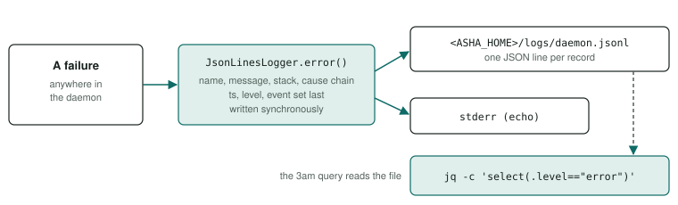

# Quality controls

What stops a defect from reaching a commit. Human review is optional (PRINCIPLES §21), so these controls have to catch defects on their own.

<div class="facts"><span>verified 2026-09-27; the linter and formatter 2026-10-12, in the gate 2026-10-14</span><span>gate: <code>npm run check</code></span><span>linter: ESLint, typescript-eslint and SonarJS, and Prettier, the gate's first two links</span><span>sources: tsconfig.json, eslint.config.mjs, .prettierrc.json, package.json, AGENTS.md, src/daemon/log.ts</span></div>

> [!SUMMARY]
> - `npm run check` is the gate: lint, format check, typecheck, unit, integration, demo selection, agents, eval, routing, stopping at the first failure. Nothing is done until it is green.
> - The typecheck is strict, TypeScript is pinned at 6.0.3, and Node APIs stop at 22.13; a test proves each strict setting.
> - ESLint (type-checked typescript-eslint and SonarJS, every rule on but four design exemptions) and Prettier run as `npm run lint` and `npm run format:check`, the gate's first two links since 2026-10-14 (`docs/plans/lint-format.md`).
> - A guard counts only once it has been seen to fail.
> - Definitions are closed schemas, models are pinned by sha, every failure lands in one JSON log, and every remote call is bounded.
> - Every change gets one adversarial review and must pass the [checklists](../project/workflows.md#checklists).

<div class="stats"><div class="stat"><b>9</b><span>links in the gate</span></div><div class="stat"><b>6.0.3</b><span>TypeScript, pinned exactly</span></div><div class="stat"><b>20 min</b><span>bound per agent or eval test</span></div></div>

## Static analysis {#static}

### TypeScript typecheck <span class="badge built">built</span> {#typecheck}

`npm run typecheck` runs `tsc --noEmit -p tsconfig.json` with TypeScript `6.0.3` over `src/` (less `src/portal/`), `images/*/src/`, `evals/`, `tools/` (the `.mts` files, such as `tools/docs/render.mts`), `tests/` and the Vitest configs; then `tsc --noEmit -p tsconfig.portal.json` over the [portal](../portal/index.md)'s page, `src/portal/`, and the shared modules it loads, with ES2024 and the DOM library and no Node types (`"types": []`), so a Node global such as `Buffer` in any module the page loads fails the check (`docs/plans/portal.md` R15); then `tsc --noEmit -p tsconfig.dom-tests.json` over the unit tests of the page's browser modules (`tests/**/*.dom.test.ts`) and their fakes ([`fake-dom.ts`](../../tests/helpers/fake-dom.ts), [`fake-canvas.ts`](../../tests/helpers/fake-canvas.ts)), with the DOM library and Node's types both, which `tsconfig.json` leaves out so no Node module may name a DOM type. `npm run build` compiles the first two, the page into `dist/portal-build/`. Settings in [tsconfig.json](../../tsconfig.json), which [tsconfig.portal.json](../../tsconfig.portal.json) repeats but for its library and types:

| Option | Value | Effect |
|---|---|---|
| `strict` | `true` | All strict-family checks, including `strictNullChecks` and `noImplicitAny` |
| `noUnusedLocals`, `noUnusedParameters` | `true` | Unused locals and parameters are errors |
| `noImplicitReturns` | `true` | Every path of a returning function returns |
| `noFallthroughCasesInSwitch` | `true` | No silent fall-through between `case`s |
| `noUncheckedIndexedAccess` | `true` | `a[i]`, `record[key]` may be `undefined` and must be checked |
| `noImplicitOverride` | `true` | An override needs the `override` keyword |
| `allowUnreachableCode`, `allowUnusedLabels` | `false` | Unreachable code and unused labels are errors |
| `verbatimModuleSyntax` | `true` | Type-only imports say `import type`, so emitted imports are exactly the written ones |
| `skipLibCheck` | `true` | Dependencies' declaration files are not checked |
| `target` / `lib` | `ES2024` / `ES2024`, `ES2025.Iterator`, `ES2025.Collection` | Stops at what Node 22 runs: ES2025's iterator helpers and Set methods are in Node 22; `Promise.try`, `Float16Array`, `RegExp.escape` are not. `dist/` was byte-identical to the `ES2022` build on 2026-09-27 |
| `module` | `nodenext` | Node ESM semantics for ES-module, CommonJS and dual packages |

**The Node API floor:** `@types/node` is `~22.13.0`, the floor of `engines`, so callable Node APIs stop at 22.13; the docs guard asserts both. It is the lowest the toolchain accepts: `engines` is the intersection of the ranges Vitest 5.0.2 declares, `^22.12.0 || ^24.0.0 || >=26.0.0`, and ESLint 10.12.0, `^20.19.0 || ^22.13.0 || >=24` — `^22.13.0 || ^24.0.0 || >=26.0.0` (`docs/plans/lint-format.md` R10 (b), since 2026-10-14; before it, Vitest's range alone and a 22.12 floor) — and Vite 8.3.1 requires `@types/node` `^20.19.0 || >=22.12.0` (each from its installed `package.json`, read 2026-10-14).

> [!WARNING]
> A newer `@types/node` declares APIs this floor lacks, such as `Float16Array` (Node 24) and `registerHooks` from `node:module` (Node 22.15). Those would typecheck and then throw at run time. One already does: `@types/node` 22.13.17 declares `findPackageJSON` (its own `@since v23.2.0, v22.14.0`), which is `undefined` on Node 22.13.1 — the only declaration in the package past 22.13.0 (its `@since` tags, read 2026-10-14). Nothing here calls it.

#### Why TypeScript 6.0.3, not 7.x

> [!DECISION] The owner, 2026-09-27 (debt D7)
> TypeScript stays on 6.0.3, because TypeScript 7.0 has no stable compiler API.

- 7.0 "does not ship with an API"; the team expects "TypeScript 7.1 to ship with a new (and different) API" ([Announcing TypeScript 7.0](https://devblogs.microsoft.com/typescript/announcing-typescript-7-0/), 2026-07-08, read 2026-09-27). The `typescript@7.0.2` main entry exports only the version; its API is under `typescript/unstable/*` (its `exports` map, read 2026-09-27).
- Tools on the stable API do not run on 7.0: typescript-eslint 8.70.1 peers `>=4.8.4 <6.1.0`, TypeDoc 0.28.20 `5.0.x … 6.0.x` (npm registry, read 2026-09-27). Since 2026-10-12 typescript-eslint 8.71.1 runs the [linter](#lint) (its peer range, read that day, still `>=4.8.4 <6.1.0`); TypeDoc is not installed.

> [!NOTE]
> Earlier corrections, measurements and guard proofs: [History](history.md).

#### Not enabled

| Option | Errors here (2026-09-27) | Why it stays off |
|---|---|---|
| `exactOptionalPropertyTypes` | 0 | It checks call sites against third-party declarations; in `web` it fails on `aws-cdk-lib`'s own types (`Bucket` is not assignable to `IBucket`). Broad package compatibility is the owner's stated priority (2026-09-27) |
| `erasableSyntaxOnly` | 61, all TS1294 on constructor parameter properties | Matters only if the repo runs `.ts` directly with Node's type stripping |

#### How the settings are guarded

[tests/unit/tsconfig.test.ts](../../tests/unit/tsconfig.test.ts) runs real `tsc` with this `tsconfig.json`: one canary per option from `strict` (its `noImplicitAny` and `strictNullChecks`) through `verbatimModuleSyntax`, each reporting exactly one expected error; one clean canary using ES2024 and Node 22's ES2025 parts; and three pinning the API ceiling (`Promise.try` and `RegExp.escape` outside `lib`, `Float16Array` outside `@types/node`, `registerHooks` outside its floor — `findPackageJSON` until 2026-10-14, when the 22.13 floor's `@types/node` turned out to declare it, [above](#typecheck)). `target` and `skipLibCheck` are not guarded. The build ([tsconfig.build.json](../../tsconfig.build.json)) extends these settings and emits `src`, `images` and `evals` to `dist/`.

### Linter <span class="badge built">built</span> {#lint}

`npm run lint` runs ESLint 10.12.0 as `eslint --max-warnings 0 .`, with the configuration in [eslint.config.mjs](../../eslint.config.mjs); `npm run lint:fix` applies the rules' own fixes. The first link of [the gate](#gate) since 2026-10-14, about 36 s on this Mac: when it was added on 2026-10-12 the tree held 6,316 findings in 315 of the 396 files it reads, and the `docs/plans/lint-format.md` plan fixed every one in the code, the configuration unchanged (its R6). Check a file you write or rewrite before the gate does: `npx eslint <file>`.

- **The rules.** Three presets, every rule on at `error` with its own options: ESLint's `recommended` (`@eslint/js` 10.0.1); typescript-eslint 8.71.1's `strictTypeChecked`, which reads types from the three programs `npm run typecheck` checks (`tsconfig.json`, `tsconfig.portal.json` and `tsconfig.dom-tests.json`) and so finds a promise nobody awaits, a condition that is always true, a value printed as `[object Object]`; and SonarJS's `recommended` (`eslint-plugin-sonarjs` 4.2.2), the bug and code-smell rules of SonarQube's JavaScript analyzer, among them cognitive complexity, duplicated branches and super-linear regular expressions. Plain JavaScript, which neither program holds, gets the rules that need no types.
- **What it reads.** Every tracked `.ts`, `.mts`, `.cts`, `.js`, `.mjs` and `.cjs` file but the dated probes under `evals/probes/`, which stay as they ran, and the copies of them under `tests/fixtures/probes/` that shipped tests read (`tests/fixtures/README.md`; Prettier skips `tests/fixtures/agent-results/` too); nothing in what `.gitignore` or `.git/info/exclude` keeps out (dependencies, build output, `.claude/`, `.qa/`).
- **No exemption in the code.** `noInlineConfig` makes an `eslint-disable` comment inert and reports it, and `--max-warnings 0` fails on that report; an exemption lives only in `eslint.config.mjs`, with its reason. There are four, each where the rule's demand contradicts the design:

| Rule | Off in | Why |
|---|---|---|
| `sonarjs/no-os-command-from-path` | everywhere | asha and its tools run the owner's own `git`, `npm`, `brew`, `ps` and `open` from `PATH`, as a shell would; an absolute path differs between Homebrew prefixes and machines |
| `sonarjs/no-hardcoded-ip` | everywhere | The addresses are the design: the egress proxy's private-range blocklist, colima's host gateway (`HOST_GATEWAY`) and the TEST-NET resolver agents are given ([Architecture](../architecture/index.md)) |
| `sonarjs/publicly-writable-directories` | `tests/` | A `/tmp` path in a test is a path inside an agent's container, or one of the suites' lock files, which live in `/tmp` by design ([rules/gate-and-tests.md](../../rules/gate-and-tests.md)) |
| `sonarjs/todo-tag` | `tools/docs/render.mts`, `tests/unit/docs-plans.test.ts` | They implement and test the docs' gap marker, so they name it (the test moved from `docs.test.ts` with the plans' checks, 2026-10-16) |

A new exemption is the owner's decision (`docs/plans/lint-format.md` R2).

**Licences.** All MIT, but `eslint-plugin-sonarjs` and the `@sonarsource/analyzer-commons-configurations` it depends on, LGPL-3.0-only (their `package.json`, read 2026-10-12). They are development dependencies, run and never shipped: the `node_modules/` a release and the agent images carry comes from `npm ci --omit=dev` ([`tools/agent-packages/build.mts`](../../tools/agent-packages/build.mts)).

**Node.** ESLint 10.12.0 declares Node `^20.19.0 || ^22.13.0 || >=24` (npm registry, read 2026-10-12), above the 22.12.0 floor `engines` had; since 2026-10-14 `engines` is the intersection of that and Vitest's range, and `@types/node` its floor ([the Node API floor](#typecheck), `docs/plans/lint-format.md` R10 (b)).

### Unused code <span class="badge built">built</span> {#unused}

`npm run lint:unused` runs knip 6.39.0 (ISC, pinned exactly in `package.json`) over the whole repository: it fails on a file nothing imports, an export or an exported type nothing imports, an export made twice, and a dependency nothing uses — what ESLint and tsc cannot see, since each reads one file at a time, so to them an export is always used. Its entry points beyond those its plugins find (vitest's, ESLint's and Prettier's configs, `package.json`'s scripts) are named in [`knip.jsonc`](../../knip.jsonc), each with why: the images' processes, the reference modules, the harness images' processes, the portal's page, the eval report, and the paused decider until the owner's record on it is answered; the dated probes and the fixtures' copies are left out. A type kept for the HTTP API's clients though no harness code names it carries `@public` (five, in `src/shared/protocol.ts`). The gate's link after `npm run lint`, and a CI step, since 2026-10-17 (the owner's question of that day: why the reviews kept finding exports nothing imports). Its first run removed 81 exports' and 35 types' `export`, and the code those left unused. Proven by `tests/unit/lint-format.test.ts`: knip over a small project fails naming an unused export, and passes once it is used.

### Formatter <span class="badge built">built</span> {#format}

`npm run format:check` runs Prettier 3.9.9 as `prettier --check .`, and `npm run format` as `prettier --write .`. [.prettierrc.json](../../.prettierrc.json) sets two things: a 120-column line, and single quotes, the code's own style (37,337 lines of code held a single quote and 2,679 a double, 2026-10-12); the rest is Prettier's default. It checks exactly the files the linter reads, and no other kind: [.prettierignore](../../.prettierignore) says why Markdown, JSON, HTML, CSS and YAML stay as written. The gate's second link since 2026-10-14, about 5 s: 355 files were unformatted on 2026-10-12, formatted in one commit that `.git-blame-ignore-revs` names (`docs/plans/lint-format.md` R7); `npx prettier --check <file>` checks one.

### How the linter and formatter are guarded {#lint-guard}

[tests/unit/lint-format.test.ts](../../tests/unit/lint-format.test.ts) compares the configuration ESLint resolves for every linted file with the bare presets: any rule switched off, set to `warn` or given other options fails, naming the file and rule, unless it is that file's exemption. It also checks the inline-comment settings, which files each tool reads (every tracked code file, none of the probes, nothing in the folders git keeps out), the four scripts' exact commands and Prettier's settings, and runs canaries through the real configuration: a floating promise (a type-aware rule), a duplicated branch (SonarJS), an `eslint-disable` comment, and an unformatted line. Each check was seen failing on 2026-10-12, the files restored after each (`docs/plans/lint-format.md` A1). That both run first, before the typecheck, is asserted by the unit test of the gate's order, "is the gate's last step …" in [tests/unit/routing.test.ts](../../tests/unit/routing.test.ts), seen failing on 2026-10-14 with each removed from `check` (lint-format A6).

## The gate {#gate}

`npm run check` is the whole gate; the repo has no deploy path ([AGENTS.md](../../AGENTS.md) §2). Its links are joined by `&&`.

: `npm run lint && npm run lint:unused && npm run format:check && npm run typecheck && npm run scan:secrets && npm test && npm run test:integration && npm run build && npm run demos:select && npm run test:agents && npm run eval && npm run eval:routing:gate`. What each suite covers, and the demo selection: [Testing](../testing/index.md#selection). (*Corrected 2026-09-29: this showed five links; the routing step joined on 2026-09-29 and the selection with `docs/plans/demo-selector.md`. The linter and the formatter joined as the first two on 2026-10-14, `docs/plans/lint-format.md` R10; the secret scan after the typecheck on 2026-10-16, `docs/plans/oss-release.md` R5; the unused-code check after the linter on 2026-10-17.*)](gate-chain.svg)

- **The secret scan** (`npm run scan:secrets`, after the typecheck since 2026-10-16, `docs/plans/oss-release.md` R5): gitleaks 8.30.1 or later below 9, with its default rules only, over a temporary copy of exactly the tracked files; a finding is printed by file, line and rule, never its value, and fails the gate ([`tools/oss/secrets.mts`](../../tools/oss/secrets.mts)). Proven: the secret fakes of `files-secrets.test.ts` before their fix gave two findings, and the scan made to return none failed four of [`secret-scan.test.ts`](../../tests/unit/secret-scan.test.ts)'s cases.
- **The shipped-file guard** ([`shipped-files.test.ts`](../../tests/unit/shipped-files.test.ts), in `npm test`, R11): no file the public export ships holds a home folder's path, a `.claude/` path, a machine's temporary folder, a path into a home folder's Documents, Desktop or Downloads, or a private address but the allowed ones, each with its reason. Proven by a planted home path and address in `docs/index.md`, and by the probe copy it caught.
- **The marker scan** (`npm run oss:scan-markers -- <dir>`, R9; run by `npm run oss:check`, not by the gate): the private values the owner keeps in a file outside every repository, none of them printed; [`marker-scan.test.ts`](../../tests/unit/marker-scan.test.ts) plants each kind in each place.
- **The demo selection** (`npm run demos:select`, [Testing](../testing/index.md#selection)): before the agent suite, it records which pattern demos the change since the last green gate touches, three repeats for those and one for the rest, and fails closed — a path it cannot place, or a base it cannot trust, selects every demo; a git command that fails stops the gate.

- **Bounds are guards:** 20 minutes per agent or eval test (`testTimeout: 1_200_000`), because a cold run downloads a 5 GB model. Hitting one is a failure, not a flake (PRINCIPLES §14.5).
- **Agent files run one at a time** (`fileParallelism: false`): each starts its own daemon, and two would load the model twice.
- **Never bypassed:** no `.skip`, no retries, no subset in place of the gate (PRINCIPLES §8).

## Guard proofs {#guard-proofs}

A guard is trusted only after it has been seen to fail: break what it guards, watch the test go red naming the offender, restore (PRINCIPLES §3). The records: the compiler-settings guard and the architecture-era guards on [History](history.md#tsconfig-proof), the [docs guard](../project/documentation.md#guard) on [Project history](../project/history.md#guard-proofs).

The release guards ([`tests/unit/release.test.ts`](../../tests/unit/release.test.ts)) are recorded on the `docs/plans/brew-install.md` plan (A9, A11), each broken once in `tools/release/` and restored:

- **The release script** refuses a dirty tree, a `HEAD` not at the tag, a missing tag and an existing release, and ships exactly the nine entries: committed files only, plus the build and the agent packages' runtime files, which since `d231ad0` come from a clean offline `npm ci` of the lockfile, never from the checkout's `node_modules/` — since 2026-10-03 the build's own, `dist/agent-packages/` (`docs/plans/debt-paydown.md` R10, R11), the release running no `npm ci` of its own; it refuses when the npm cache lacks a locked package or the lockfile marks an agent package dev. *Corrected 2026-09-27 (unreviewed-changes review): this said it refused "a `node_modules/` that is not the lockfile's"; until `d231ad0` only each package's version was compared, and a stray `.DS_Store` or `.env` inside a locked package's folder shipped. Staging an image still copies from the checkout (D22).* `d231ad0`'s proofs: on the old script "builds…" failed listing `node_modules/dep/.DS_Store` and `.env` and, without them, the edited `index.js`. The install's `--loglevel=error` and `--no-dry-run` (added after `d231ad0`'s review found that `npm run --silent release` silenced the cache-miss refusal into a bare stack trace) are guarded by the "… under npm run --silent --dry-run" tests, each of which failed with its flag removed. Each check was removed once and its test failed. Staging from the checkout instead of `git archive` failed "builds…", naming `images/.DS_Store` and `images/agent/node_modules/evil/x.js`.
- **The generated formula** is compared as exact text, so removing `assert_match`, a `depends_on` or the `node` wrapper fails "builds…".
- **No install-mode branch in `src/`:** `grep -rnE 'HOMEBREW|homebrew|Cellar|brew --prefix|libexec' src` must find nothing but one excepted line, `src/daemon/decider/layout.ts`'s `DECIDER_PYTHON` (Homebrew's Python 3.14 named by its path), matched by file and exact text — the owner's answer to decision `release-guard-decider-python`, (a), 2026-10-11. A scratch `// libexec` line made it fail, naming the line; on 2026-10-11 a new Homebrew path elsewhere in `src/`, the excepted line changed, and the excepted line removed each made it fail.

The control-api-auth guards (the credential, `Host` and `Origin` checks, refusal logging, the CLI's handling of `daemon.json`, the model server key, the source guard [`tests/unit/secrets-guard.test.ts`](../../tests/unit/secrets-guard.test.ts), container confinement and the credential canary) are recorded on the `docs/plans/control-api-auth.md` plan, each broken once and restored; the evals among them (A6, A10, A15) were broken in a build and run against the real VM.

The routing gate step (`docs/plans/agent-calls.md` A10, R18), 2026-09-29: **its place in the gate** ("is the gate's last step …" in [`tests/unit/routing.test.ts`](../../tests/unit/routing.test.ts)) failed with the step dropped from `check` and with a build added to it (and, in the completion review's own copy, with `--out` set to `evals/routing/results` and with `--gate` removed); **the step itself** exited 1 naming the ask-for-yourself cases with `consult` taken out of an agent's tools (records (`evals/probes/agent-calls-2026-09-29/README.md`), `a10-proof/`).

The prompt-prefix guards (plan (`docs/plans/prompt-prefix.md`), steps 5, 6 and 9), each broken once in the worktree and restored, 2026-09-28:

- **The shared prefix** (A1, "the shared prefix …" in [`tests/unit/agent-sdk.test.ts`](../../tests/unit/agent-sdk.test.ts) and [`tests/unit/memory/agent.test.ts`](../../tests/unit/memory/agent.test.ts)): with the handle put back in line 1 of the system message, the others-only `to` enum restored, and the `# Memory` section appended to the system message again, each failed naming the agents whose system message or tools differ. The routing leak guard failed with a routing case's text put in `identityLine`.
- **The cache arguments and reserved keys** (A5): the exact-arguments test in [`tests/unit/model-server.test.ts`](../../tests/unit/model-server.test.ts) failed with `CHAT_CACHE_ARGS` removed; the definitions tests failed with the `CACHING_FIELDS` check removed.
- **The token counts** (A6): with the gateway's usage check removed, the four `bad_response` tests in [`tests/unit/model-gateway.test.ts`](../../tests/unit/model-gateway.test.ts) and the supervisor's test in [`tests/unit/agents.test.ts`](../../tests/unit/agents.test.ts) failed; with `modelCalls` no longer parsing the counts, its two tests in [`tests/unit/agent-transcript.test.ts`](../../tests/unit/agent-transcript.test.ts) failed.
- **The margin check** (A9, "the agent suite's margin check, through finishSuite"): with the bound read as 0 every fixture failed; with the check removed from `finishSuite` the 45,001 ms and 60,002 ms fixtures passed and their tests failed.
- **The cache-hit count** (R13, "memory-crowd's cache-hit count"): with the threshold raised to 95 %, or the `since` filter dropped, its test failed. In the real suite, with `--cache-prompt` changed to `--no-cache-prompt` at `60ab222`, memory-crowd's ask-all failed "prompt-cache hits among the ten first calls: expected 0 to be greater than or equal to 6", and the margin check failed naming five calls over 45,000 ms and the other `llama-server`s, the owner's key file path left out (records (`evals/probes/prompt-prefix-2026-09-28/README.md`), `scenarios/proof-no-cache/`).
- **The greeting's cache hits** (D44, `docs/plans/prompt-prefix.md`, amendment 2): with the prompt-store request taken out at `2191078`, multi-agent `greeting` failed "first calls served 90 % or more from the prompt cache: expected [ 'hewo-2' ] to deeply equal [ 'hewo-1', 'hewo-2' ]" in 5,465 ms. The request's unit tests failed under each of six mutations — the call removed (7 tests), sent on every call (3), sent while stopping (1), not abandoned at the stop (1), not waited for (1), a text prompt in place of the token ids (3) (records (`evals/probes/d44-2026-09-29/README.md`), `proof-no-store/` and `unit-proofs/`).
- **The amended identity line** (R1, R5 as amended 2026-09-29, amendment (`docs/plans/prompt-prefix.md`)): with a lone agent's identity line restored and the old wording, 10 tests of `agent-sdk.test.ts` and `memory/agent.test.ts` failed (at `8896cb6`); with a handle put back in the identity line, 7 (at `590cb96`), among them "an identity line names the agent and no other agent …".
- **The tool sequence of `two-models`** (`docs/plans/agent-tools.md` correction 9): with `model.chat`'s `toolCalls` emptied, "names in model.chat the tools the model called …" in `tests/unit/agents.test.ts` failed; in the real suite at `590cb96`, with "then read it back with read_file" taken out of the scenario's message, it failed "hewo-1: expected [ 'write_file', 'reply' ] to deeply equal [ 'write_file', 'read_file', 'reply' ]".

The agent-persistence guards (plan (`docs/plans/agent-persistence.md`)), 2026-09-29, each proven by a failing case kept in the suite, so the proof re-runs with every `npm test`:

- **No user ID or container output in a failure record** (A15, [`tests/unit/log-privacy-guard.test.ts`](../../tests/unit/log-privacy-guard.test.ts)): the TypeScript compiler parses every `.ts` under `src/` and `images/`; planted calls — a warn with `user`, an error whose fields come from a `const` holding `user`, the memory image's `logError` with `user`, an error embedding `logTail(`, a warn embedding a one-shot's `stderr`, R9's `state.redelivered` with `text` and `state.pending_found` with `user`, and an error spreading fields it cannot read — each fail naming the file, line and event; a field set it cannot read is allowed only when listed by hand with its reason, and a listed site that no longer exists fails too.
- **The daemon does not reach into an image's code** (A16, same file): a planted import of `images/…` and a planted `scopeKey` fail naming the line; the daemon's own `src/daemon/images/` module passes.
- **Committed results name only invented users** (A14, `tests/unit/agent-results-users.test.ts`): a planted result naming `olga` — as a `user=` argument, an event's `from` and `to`, and in the report's HTML — fails naming each place.
- **A checkpoint's bound holds whatever hangs** (R10, "(5b)" and "a checkpoint still running at T+35 s …" in [`tests/unit/persistence-stop.test.ts`](../../tests/unit/persistence-stop.test.ts)): with the race against the abort signal disabled in [`src/daemon/agents/persisted.ts`](../../src/daemon/agents/persisted.ts), both failed (the stop hung on a write that never returned); restored, both pass.

The extension-modules guards (plan (`docs/plans/extension-modules.md`)), 2026-10-02, each broken once in the checkout and restored:

- **The reference modules** ([`tests/unit/reference-modules.test.ts`](../../tests/unit/reference-modules.test.ts)): with a byte appended to `modules/tavily/index.mjs`, a `node_modules/` folder in `modules/bedrock/`, and a file holding `tvly-` in `modules/aws_cli/`, four tests failed naming each.
- **The contract suite** ([`tests/helpers/module-contract.ts`](../../tests/helpers/module-contract.ts)): with `tavily` putting its key in the request body, six tests failed naming the body; with its endpoint's host changed, the fake refused it as a host the manifest does not list. It found, on its first run, the module runtime answering a provider with `unknown_tool` and `module_unavailable`, neither a provider's reason; fixed.
- **The module host** ([`tests/unit/modules-host.test.ts`](../../tests/unit/modules-host.test.ts)): with `MAX_RESTARTS` 4, the 1 MiB line check `>=`, and an extra variable in a module's environment, three tests failed.
- **The meter, the launch checks, the plugin runner, the approved turn and `--approve`**: the cap check `>=` and no month roll-over (3 failed); the message bound one millisecond loose and the memory rule removed (2); the hard-link check, the redaction and the cut removed (each failed, the hard link once its refusal's text was pinned — the descriptor's own identity check had caught it with another message); `decide()` and `channelTurn` running own tools for an approved message (3); `--approve`'s bound at `timeoutMs` + 9,000, its arguments printed raw, and any answer beginning `y` accepted (3).
- **Found by the integration tests and fixed** ([`tests/integration/modules.test.ts`](../../tests/integration/modules.test.ts)): an approved call in flight at the daemon's stop was never audited (the stop now waits 1 s after the reclaim); a budget refusal and a corrupt meter were each logged twice, so R35's query found two lines for one event (re-adding the second line fails its test); two approvals of one id at once could both pass the first check.
- **With modules unused** ([`tests/integration/modules-unused.test.ts`](../../tests/integration/modules-unused.test.ts)): with a Docker version check added to the start, the comparison with the base commit's recording failed naming `engineVersion`.
- **The offline gate** ([`tests/unit/network-sites.test.ts`](../../tests/unit/network-sites.test.ts)): a `fetch` added in `src/daemon/` failed naming the file and symbol; run without the suites' setup file, the `192.0.2.1` test failed, so the guard is what refuses it. The plugin base's unpacker ([`tests/unit/plugin-unzip.test.ts`](../../tests/unit/plugin-unzip.test.ts)) failed with its climb-out check removed. Since 2026-10-17 (code review R1-SECURITY-001) `unzip.mjs` also refuses, naming the entry, a link whose target is absolute or resolves outside `<into-dir>`, and an entry written through, or replacing, a link an earlier entry made, each with a test of its own.

The portal guards (plan (`docs/plans/portal.md`)), 2026-10-02, each broken once in the checkout and restored (records (`evals/probes/portal-build-2026-10-02/README.md`)):

- **The page's sources** (A3, [`tests/unit/portal-guards.test.ts`](../../tests/unit/portal-guards.test.ts)): nothing loaded from the network and nothing rendered as markup under `portal/` and `src/portal/` — a remote URL, `@import`, `url()`, `innerHTML`, `outerHTML`, `insertAdjacentHTML`, `document.write`, `eval`, `new Function`, an inline script, an `on*=` attribute, `localStorage`, `document.cookie` — each kind failing on a fixture kept in the suite, naming the file and the kind.
- **The modules the page loads** (A16, same file): the allow-list is exactly what `app.js` loads; none reaches a `node:` import — failed on `protocol.ts` (`evals/probes/portal-build-2026-10-02/a16-proof-protocol.out.txt`) before `traceIdFor` moved to `trace-id.ts`; a page module that decodes a stream, switches on a stream event or calls `fetch(` outside `client.ts` fails on fixtures kept in the suite; one definition of each line printer; a Node global in a page module fails `npm run typecheck` (`evals/probes/portal-build-2026-10-02/a16-proof-buffer.out.txt`), since `tsconfig.portal.json` has no Node types.
- **The secret scan** (A21, [`tests/unit/files-secrets.test.ts`](../../tests/unit/files-secrets.test.ts)): with no bytes held back, the split test failed for 742 of 822 (`evals/probes/portal-build-2026-10-02/a21-proof-held-back.out.txt`) offsets and chunk sizes.
- **Ten more, each broken once** (records (`evals/probes/portal-build-2026-10-02/guard-proofs.out.txt`)): a foreign `Origin` let through on `POST /v1/stop` (control-api-auth's A7 loop failed); the policy header dropped (A2 failed for all 24 files); eleven reports a window (R6); a second stop request run (R14); six robots below 600 px (A10); an agent's own spans counted (A11); a reply rendered as markup (A14); no drain after a refusal (A22: the page waited out its bound); the credential printed with `--portal`'s address (A1); the page not applying the deny list's names (A20).

TODO: there is no single register of guard proofs. Other proofs made after 2026-09-26 are recorded only in commit messages, if at all. Decide where proofs are recorded, and link it here.

**Guards proposed by reviews, not implemented.** Each is a check a reviewer named as the one that would have caught a finding earliest (PRINCIPLES §21); whether to build it is the lead's decision.

- TODO: a docs-guard rule in [`tests/unit/docs.test.ts`](../../tests/unit/docs.test.ts) that fails when a plan whose status is `done` has an acceptance criterion that is neither ticked (`- [x]`) nor marked *Withdrawn*, naming the plan and the criterion. Proposed by the unreviewed-changes review, 2026-09-27, after `docs/plans/channel-instructions.md` was marked done with A2 unticked and unwithdrawn; it extends the rule proposed by that plan's completion review (a done plan with a requirement neither proven nor withdrawn).


The debt-paydown guards (plan (`docs/plans/debt-paydown.md`)), 2026-10-03, each broken once and restored, each failing naming its offender:

- **Only agent containers carry the DNS flags** (A1, [`tests/unit/container-runtime.test.ts`](../../tests/unit/container-runtime.test.ts)): R1's flags taken out of `start` failed "the agent create"; `--dns` added to the holder's create failed "the holder create".
- **No address of a private network in the agent tests** (A5, `tests/unit/agent-addresses.test.ts`): a planted `192.168.1.10` in `tests/agents/egress.test.ts` and `10.1.2.3` in `tests/agents/results/egress.json` failed it, naming `egress.test.ts:160` and `egress.json:2`.
- **Every command plugin's signature verified by its own key** (A6, [`tests/unit/plugin-signatures.test.ts`](../../tests/unit/plugin-signatures.test.ts)): it failed on the AWS CLI manifest as it was ("not verified"), on one naming another fingerprint, and — after the completion review tied it to the verification run — on an archive re-pinned to another sha256, each naming `modules/aws_cli/module.json`.
- **Images staged only from `dist/agent-packages/`** (A9, [`tests/unit/images.test.ts`](../../tests/unit/images.test.ts)): staging pointed back at the root failed with the stray `.DS_Store`, the `.env` and the edited file all staged; the build step without `--no-dry-run` failed "installs the agent packages under npm run --silent --dry-run" ([`tests/unit/release.test.ts`](../../tests/unit/release.test.ts)).
- The orphan sweep's selection (A10), the stopping daemon's consumers (A12), the build lock (A15), the lock's clearers (A16) and the light-run registration (A17): each clause broken alone, recorded on the plan (`docs/plans/debt-paydown.md`).

The timeout guards ([`tests/unit/abort.test.ts`](../../tests/unit/abort.test.ts)), 2026-10-11, each broken once and restored: `withTimeout` without its timer's hold failed its collection cases, re-wrapped and direct; the source guard failed naming a planted `const t = AbortSignal.timeout(5)` passed to a multi-line `AbortSignal.any([…])`, and it finds every such call of the tree before the fix (`049eb99~1`: seven, in five files), a case kept in the test.

The demo-videos guards (plan (`docs/plans/demo-videos.md`)), 2026-10-11, each broken once and restored:

- **The recorder's frame** (R9, A4, [`tests/integration/portal-record-frame.test.ts`](../../tests/integration/portal-record-frame.test.ts)), in the gate: the sampler named the telemetry, the scene's caption, the message box and the command-line view each when the frame let it show; with the frame's own hiding rule removed, the clean case failed naming `figcaption.muted in #view-watch`.
- **The videos agree with their pages** (R8, A5, [`tests/unit/docs.test.ts`](../../tests/unit/docs.test.ts)): a video deleted, a sidecar's commit, sha256, models and frame size changed, a page's line changed, a video over 10,000,000 bytes, the folder over 125,000,000 bytes, the combined video's parts reordered or a part's sha256 changed, and the stylesheet's video rule removed each failed, naming the page or file.
- **Promotion refuses each bad recording** (R4, R5, A2, [`tests/unit/demos-record.test.ts`](../../tests/unit/demos-record.test.ts)): every reason in `refusals`, `encode` and `privateIn`, removed in turn, failed a test.

## The gate stays offline {#offline}

No suite of the gate reaches the network once its caches are warm (`docs/plans/extension-modules.md` R17, A17): the unit and integration suites run with a setup file ([`tests/helpers/network-guard.ts`](../../tests/helpers/network-guard.ts)) that refuses any TCP connection but to loopback, naming the address, so a test that would reach a vendor fails instead; every module test runs against fakes and the [contract suite](../../tests/helpers/module-contract.ts). Every network call site under `src/`, `images/`, `harness-images/` and `modules/` is listed, by file and enclosing symbol, with why it reaches out ([`tests/unit/network-sites.test.ts`](../../tests/unit/network-sites.test.ts), found by parsing with the TypeScript compiler); a new one fails until it is listed. No shipped recipe names a hosted model. A vendor is reached only by the opt-in `npm run live:modules` ([Deployments](../deployments/index.md#live-modules)).

## Determinism {#determinism}

- **Exact assertions need greedy decoding:** a recipe whose output the gate asserts exactly sets `chat.temperature: 0` ([AGENTS.md](../../AGENTS.md) §3), merged over the catalogue's sampling defaults. Both recipes do: [recipes/hello-world.json](../../recipes/hello-world.json), [recipes/memory.json](../../recipes/memory.json). Measured, not assumed ([History](history.md#determinism)).
- **Never loosen an assertion.** If an upgrade changes the output, re-verify and update the expectation (PRINCIPLES §8).
- **A timed-out test cannot move the next test's fake clock** ([`tests/helpers/fake-clock-guard.ts`](../../tests/helpers/fake-clock-guard.ts), the unit and integration suites' second setup file): vitest moves on from a test that times out while its body runs on, so each test runs with its own signal and `vi`'s clock moves refuse once it has aborted. Proven ([`fake-clock-guard.test.ts`](../../tests/unit/fake-clock-guard.test.ts)): the abort check, the per-test binding, the setup file and one listed move, each removed, failed it; and with a test forced to time out, the files that showed the knock-on (`restart.test.ts`, `persistence-stop.test.ts`, as they stood before `e23af9b`) failed only that test (2026-10-11).
- **Every turn ends in a tool call:** channel turns send `tool_choice: "required"`, so no stray text is lost.
- **Prompt caching can change greedy output.** llama.cpp's server README warns that `cache_prompt` "can cause nondeterministic results", because logits are not guaranteed bit-identical between batch sizes (read 2026-09-28 at `7fe450e19`); the routing eval already showed a temperature-0 `pass` reason differ between a cold and a cached attempt at `6da73b2`. Since the [shared prefix](../architecture/channel.md#prefix) makes cached turns the rule, the eval's four exact replies were decoded three ways — on a fresh server, after another agent's turn in the same slot, and restored from the host prompt store — and were identical in every way, and each the reply the eval asserts (probe A12, at `8e91c4f`, and again at `08136cf` after prompt-prefix's amendment changed the lone agents' requests, 28 of 28 checks, records (`evals/probes/prompt-prefix-2026-09-28/README.md`)). For the two requests of a lone agent, "warm" follows that agent's own earlier turn, since no other agent shares its prefix. Two runs in the same order reproduce the same cache states, so a repeated run is not evidence of this; the cold-and-warm probe is. *(Corrected 2026-09-29: this said the exact-reply eval runs one agent alone; its "two-agent hello world" runs hewo-1 and hewo-2 on one channel.)*

## Closed-schema definitions {#definitions}

Recipes (`recipes/*.json`), images and catalogue entries (`catalogue/*.json`) are validated once, where they enter, by `Definitions` in [`src/daemon/definitions/index.ts`](../../src/daemon/definitions/index.ts). `closedObject` rejects any unknown key, so a typo fails loudly; an unknown name throws `UnknownRecipe` or `UnknownImage`. Tests: [tests/unit/definitions.test.ts](../../tests/unit/definitions.test.ts).

## Pinned, verified models {#pins}

- Each catalogue entry pins a Hugging Face `repo` at a commit `revision`, plus the `size` and `sha256` of every file.
- The model store ([`src/daemon/model-store/index.ts`](../../src/daemon/model-store/index.ts)) downloads to staging, verifies every sha256, then renames atomically to `models/sha256-<tree digest>/`. A mismatch is fatal and never retried. Only GGUF or safetensors weights are allowed.
- Each entry records its licence id, source URL at that revision, and date read (`license.verified`); see [Models](../architecture/models.md). Agent images carry an `asha.source` label, a digest of their build context, and are tagged by it (`asha-image-<name>:<digest hex>`); a changed context is a new tag, so a stale image is never reused and no tag is replaced.

## Error surfacing {#errors}



- **One facade:** `JsonLinesLogger` in [`src/daemon/log.ts`](../../src/daemon/log.ts) writes each record synchronously as one JSON line in `<ASHA_HOME>/logs/daemon.jsonl`, echoed to stderr, so it is on disk before any crash that follows.
- **Errors keep their detail:** name, message, stack and `cause` chain; `ts`, `level` and `event` are set last so no field can hide an error. Events: [Architecture: logs](../architecture/index.md#logs).
- **Expected external failures are data:** the model gateway returns `{ok:false, reason, detail}`.
- **Refusals are findable and bounded:** every 401 and 403 is a `warn` record `http.refused` with its reason and `count`, one per reason and API per second at most ([the guard](../architecture/index.md#apis)): `jq -c 'select(.event=="http.refused")'`.
- **Isolation fails closed and loudly:** a container that cannot be confined to the daemon's port is never started; the launch fails with `ContainerIsolationFailed` (logged as `launch.failed` or `conversation.agent_unavailable`, reason `container_runtime`), naming the rule, network or check, with the command's output. A failure to remove a home's rules or network is `daemon.reclaim_failed` and fails the start or the stop ([reaching the host](../architecture/index.md#host-inference)).
- **Nothing guesses an environment:** a missing `ASHA_URL`, `ASHA_AGENT_TOKEN` or docker socket fails loudly. Tests: [tests/unit/log.test.ts](../../tests/unit/log.test.ts).

<p class="pre-label">the 3am query (PRINCIPLES §11)</p>

```sh
jq -c 'select(.level=="error")' ~/.simplyautonomous/harness/logs/daemon.jsonl
```

**Every remote call is bounded**, for example: CLI health check 3 s, daemon start 20 s, stop 90 s, an agent draining its started work at stop 65 s inside a 70 s stop grace, model chat 60 s, `llama-server` ready 120 s, model download stall 60 s, `brew install` 15 min, `colima start` 10 min, each `colima ssh` that installs or removes the container rules 30 s.

**A bound survives a garbage collection:** a timeout combined with another signal is made only by `withTimeout` ([`src/shared/abort.ts`](../../src/shared/abort.ts)). On Node 22, `AbortSignal.any([AbortSignal.timeout(ms), …])` holds its sources weakly, and a collection left such a call unbounded (2026-10-11); `withTimeout` holds the timeout signal by a timer until it fires. A guard in [`tests/unit/abort.test.ts`](../../tests/unit/abort.test.ts) fails on any `AbortSignal.any(…)` in `src/` or an image's source that holds `AbortSignal.timeout(` or a name assigned from it.

## Adversarial review and checklists {#review}

Every change gets an adversarial review by a fresh agent before it is reported done — a change that touches code through the review loops in [`sdlc/`](../../sdlc/README.md), anything else in one round — and every plan two (plan and completion); in a one-round review, findings are fixed, rebutted with evidence, or declined as not material, and the completing commit carries a `Review:` trailer. Correctness, security, data-loss and principle findings are never declined ([PRINCIPLES.md](../../PRINCIPLES.md) §18–§19). Docs are reviewed against the [contract](../project/documentation.md). The workflow and prompts: [Workflows: adversarial review](../project/workflows.md#review). The [checklists](../project/workflows.md#checklists) define done, and the item that should have caught an escaped defect is amended (§21).
